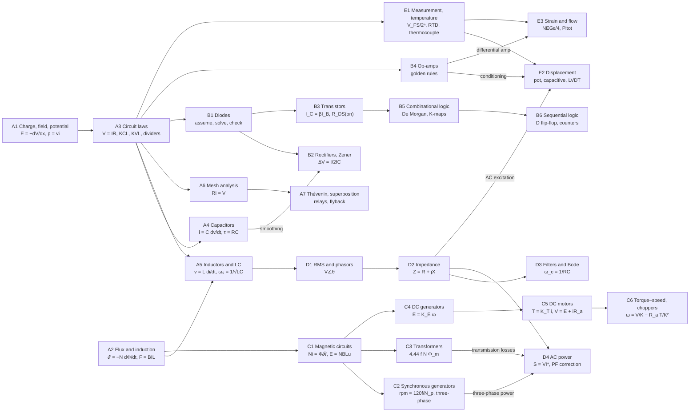

# FEEG1004 Electronics Hub

*FEEG1004 Electrical and Electronic Systems*: five strands that take you from a single charge to a complete measurement system.

> [!abstract] Module at a glance
> Every strand uses the same toolkit, KCL, KVL, Ohm's law and $p = vi$, applied with the right V–I law for each component.
> - Part A, Fundamentals (S1): charge, fields, potential and induction → DC circuit laws → capacitors and inductors → mesh analysis, Thévenin and superposition.
> - Part B, Electronics (S1): semiconductors → diodes (rectifiers, regulators, limiters) → transistors as switches and amplifiers → op-amps (golden rules) → combinational and sequential logic.
> - Part C, Electric machines (S2): Faraday and Lorentz in machine form → synchronous generators and three-phase → transformers → DC generators and motors, characteristics and speed control.
> - Part D, AC circuits (S2): phasors turn ODEs into complex algebra → impedance → filters and Bode plots → active, reactive and apparent power, and power-factor correction.
> - Part E, Transducers (S2): measurement vocabulary → temperature, displacement, strain, pressure and flow sensors, with the bridges and op-amps that condition them.
>
> Quick reference: [[FEEG1004 Formula Sheet]] · recordings: [[FEEG1004 Transcript Index]]

## Current coverage

All 26 topic notes are written. Where a recording exists its transcript sets the scope and supplies the line references; the S1 material has both the 2020 recorded videos and some 2024 live sessions, and the S2 material has the 2025 lectures. No recording of the transformer lecture survives, so [[FEEG1004 C3 - Transformers and AC Power Transmission|C3]] stays `written-ahead`, built from the Electric Machines 04 slides and Sharkh §§3.4–3.5. The other 25 notes are `lectured`. A few lectured notes take a section from the slides or course notes where the recording skips it; those sections are listed in the last column.

| Topic | Status | Recordings used | From slides or notes only |
|---|---|---|---|
| [[FEEG1004 A1 - Electrostatics, Potential and Current\|A1]] | lectured | 1a, 1b (Jul 2020); L1 (9 Oct 2024) | none |
| [[FEEG1004 A2 - Magnetism, Induction and the Lorentz Force\|A2]] | lectured | 2a, 2b (Aug 2020); L2 (16 Oct 2024) | none |
| [[FEEG1004 A3 - DC Circuit Laws - Ohm, KCL, KVL and Dividers\|A3]] | lectured | 3a, 3b (Sep 2020); L5 (7 Nov 2024) | none |
| [[FEEG1004 A4 - Capacitors\|A4]] | lectured | 4 Capacitors (11 Sep 2020) | extra exercises from the W04 and W05 interactive slides |
| [[FEEG1004 A5 - Inductors and Electrical Resonance\|A5]] | lectured | 5a, 5b (Oct 2020) | checks from the W05 interactive slides |
| [[FEEG1004 A6 - Mesh Analysis\|A6]] | lectured | 6 Mesh Analysis (Oct 2020); L5 | none |
| [[FEEG1004 A7 - Thevenin, Superposition and Relays\|A7]] | lectured | 7a, 7b, 7c (Oct 2020); L5 | none |
| [[FEEG1004 B1 - Semiconductors and Diodes\|B1]] | lectured | Electronics intro, JKA 1a (Nov 2020); L6 (13 Nov 2024) | none |
| [[FEEG1004 B2 - Diode Circuits - Rectifiers, Regulators, Limiters and Clamps\|B2]] | lectured | JKA 1b, 1c; L6 | diode clamps (Mills §1.5.6) |
| [[FEEG1004 B3 - Transistors - BJT and MOSFET Switches and Amplifiers\|B3]] | lectured | JKA 2a–2c; L7 (20 Nov 2024) | none |
| [[FEEG1004 B4 - Operational Amplifiers\|B4]] | lectured | JKA 3a–3c | integrator recap (W15-EL5 slides) |
| [[FEEG1004 B5 - Combinational Logic - Boolean Algebra and Karnaugh Maps\|B5]] | lectured | JKA 4a–4c | K-map exercises (W11-EL4 slides) |
| [[FEEG1004 B6 - Sequential Logic - Flip-Flops, Registers and Counters\|B6]] | lectured | JKA 5a, 5b | state-table exercise (W15-EL5 slides) |
| [[FEEG1004 C1 - Magnetic Circuits, Faraday's Law and Force on Conductors\|C1]] | lectured | 27 Jan 2025 | none |
| [[FEEG1004 C2 - AC Synchronous Generators and Three-Phase Systems\|C2]] | lectured | 27 Jan, 4 Feb 2025 | none |
| [[FEEG1004 C3 - Transformers and AC Power Transmission\|C3]] | written-ahead | none | all (Machines 04 slides, Sharkh §§3.4–3.5) |
| [[FEEG1004 C4 - DC Generators and the Commutator\|C4]] | lectured | 14 Feb 2025 | none |
| [[FEEG1004 C5 - DC Motors - Torque, Back EMF and Efficiency\|C5]] | lectured | 14 and 20 Feb 2025 | none |
| [[FEEG1004 C6 - DC Motor Characteristics and Speed Control\|C6]] | lectured | 20 Feb 2025 | none |
| [[FEEG1004 D1 - AC Waveforms, RMS and Phasors\|D1]] | lectured | 24 and 28 Feb 2025 | none |
| [[FEEG1004 D2 - Impedance and Phasor Circuit Analysis\|D2]] | lectured | 11, 14 and 18 Mar 2025 (parts) | most of the AC Analysis 02 deck (slides, Niu notes) |
| [[FEEG1004 D3 - AC Filters and Bode Plots\|D3]] | lectured | 11, 14 and 18 Mar 2025 | none |
| [[FEEG1004 D4 - AC Power and Power Factor\|D4]] | lectured | 18 Mar 2025 | complex power and power-factor correction (AC Analysis 04 slides, Niu notes) |
| [[FEEG1004 E1 - Measurement Systems and Temperature Sensors\|E1]] | lectured | 24 Mar 2025 | none |
| [[FEEG1004 E2 - Displacement Sensors - Potentiometric, Capacitive and Inductive\|E2]] | lectured | Sensors and Transducers L2 (28 Mar 2025) | none |
| [[FEEG1004 E3 - Strain Gauges, Bridges, Pressure and Flow Sensors\|E3]] | lectured | Sensors and Transducers L3 (28 Apr 2025) | none |

## Concept map



## Topic map

### Part A: Electrical Fundamentals and DC Circuits
1. [[FEEG1004 A1 - Electrostatics, Potential and Current]]: Coulomb, $\mathbf E = \mathbf F/q$, $E_x = -dV/dx$, drift velocity, $p = vi$
2. [[FEEG1004 A2 - Magnetism, Induction and the Lorentz Force]]: flux, $\mathcal E = -N\,d\Phi/dt$, Lenz, Lorentz force, $F = BIL$
3. [[FEEG1004 A3 - DC Circuit Laws - Ohm, KCL, KVL and Dividers]]: sign conventions, series and parallel, loaded and unloaded dividers
4. [[FEEG1004 A4 - Capacitors]]: $Q = CV$, $i = C\,dv/dt$, $\tfrac12CV^2$, RC charging from any initial voltage
5. [[FEEG1004 A5 - Inductors and Electrical Resonance]]: $v = L\,di/dt$, RL transients, LC resonance, ignition coil
6. [[FEEG1004 A6 - Mesh Analysis]]: clockwise mesh currents, $\mathbf{RI} = \mathbf V$, branch-current recovery
7. [[FEEG1004 A7 - Thevenin, Superposition and Relays]]: source resistance, Thévenin and Norton, superposition, relays, flyback diodes

### Part B: Electronics
1. [[FEEG1004 B1 - Semiconductors and Diodes]]: band theory, doping, the p-n junction, diode models and the assume–solve–check method
2. [[FEEG1004 B2 - Diode Circuits - Rectifiers, Regulators, Limiters and Clamps]]: half- and full-wave, ripple $I/2fC$, Zener regulator, limiters, clamps
3. [[FEEG1004 B3 - Transistors - BJT and MOSFET Switches and Amplifiers]]: $I_C = \beta I_B$, saturated switches with overdrive, common emitter, MOSFET switches
4. [[FEEG1004 B4 - Operational Amplifiers]]: comparators, golden rules, the standard circuits, DAC, slew rate and gain–bandwidth
5. [[FEEG1004 B5 - Combinational Logic - Boolean Algebra and Karnaugh Maps]]: gates, SOP, Boolean laws, De Morgan, K-maps, NAND-only
6. [[FEEG1004 B6 - Sequential Logic - Flip-Flops, Registers and Counters]]: latches to the D flip-flop, shift registers, ripple counters, memory

### Part C: Electric Machines
1. [[FEEG1004 C1 - Magnetic Circuits, Faraday's Law and Force on Conductors]]: mmf and reluctance, air gaps, $E = NBLu$, $F = BiL$
2. [[FEEG1004 C2 - AC Synchronous Generators and Three-Phase Systems]]: rpm $= 120f/N_p$, turbo-generator EMF, star and delta, three-phase power
3. [[FEEG1004 C3 - Transformers and AC Power Transmission]]: turns ratio, referred impedance, $4.44fN\Phi_m$, why AC
4. [[FEEG1004 C4 - DC Generators and the Commutator]]: commutation, $E = K_E\omega$, $K_E = ZN_p\Phi/2\pi a$
5. [[FEEG1004 C5 - DC Motors - Torque, Back EMF and Efficiency]]: $T = K_Ti$, $V = E' + iR_a$, power flow, torque ∝ rotor volume
6. [[FEEG1004 C6 - DC Motor Characteristics and Speed Control]]: torque–speed line, series motors, gearboxes, choppers, H-bridge, brushless

### Part D: AC Circuit Analysis
1. [[FEEG1004 D1 - AC Waveforms, RMS and Phasors]]: rms, cosine convention, phasors, Euler, complex arithmetic
2. [[FEEG1004 D2 - Impedance and Phasor Circuit Analysis]]: $Z = R + jX$, CIVIL, complex dividers, inductive and capacitive loads
3. [[FEEG1004 D3 - AC Filters and Bode Plots]]: RC and RL filters, −3 dB, decibels, 20 dB/decade, loaded and active filters
4. [[FEEG1004 D4 - AC Power and Power Factor]]: $P$, $Q$, $\mathbf S = \mathbf V\mathbf I^*$, power factor, line losses, correction

### Part E: Transducers and Measurement
1. [[FEEG1004 E1 - Measurement Systems and Temperature Sensors]]: static characteristics, ADC resolution, aliasing, RTD, thermistor, thermocouple
2. [[FEEG1004 E2 - Displacement Sensors - Potentiometric, Capacitive and Inductive]]: loaded potentiometer, op-amp linearised capacitive sensor, LVDT
3. [[FEEG1004 E3 - Strain Gauges, Bridges, Pressure and Flow Sensors]]: gauge factor, $V = NEG\varepsilon/4$, bridge layouts, pressure, Venturi, Pitot

## Core concept notes

| Fundamentals | Circuits and theorems | Electronics | Digital |
|---|---|---|---|
| [[Coulomb's Law and Electric Field]] | [[Ohm's Law and Resistivity]] | [[Band Theory and Semiconductor Doping]] | [[Boolean Algebra and De Morgan's Theorems]] |
| [[Electric Potential and Voltage]] | [[Kirchhoff's Current and Voltage Laws]] | [[P-N Junction Diode]] | [[Karnaugh Maps]] |
| [[Electric Current and Electrical Power]] | [[Series and Parallel Resistors]] | [[Rectification and Smoothing]] | [[D-Type Flip-Flop]] |
| [[Magnetic Flux and Flux Density]] | [[Potential Divider]] | [[Zener Diode Regulator]] | [[Shift Registers and Binary Counters]] |
| [[Faraday's Law and Lenz's Law]] | [[Current Divider]] | [[Diode Limiters and Clamps]] | |
| [[Lorentz Force]] | [[Mesh Current Method]] | [[Bipolar Junction Transistor]] | |
| [[Hydraulic Analogy for Circuits]] | [[Thevenin and Norton Equivalent Circuits]] | [[MOSFET]] | |
| [[Capacitance]] | [[Superposition Theorem (Circuits)]] | [[Transistor as a Switch]] | |
| [[Inductance]] | [[Maximum Power Transfer]] | [[Op-Amp Golden Rules]] | |
| [[RC and RL Transients]] | [[Flyback Diode]] | [[Standard Op-Amp Configurations]] | |
| | [[Electromechanical Relays]] | [[Op-Amp Comparator]] | |

| Machines | AC circuits | Transducers |
|---|---|---|
| [[Magnetomotive Force and Reluctance]] | [[RMS Value]] | [[Transducer Static Characteristics]] |
| [[Synchronous Speed and Pole Number]] | [[Phasor Representation]] | [[Passive and Active Transducers]] |
| [[Motional EMF in Electric Machines]] | [[Complex Impedance]] | [[RTDs and Thermistors]] |
| [[Three-Phase Star and Delta Connections]] | [[RC Low-Pass and High-Pass Filters]] | [[Thermocouples and Cold-Junction Compensation]] |
| [[Ideal Transformer]] | [[Active, Reactive and Apparent Power]] | [[Potentiometric Displacement Sensor]] |
| [[Transformer EMF Equation]] | [[Power Factor Correction]] | [[Capacitive Displacement Sensor]] |
| [[Commutator]] | | [[Linear Variable Differential Transformer]] |
| [[Back EMF and Torque Constants]] | | [[Gauge Factor]] |
| [[Torque-Speed Characteristics of DC Motors]] | | [[Strain Gauge Bridge Configurations]] |
| [[Electric and Magnetic Loading]] | | |
| [[DC Motor Speed Control]] | | |

[[Maximum Power Transfer]] is a supporting concept note: it is not in the FEEG1004 slides, course notes or recordings, so it is not on the formula sheet.

**Shared with other modules** (linked rather than duplicated): [[Decibels]] · [[Bode Plot]] · [[Transfer Function]] · [[Resonance]] · [[Measurement Chain]] · [[Loading Effect and Buffering]] · [[Accuracy and Precision]] · [[ADC Quantisation and Resolution]] · [[Wheatstone Bridge and Strain Gauges]] · [[Stagnation Pressure and Pitot Tube]]

## Exam skills

The module is assessed by one online, open-book exam worth 100 % of the module, which must be passed to progress (revision briefing, 25 Apr 2025). Part A, 40 %, is multiple-choice and numeric-answer questions on the S1 content (Parts A and B here). Part B, 60 %, is written answers with working on the S2 content (machines, AC circuits and transducers). The paper is sized as about one hour of work in a two-hour window. The best preparation is the tutorial sheets, the S1 quizzes, the live-lecture examples and the S1 learning objectives; past papers are on Blackboard but are not filed in this vault.

| Skill | Where it is taught and practised |
|---|---|
| Force and field from point charges; particle energy across a voltage; drift speed | [[FEEG1004 A1 - Electrostatics, Potential and Current#Two positive charges: force and field between them\|A1]] · [[FEEG1004 Tutorial 1 - Electrostatics, Magnetism and Resistors Solutions#Q1: Two +1 mC charges at x = -10 cm and x = +10 cm\|T1 Q1]] |
| EMF of a rotating coil; force on a current-carrying cable | [[FEEG1004 A2 - Magnetism, Induction and the Lorentz Force#Rotating coil and induced voltage\|A2]] · [[FEEG1004 Tutorial 1 - Electrostatics, Magnetism and Resistors Solutions#Q5: 10-turn, 0.1 m² coil rotating at 20 Hz in 2 T\|T1 Q5]] |
| Source resistance from a loaded terminal voltage | [[FEEG1004 A7 - Thevenin, Superposition and Relays#1. Source resistance and terminal behaviour\|A7 §1]] · [[FEEG1004 Tutorial 1 - Electrostatics, Magnetism and Resistors Solutions#Q2: Sam's car battery (13 V, nominally 10 mΩ ESR)\|T1 Q2]] |
| Series–parallel reduction, loaded dividers, deriving the combination rules | [[FEEG1004 A3 - DC Circuit Laws - Ohm, KCL, KVL and Dividers#Reducing and recovering a resistor network\|A3]] · [[FEEG1004 Tutorial 1 - Electrostatics, Magnetism and Resistors Solutions#Q3: Resistor ladder with a 5 V voltmeter reading\|T1 Q3]], [[FEEG1004 Tutorial 1 - Electrostatics, Magnetism and Resistors Solutions#Q4: Deriving series and parallel resistance\|Q4]] |
| Mesh equations in matrix form | [[FEEG1004 A6 - Mesh Analysis#Four meshes in Tutorial 2\|A6]] · [[FEEG1004 Tutorial 2 - DC Circuit Analysis and Kirchhoff's Laws Solutions#Q1: Mesh equations for the four-window network\|T2 Q1]] |
| Thévenin equivalents and superposition | [[FEEG1004 A7 - Thevenin, Superposition and Relays#Thévenin load check in both circuits\|A7 Thévenin]] · [[FEEG1004 A7 - Thevenin, Superposition and Relays#Superposition with a current source\|A7 superposition]] · [[FEEG1004 Tutorial 2 - DC Circuit Analysis and Kirchhoff's Laws Solutions#Q2: Superposition for ia (50 Ω) with a current source Is and a 12 V source behind 200 Ω\|T2 Q2]], [[FEEG1004 Tutorial 2 - DC Circuit Analysis and Kirchhoff's Laws Solutions#Q3: Thévenin equivalent at A–B\|Q3]] |
| Capacitor and inductor steady states and switching transients | [[FEEG1004 A4 - Capacitors#RC response in Tutorial 2\|A4]] · [[FEEG1004 A5 - Inductors and Electrical Resonance#The six-volt RL circuit\|A5]] · [[FEEG1004 Tutorial 2 - DC Circuit Analysis and Kirchhoff's Laws Solutions#Q4: Capacitor and inductor steady states and transients\|T2 Q4]], [[FEEG1004 Tutorial 2 - DC Circuit Analysis and Kirchhoff's Laws Solutions#Q5: Opening the switch on a 5 mH inductor fed from 12 V with 0.2 Ω internal resistance\|Q5]] |
| Diode states, conduction angle, limiters | [[FEEG1004 B1 - Semiconductors and Diodes#Four shunt-diode circuits compared under ideal and constant-drop models\|B1]] · [[FEEG1004 B2 - Diode Circuits - Rectifiers, Regulators, Limiters and Clamps#Biased soft limiter and Zener–diode clipper characteristics\|B2 limiter]] · [[FEEG1004 Tutorial 3 - Diodes and Transistors Solutions#Q1: Four ideal-diode circuits (2.5 kΩ in series, diode across the output)\|T3 Q1]], [[FEEG1004 Tutorial 3 - Diodes and Transistors Solutions#Q3: Soft limiter with biased diodes\|Q3]], [[FEEG1004 Tutorial 3 - Diodes and Transistors Solutions#Q5: Conduction angle of a real (0.7 V) half-wave rectifier, 20 V p-p input\|Q5]] |
| Rectifier and smoothing-capacitor design; rectifier voltmeter | [[FEEG1004 B2 - Diode Circuits - Rectifiers, Regulators, Limiters and Clamps#Smoothed full-wave bridge rectifier design and half-wave comparison\|B2 rectifier]] · [[FEEG1004 B2 - Diode Circuits - Rectifiers, Regulators, Limiters and Clamps#Half-wave rectifier AC voltmeter calibration\|B2 voltmeter]] · [[FEEG1004 Tutorial 3 - Diodes and Transistors Solutions#Q4: Rectifier AC voltmeter: find R for full scale at 20 V p-p\|T3 Q4]], [[FEEG1004 Tutorial 3 - Diodes and Transistors Solutions#Q6: Full-wave rectifier with smoothing: 10 V average, 0.2 V ripple, 5 mA, 50 Hz\|Q6]] |
| BJT and MOSFET switch design | [[FEEG1004 B3 - Transistors - BJT and MOSFET Switches and Amplifiers#BJT switch design with base overdrive and saturation check\|B3 BJT]] · [[FEEG1004 B3 - Transistors - BJT and MOSFET Switches and Amplifiers#MOSFET motor switch current limit and gate-divider biasing\|B3 MOSFET]] |
| Multi-stage op-amp transfer functions; T-network; bandwidth and slew rate | [[FEEG1004 B4 - Operational Amplifiers#Three-op-amp summing circuit (Tutorial 4 Q1)\|B4 chain]] · [[FEEG1004 B4 - Operational Amplifiers#T-network gain, bandwidth and slew-rate limit\|B4 T-network]] · [[FEEG1004 Tutorial 4 - Operational Amplifiers and Logic Solutions#Q1: Circuit transfer function of the three-stage chain\|T4 Q1]], [[FEEG1004 Tutorial 4 - Operational Amplifiers and Logic Solutions#Q5: The T feedback network\|Q5]] |
| Boolean simplification, truth-table proofs, K-maps | [[FEEG1004 B5 - Combinational Logic - Boolean Algebra and Karnaugh Maps#Gate circuit simplified with De Morgan (Tutorial 4 Q3)\|B5 De Morgan]] · [[FEEG1004 B5 - Combinational Logic - Boolean Algebra and Karnaugh Maps#Three- and four-variable K-maps (Tutorial 4 Q4)\|B5 K-maps]] · [[FEEG1004 Tutorial 4 - Operational Amplifiers and Logic Solutions#Q2: Truth-table proofs\|T4 Q2]]–[[FEEG1004 Tutorial 4 - Operational Amplifiers and Logic Solutions#Q4: Karnaugh-map simplification\|Q4]] |
| Flip-flop state sequences and counter frequencies | [[FEEG1004 B6 - Sequential Logic - Flip-Flops, Registers and Counters#Two-bit synchronous state machine\|B6 state machine]] · [[FEEG1004 B6 - Sequential Logic - Flip-Flops, Registers and Counters#Ripple counter frequencies and a divide-by-60 stage\|B6 counter]] |
| Magnetic circuits with air gaps; falling magnet through a coil | [[FEEG1004 C1 - Magnetic Circuits, Faraday's Law and Force on Conductors#Toroid with a 1 mm air gap\|C1]] · [[FEEG1004 Tutorial 5 - Faraday, Generators and Transformers Solutions#Q1: Bar magnet falling at constant speed through a coil\|T5 Q1]], [[FEEG1004 Tutorial 5 - Faraday, Generators and Transformers Solutions#Q3: 10 m cable carrying 1 kA DC east–west across a 10⁻⁴ T northward field\|Q3]] |
| Generator speed, pole number and phase EMF | [[FEEG1004 C2 - AC Synchronous Generators and Three-Phase Systems#Phase EMF of a 2-pole turbo-alternator\|C2 turbo]] · [[FEEG1004 C2 - AC Synchronous Generators and Three-Phase Systems#24-pole tidal-turbine generator\|C2 tidal]] · [[FEEG1004 Tutorial 5 - Faraday, Generators and Transformers Solutions#Q2: Two-pole, three-phase synchronous generator\|T5 Q2]], [[FEEG1004 Tutorial 5 - Faraday, Generators and Transformers Solutions#Q4: Tidal turbine with a 24-pole, 3-phase PM generator at 150 rpm\|Q4]] |
| Transformer flux density, currents and referred load | [[FEEG1004 C3 - Transformers and AC Power Transmission#Core-type transformer feeding a 10 kW load\|C3]] · [[FEEG1004 Tutorial 5 - Faraday, Generators and Transformers Solutions#Q5: Single-phase transformer, 70:350 turns, 100 cm² core, 230 V at 50 Hz\|T5 Q5]] |
| DC machine constants, losses and efficiency from tests | [[FEEG1004 C4 - DC Generators and the Commutator#Open-circuit test for the EMF constant\|C4]] · [[FEEG1004 C5 - DC Motors - Torque, Back EMF and Efficiency#No-load and pump-load tests\|C5]] · [[FEEG1004 Tutorial 6 - DC Motors and Characteristics Solutions#Q1: Back-EMF constant from an open-circuit test\|T6 Q1]]–[[FEEG1004 Tutorial 6 - DC Motors and Characteristics Solutions#Q3: Driving a pump at 1000 rpm with 5 A\|Q3]] |
| Torque and rotor volume; gearbox sizing | [[FEEG1004 C5 - DC Motors - Torque, Back EMF and Efficiency#Rotor volume with and without a step-down gearbox\|C5]] · [[FEEG1004 Tutorial 6 - DC Motors and Characteristics Solutions#Q4: Show T = 1/2 B Z i_c D L = 2 B A V_R\|T6 Q4]], [[FEEG1004 Tutorial 6 - DC Motors and Characteristics Solutions#Q5: Why use a step-down gearbox with a slow load?\|Q5]] |
| Torque–speed characteristics, load matching and chopper control | [[FEEG1004 C6 - DC Motor Characteristics and Speed Control#Counterweighted passenger lift\|C6 lift]] · [[FEEG1004 C6 - DC Motor Characteristics and Speed Control#Chopper speed control of a cooling fan\|C6 fan]] · [[FEEG1004 Tutorial 6 - DC Motors and Characteristics Solutions#Q6: Torque–speed characteristics, shunt vs series\|T6 Q6]] |
| Complex arithmetic and time function to phasor | [[FEEG1004 D1 - AC Waveforms, RMS and Phasors#Waveform parameters and sine-to-cosine phasors\|D1 phasors]] · [[FEEG1004 D1 - AC Waveforms, RMS and Phasors#Complex division and quadrant conversions\|D1 arithmetic]] · [[FEEG1004 Tutorial 7 - Phasors and Complex Impedance Solutions#Q1: Complex-number operations\|T7 Q1]], [[FEEG1004 Tutorial 7 - Phasors and Complex Impedance Solutions#Q2: Time functions → phasors (rms, cosine reference)\|Q2]] |
| Impedance networks and complex dividers | [[FEEG1004 D2 - Impedance and Phasor Circuit Analysis#Series-parallel reduction and cascaded voltage dividers\|D2 dividers]] · [[FEEG1004 D2 - Impedance and Phasor Circuit Analysis#Terminal impedance and a two-stage current divider\|D2 current divider]] · [[FEEG1004 Tutorial 7 - Phasors and Complex Impedance Solutions#Q3: 200 Ω + 150 mH + 2 µF in series at 400 Hz\|T7 Q3]]–[[FEEG1004 Tutorial 7 - Phasors and Complex Impedance Solutions#Q5: Currents I_1 and I_2 from a 20∠45° A source\|Q5]] |
| Filter transfer functions, cut-off and loading | [[FEEG1004 D3 - AC Filters and Bode Plots#Loaded RC low-pass filter\|D3 loaded]] · [[FEEG1004 D3 - AC Filters and Bode Plots#RL high-pass filter with a 3 kHz corner\|D3 RL]] · [[FEEG1004 Tutorial 8 - Filters, Transfer Functions and Power Factor Solutions#Q1: Loaded RC low-pass (R_1 = 1 kΩ, C = 10 µF, R_L = 10 kΩ)\|T8 Q1]], [[FEEG1004 Tutorial 8 - Filters, Transfer Functions and Power Factor Solutions#Q2: RL filters\|Q2]] |
| Complex power and power-factor correction | [[FEEG1004 D4 - AC Power and Power Factor#Correcting an 80 kVA industrial load\|D4 correction]] · [[FEEG1004 D4 - AC Power and Power Factor#Furnace fed through a cable with a shunt capacitor\|D4 furnace]] · [[FEEG1004 Tutorial 8 - Filters, Transfer Functions and Power Factor Solutions#Q3: Furnace (R_1 = 1 Ω, L_1 = 5 mH) fed through a cable (0.01 Ω, 50 µH), with 1 mF across the load, 400 V at 50 Hz\|T8 Q3]] |
| ADC resolution, aliasing, temperature sensors | [[FEEG1004 E1 - Measurement Systems and Temperature Sensors#ADC resolution, noise floor and aliasing\|E1 ADC]] · [[FEEG1004 E1 - Measurement Systems and Temperature Sensors#Type J thermocouple with CJC and a thermistor alarm\|E1 thermocouple]] |
| Loaded potentiometer and capacitive linearisation | [[FEEG1004 E2 - Displacement Sensors - Potentiometric, Capacitive and Inductive#Potentiometer loading error and buffering\|E2 pot]] · [[FEEG1004 E2 - Displacement Sensors - Potentiometric, Capacitive and Inductive#Capacitive gap sensor with an op-amp lineariser\|E2 capacitive]] |
| Bridge outputs, gauge layouts, Pitot and Venturi | [[FEEG1004 E3 - Strain Gauges, Bridges, Pressure and Flow Sensors#Excitation limit, bridge outputs and amplifier gain\|E3 bridge]] · [[FEEG1004 E3 - Strain Gauges, Bridges, Pressure and Flow Sensors#Pitot-static sensitivity and Venturi flow rate\|E3 flow]] |

No tutorial sheet covers sequential logic, transistors or transducers; the worked examples in B3, B6 and E1–E3 and their Self-study tasks stand in for one.

## Tutorial sheets: full worked solutions

| Sheet | Topics | Solution note |
|---|---|---|
| 1 | electrostatics, battery ESR, resistor ladder, rotating coil | [[FEEG1004 Tutorial 1 - Electrostatics, Magnetism and Resistors Solutions]] |
| 2 | mesh matrices, superposition, Thévenin, L/C transients | [[FEEG1004 Tutorial 2 - DC Circuit Analysis and Kirchhoff's Laws Solutions]] |
| 3 | diode circuits, rectifiers, limiter, smoothing | [[FEEG1004 Tutorial 3 - Diodes and Transistors Solutions]] |
| 4 | op-amp chain, T-network, Boolean, K-maps | [[FEEG1004 Tutorial 4 - Operational Amplifiers and Logic Solutions]] |
| 5 | Faraday, synchronous generator, transformer | [[FEEG1004 Tutorial 5 - Faraday, Generators and Transformers Solutions]] |
| 6 | DC motor constants, losses, torque–size, characteristics | [[FEEG1004 Tutorial 6 - DC Motors and Characteristics Solutions]] |
| 7 | complex numbers, phasors, impedance, current divider | [[FEEG1004 Tutorial 7 - Phasors and Complex Impedance Solutions]] |
| 8 | loaded filter, RL filters, power-factor correction | [[FEEG1004 Tutorial 8 - Filters, Transfer Functions and Power Factor Solutions]] |

Every numerical answer was reproduced in Python: matrix solves for the mesh problems, complex arithmetic for AC, exhaustive truth tables for logic. Sheets 1 and 7 have official answers, and all are matched; sheets 2–6 and 8 print none, so their solutions were derived independently.

> [!warning] Slips in the sources that change a number
> - Tutorial 7 solutions: $10\angle20°$ is printed as 9.58 + j3.49; the correct value is 9.40 + j3.42.
> - Sharkh machines notes: the DC-motor example prints 6600 rpm (π omitted); the correct value is 2101 rpm. The turbo-generator EMF "2473 V" is a typo for 2463 V.
> - AC 03 slides: the "47 kΩ" low-pass example calculates with 4.7 kΩ.
> - Lecture 1b: the drift-velocity example uses the wire diameter as its radius.

## Figures

77 figures live in `01 - Notes/Figures`. Every plotted number is computed in the generator scripts, which share one module (`feeg1004_style.py`: schematic primitives and logic gates, built on the vault-wide `vault_style.py` for colours and plot defaults):

- `generate_fundamentals_figures.py` (Part A, Tutorials 1–2);
- `generate_electronics_figures.py` (Part B, Tutorials 3–4);
- `generate_machines_figures.py` (Part C);
- `generate_ac_transducer_figures.py` (Parts D and E, Tutorials 7–8).

## Recommended study route

1. Read the topic note for the physical model, then redraw each circuit yourself.
2. Attempt the tutorial sheet before opening the solution note, and compare sign conventions and diode or transistor state assumptions as well as the numbers.
3. For AC, write every phasor in both polar and Cartesian form. Most lost marks are sine-to-cosine conversions and quadrant errors.
4. Use [[FEEG1004 Formula Sheet]] as the one-page equation map.

## All notes

```dataview
TABLE type, stream, status, file.mtime AS "Updated"
FROM "Year 1/FEEG1004 Electronics"
WHERE type
SORT type ASC, file.name ASC
```

## Builds on / feeds into

- **Builds on**:
  - A-level physics (charge, fields, circuits);
  - complex numbers and calculus (MATH1054; see its [[Useful Trigonometry Identities and stuff|trigonometry identities]] note);
  - [[FEEG1002 Mechanics, Materials and Structures Hub]]: the SDOF oscillator is the mechanical twin of the RLC circuit ($m\leftrightarrow L$, $k\leftrightarrow1/C$, $c\leftrightarrow R$), and stress and strain feed straight into strain gauges.

| Later module | Bridge from FEEG1004 | Continue with |
|---|---|---|
| [[SESA2027 Aerospace Mechanics & Control Hub]] (sensing) | transducers, bridges, op-amp conditioning, loading, filters | [[SESA2027 C1 - Sensing Systems, Sensor Principles and Sensor Fusion]] · [[SESA2027 C2 - Sensor Characteristics, Dynamics and Design]] · [[SESA2027 C3 - Signal Conditioning, Digitisation and Digital Filtering]] |
| SESA2027 (control) | RC/RLC dynamics → transfer functions; filters → Bode plots; op-amp feedback → closed loop | [[SESA2027 A4 - Laplace Transforms, Transfer Functions and Step Response]] · [[SESA2027 A5 - Frequency Response and Bode Plots]] · [[SESA2027 B1 - Control System Fundamentals and PID Control]] |
| [[SESA2024 Astronautics Hub]] | power sources, batteries, regulators, motors, magnetic torquers, dB | [[SESA2024 08 - Electrical Power Subsystem]] · [[SESA2024 06 - Attitude Control]] · [[SESA2024 09 - Communications]] · [[SESA2024 07 - Spacecraft Propulsion]] |
| [[MATH2048 Mathematics for Engineering and the Environment Part II Hub]] | circuit ODEs, phasors, rectified waveforms | [[MATH2048 ODE1 - Second-Order Linear ODEs with Constant Coefficients]] · [[MATH2048 TR2 - Laplace Transforms - Definition, Properties and Solving IVPs]] · [[MATH2048 FS3 - Calculus with Fourier Series and Complex Fourier Series]] |
| [[SESA3047 Advanced Aerospace Mechanics & Control Hub]] | feedback, actuators and sensors in the loop | [[SESA3047 1.1 - Dynamic Systems and Control Architectures]] |
| [[SESA2022 Aerodynamics Hub]], [[SESA1015 Intro to Aero & Astro Hub]] | pressure transducers, pitot-static airspeed, strain-gauge balances | [[SESA2022 Wind Tunnel Lab Summary]] · [[SESA1015 M01 - Atmosphere, Airspeed and Mach Number]] |

The same first-order equation runs from [[FEEG1004 A4 - Capacitors]] through [[FEEG1004 D3 - AC Filters and Bode Plots]] to the Bode plots of SESA2027 A5. The op-amp golden rules are the closed-loop idea of SESA2027 B1. A strain gauge, bridge, differential amplifier and ADC form the measurement chain that SESA2027 Part C analyses dynamically, and $F = BIL$ with $E = K\omega$ describes every reaction wheel, magnetorquer and electromechanical actuator on an aerospace vehicle.

## Cambridge practice

- [[FEEG1004 Cambridge Part IIA Practice]]: third-year Cambridge questions (3F2) that revise this module, listed under each topic note.

## Sources

- S1 Fundamentals (`02 - Sources/S1 Fundamentals`): recorded and interactive decks for weeks 2–6 (A1–A7) and the S1 Equations Sheet.
- S1 Electronics (`02 - Sources/S1 Electronics`): the EL1–EL5 decks (B1–B6) and Mills's course notes on diodes, transistors, op-amps and digital logic.
- S2 Electric Machines (`02 - Sources/S2 Machines`): eight lecture decks (C1–C6) and Sharkh's machines notes.
- S2 AC Analysis (`02 - Sources/S2 AC Analysis`): four lecture decks (D1–D4), Niu's 2021 lecture notes and the complex-numbers notes.
- S2 Transducers (`02 - Sources/S2 Transducers`): three lecture decks (E1–E3).
- Tutorial sheets (`02 - Sources/Tutorial Sheets`): Sheets 1–8, with official answers for Sheets 1 and 7.
- Recordings: 46 transcripts in `02 - Sources/Lectures`, from the 2020 recorded videos to the 2025 S2 lectures and the April 2025 revision briefing, each matched to its topic in [[FEEG1004 Transcript Index]].
- Past papers: none filed; they are on the module's Blackboard site.
