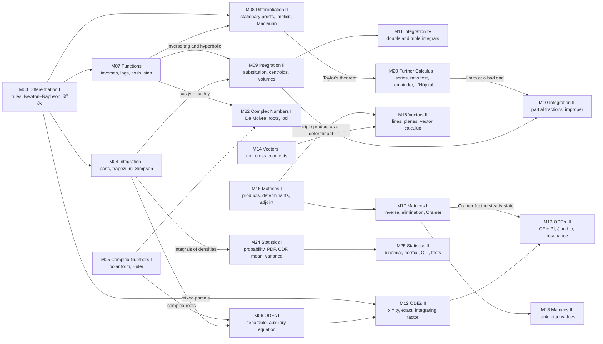

# MATH1054 Mathematics for Engineering and the Environment Hub

> [!abstract] Module at a glance
> MATH1054 is the self-paced first-year engineering mathematics course. Each module is a work scheme in the Module Booklet built around James, *Modern Engineering Mathematics* (6th ed.): study the listed examples, do the listed exercises, then check yourself with the module's Specimen Test. Module 11 (multiple integrals) is booklet-only.
>
> The 20 modules fall into five blocks. Calculus covers differentiation, functions, integration techniques and their applications, numerical and multiple integrals. Complex numbers run from algebra and polar form to De Moivre, complex functions and loci. Differential equations cover first-order methods, then linear constant-coefficient equations, damping and forced response. Vectors and matrices cover dot and cross products, lines and planes, determinants, inverses, elimination, rank and eigenvalues. Series and statistics cover sequences, convergence, the Taylor remainder, L'Hôpital, probability, the binomial and normal distributions and inference for a mean.
>
> Quick reference: [[MATH1054 Formula Sheet]] · reference sheets: [[Integration Formulae]], [[Useful Trigonometry Identities and stuff]]

## Current coverage

The course has no lectures, so there are no transcripts: the work scheme of each module in `Module Booklet.pdf` sets the scope, and each topic note covers every item of its scheme (the James sections, examples and exercises it lists, the booklet's own examples and exercises, and the Specimen Test). A note is `lectured` once its whole scheme is written up and solved; all 20 are at that stage, none is `written-ahead`, and only the user promotes a note beyond `lectured`.

| Block | Topic notes | Status |
|---|---|---|
| Calculus | 7 (M03, M04, M07–M11) | lectured |
| Complex numbers | 2 (M05, M22) | lectured |
| Differential equations | 3 (M06, M12, M13) | lectured |
| Vectors and matrices | 5 (M14–M18) | lectured |
| Series and statistics | 3 (M20, M24, M25) | lectured |

The folders hold 20 topic notes, 20 solutions notes, 53 concept notes and 20 figure generators (`01 - Notes/Figures/generate_m1054_mXX_figures.py`, shared Year 3 style). Modules 0–2 (self-contained revision modules the booklet refers back to) and Modules 19, 21 and 23 are not in the filed booklet, so they have no notes.

## Concept map



## Topic map

### Block 1: Calculus
1. [[MATH1054 M03 - Differentiation I]]: first principles, the rules, standard derivatives, Newton–Raphson, partial derivatives
2. [[MATH1054 M04 - Integration I]]: standard integrals, trigonometric identities, integration by parts, trapezium and Simpson rules
3. [[MATH1054 M07 - Functions]]: inverses, even, odd and periodic functions, inverse trigonometric functions, logs, hyperbolic functions
4. [[MATH1054 M08 - Differentiation II]]: stationary points, curve sketching, optimisation, parametric, implicit and logarithmic differentiation, Maclaurin series
5. [[MATH1054 M09 - Integration II]]: substitution; areas, centroids, volumes, centres of gravity, mean and RMS values, arc length, surface area
6. [[MATH1054 M10 - Integration III]]: partial fractions, completing the square, improper integrals
7. [[MATH1054 M11 - Integration IV]]: double and triple integrals, change of order, polar coordinates, mass and moments of inertia

### Block 2: Complex numbers
8. [[MATH1054 M05 - Complex Numbers I]]: cartesian, polar and exponential forms; the Argand diagram; Euler's formula
9. [[MATH1054 M22 - Complex Numbers II]]: complex trigonometric, hyperbolic and logarithm functions, De Moivre, $n$th roots, complex quadratics, loci

### Block 3: Differential equations
10. [[MATH1054 M06 - Differential Equations I]]: classification, direct integration, separable equations, homogeneous second-order equations
11. [[MATH1054 M12 - Differential Equations II]]: $\dot x=f(x/t)$, exact equations, the integrating factor, applications
12. [[MATH1054 M13 - Differential Equations III]]: linear operators, CF + PI, undetermined coefficients, damping parameter and natural frequency, forced response and resonance

### Block 4: Vectors and matrices
13. [[MATH1054 M14 - Vectors I]]: components, relative velocity, dot and cross products, moments, rotating bodies
14. [[MATH1054 M15 - Vectors II]]: triple products, vector calculus in time, polar acceleration, lines and planes, distances
15. [[MATH1054 M16 - Matrices I]]: matrix algebra, quadratic forms, rotation matrices, determinants, cofactors, the adjoint
16. [[MATH1054 M17 - Matrices II]]: the inverse (cofactor and elimination), existence of solutions, Cramer's rule, Gaussian elimination, ill-conditioning
17. [[MATH1054 M18 - Matrices III]]: rank and consistency, eigenvalues and eigenvectors, symmetric matrices

### Block 5: Series and statistics
18. [[MATH1054 M20 - Further Calculus II]]: AP and GP, limits of sequences, convergence tests, radius of convergence, mean value theorems, Lagrange remainder, L'Hôpital
19. [[MATH1054 M24 - Statistics I]]: probability rules, Bayes, counting, random variables, PDF and CDF, mean, median, variance, the exponential distribution
20. [[MATH1054 M25 - Statistics II]]: sums of random variables, sample statistics, binomial, normal, the CLT, confidence intervals, hypothesis tests

## Concept notes

| Calculus | Complex numbers | ODEs | Vectors and matrices | Series and statistics |
|---|---|---|---|---|
| [[Derivative from First Principles]] | [[Complex Numbers - Cartesian, Polar and Exponential Forms]] | [[Classification of Differential Equations]] | [[Vector Algebra and Components]] | [[Arithmetic and Geometric Series]] |
| [[Product, Quotient and Chain Rules]] | [[Argand Diagram]] | [[Separable First-Order ODEs]] | [[Scalar (Dot) Product]] | [[Convergence Tests for Series]] |
| [[Partial Derivatives]] | [[Euler's Formula]] | [[Homogeneous First-Order ODEs]] | [[Vector (Cross) Product]] | [[Taylor and Maclaurin Series]] |
| [[Inverse Functions]] | [[De Moivre's Theorem and Roots of Complex Numbers]] | [[Exact Differential Equations]] | [[Scalar Triple Product]] | [[L'Hôpital's Rule]] |
| [[Even, Odd and Periodic Functions]] | [[Complex Functions - Trig, Hyperbolic and Logarithm]] | [[Integrating Factor Method]] | [[Equations of Lines and Planes]] | [[Probability Rules and Conditional Probability]] |
| [[Inverse Trigonometric Functions]] | [[Loci in the Complex Plane]] | [[Linear Differential Operators and Superposition]] | [[Differentiation of Vectors]] | [[Random Variables, PDF and CDF]] |
| [[Hyperbolic Functions]] | | [[Auxiliary Equation]] (MATH2048) | [[Matrix Algebra]] | [[Mean, Median and Variance of a Distribution]] |
| [[Implicit and Parametric Differentiation]] | | [[Method of Undetermined Coefficients]] (MATH2048) | [[Determinants and Cofactors]] | [[Binomial Distribution]] |
| [[Logarithmic Differentiation]] | | [[Damping Ratio and Natural Frequency]] (SESA2027) | [[Matrix Inverse]] | [[Normal Distribution and Standardisation]] |
| [[Stationary Points and Inflection]] | | [[Resonance]] (MATH2048) | [[Gaussian Elimination]] | [[Confidence Intervals and Hypothesis Tests for the Mean]] |
| [[Integration by Parts]] | | | [[Rank and Consistency of Linear Systems]] | |
| [[Integration by Substitution]] | | | [[Eigenvalues and Eigenvectors]] | |
| [[Trigonometric Integrals and Power Reduction]] | | | [[Characteristic Equation and Eigenvalues]] (SESA2027) | |
| [[Partial Fractions]] | | | | |
| [[Completing the Square]] | | | | |
| [[Improper Integrals]] | | | | |
| [[Centroids and Solids of Revolution]] | | | | |
| [[Trapezium and Simpson's Rules]] | | | | |
| [[Double Integrals and Change of Order]] | | | | |
| [[Direct Substitution and Newton-Raphson]] (SESA2029) | | | | |
| [[RMS Value]] (FEEG1004) | | | | |
| [[Jacobian and Volume Elements]] (MATH2048) | | | | |

## Exam skills

No past papers are filed (`03 - Exams & Past Papers` is empty), so the evidence for what is examined is the 20 Specimen Tests that close the work schemes, plus two booklet remarks: in graph questions marks are awarded for each sketching step (symmetry, stationary points, asymptotes, behaviour at $\pm\infty$, intercepts), so the algebra must be shown even when a calculator plot is available (Module 8), and differential-equation questions test the solution methods, not the modelling that sets the equations up (Module 12).

| Test | What it asks | Taught in | Solved in |
|---|---|---|---|
| 3 | derivative from first principles; product, quotient and chain rules; Newton–Raphson for $x^2=5$ from $x_0=2$; partial derivatives | [[MATH1054 M03 - Differentiation I\|M03]] | [[MATH1054 M03 Solutions - Differentiation I#Part C: Specimen Test 3\|Test 3]] |
| 4 | standard indefinite and definite integrals; $\int x\ln x$ by parts; Simpson's rule for $\int_1^2\mathrm dx/x$, $h=0.25$ | [[MATH1054 M04 - Integration I\|M04]] | [[MATH1054 M04 Solutions - Integration I#Part C: Specimen Test 4\|Test 4]] |
| 5 | arithmetic and the Argand diagram; modulus and argument of $-\sqrt3-\mathrm j$; modulus rules; $\cos\theta$ and $\sin\theta$ from Euler's formula | [[MATH1054 M05 - Complex Numbers I\|M05]] | [[MATH1054 M05 Solutions - Complex Numbers I#Part C: Specimen Test 5\|Test 5]] |
| 6 | classifying ODEs; direct integration; separable equations; complex and repeated auxiliary roots; a second-order IVP | [[MATH1054 M06 - Differential Equations I\|M06]] | [[MATH1054 M06 Solutions - Differential Equations I#Part C: Specimen Test 6\|Test 6]] |
| 7 | a domain with a square root; the graph of $\cos^{-1}x$; simplifying exp–log expressions; all hyperbolic functions from $\sinh x$; proving the log form of $\sinh^{-1}x$; derivatives of inverse functions | [[MATH1054 M07 - Functions\|M07]] | [[MATH1054 M07 Solutions - Functions#Part C: Specimen Test 7\|Test 7]] |
| 8 | stationary points and inflections; sketching a cubic; parametric second derivative; tangent to an implicit curve; Maclaurin series of $\sin x$ | [[MATH1054 M08 - Differentiation II\|M08]] | [[MATH1054 M08 Solutions - Differentiation II#Part C: Specimen Test 8\|Test 8]] |
| 9 | substitution, including a root substitution with new limits; a volume of revolution; area and centroid under $\sin x$ | [[MATH1054 M09 - Integration II\|M09]] | [[MATH1054 M09 Solutions - Integration II#Part C: Specimen Test 9\|Test 9]] |
| 10 | completing the square; partial fractions; dividing an improper fraction; an improper integral to $\infty$ | [[MATH1054 M10 - Integration III\|M10]] | [[MATH1054 M10 Solutions - Integration III#Part C: Specimen Test 10\|Test 10]] |
| 11 | iterated double integrals; describing a region both ways; reversing the order; polar coordinates | [[MATH1054 M11 - Integration IV\|M11]] | [[MATH1054 M11 Solutions - Integration IV#Part C: Specimen Test 11\|Test 11]] |
| 12 | classifying a first-order ODE; integrating factor with a condition; $x=yt$; the exactness test | [[MATH1054 M12 - Differential Equations II\|M12]] | [[MATH1054 M12 Solutions - Differential Equations II#Part C: Specimen Test 12\|Test 12]] |
| 13 | linearity of an operator; CF + PI for several forcings; $\omega$, $\zeta$ and the damping regime with a parameter | [[MATH1054 M13 - Differential Equations III\|M13]] | [[MATH1054 M13 Solutions - Differential Equations III#Part C: Specimen Test 13\|Test 13]] |
| 14 | vectors round a quadrilateral; position vectors; dot and cross products; work; a moment about a point; velocity on a rotating body | [[MATH1054 M14 - Vectors I\|M14]] | [[MATH1054 M14 Solutions - Vectors I#Part C: Specimen Test 14\|Test 14]] |
| 15 | triple products; a line and its intersections; planes from a normal and from three points; velocity and acceleration of a helix; position from acceleration; $\frac{\mathrm d}{\mathrm dt}(\mathbf r\times\dot{\mathbf r})$ | [[MATH1054 M15 - Vectors II\|M15]] | [[MATH1054 M15 Solutions - Vectors II#Part C: Specimen Test 15\|Test 15]] |
| 16 | which sums and products exist; symmetric matrices; products and transposes; $3\times3$ determinants by any row or column; the adjoint | [[MATH1054 M16 - Matrices I\|M16]] | [[MATH1054 M16 Solutions - Matrices I#Part C: Specimen Test 16\|Test 16]] |
| 17 | inverse by cofactors; when solutions exist; a parameter for a non-trivial solution; elimination on a singular but consistent system; inverse by elimination | [[MATH1054 M17 - Matrices II\|M17]] | [[MATH1054 M17 Solutions - Matrices II#Part C: Specimen Test 17\|Test 17]] |
| 18 | rank of a $4\times4$; consistency of two systems; eigenvalues and eigenvectors of a symmetric $3\times3$ | [[MATH1054 M18 - Matrices III\|M18]] | [[MATH1054 M18 Solutions - Matrices III#Part C: Specimen Test 18\|Test 18]] |
| 20 | AP and GP terms and sums; limits of sequences; convergence of a series; statement of Maclaurin's theorem; L'Hôpital; bounding a Lagrange remainder | [[MATH1054 M20 - Further Calculus II\|M20]] | [[MATH1054 M20 Solutions - Further Calculus II#Part C: Specimen Test 20\|Test 20]] |
| 22 | $\sin$ of a complex number; $\ln(-3)$; cube roots; $z^n\pm z^{-n}$; a circle of Apollonius | [[MATH1054 M22 - Complex Numbers II\|M22]] | [[MATH1054 M22 Solutions - Complex Numbers II#Part C: Specimen Test 22\|Test 22]] |
| 24 | events and the addition rule; Bayes with two bags; combinations; constants, CDFs, means and variances of discrete and continuous variables | [[MATH1054 M24 - Statistics I\|M24]] | [[MATH1054 M24 Solutions - Statistics I#Part C: Specimen Test 24\|Test 24]] |
| 25 | sample mean and variance; normal probabilities; the sampling distribution of $\bar X$; a confidence interval; a one-sample test | [[MATH1054 M25 - Statistics II\|M25]] | [[MATH1054 M25 Solutions - Statistics II#Part C: Specimen Test 25\|Test 25]] |

The skills that recur across tests are the chain rule and integration by parts, partial fractions with completing the square, the auxiliary equation with undetermined coefficients, cross products for normals and moments, elimination and eigenvalues, and standardising the normal distribution. Two traps from the tests: Test 17 Q4 is singular but consistent, so it has infinitely many solutions, and in Test 16 $\mathbf A^{\mathrm T}-\mathbf D^{\mathrm T}$ does not exist.

## Worked solutions

Each solutions note works every worked example, assigned exercise and booklet task in its module's work scheme, and the Specimen Test as Part C. Every answer was checked with SymPy, NumPy or SciPy.

| Solutions note | Covers | Highlights |
|---|---|---|
| [[MATH1054 M03 Solutions - Differentiation I]] | 17 examples, 9 exercise groups, Booklet Ex A, Specimen Test 3 | Ex 26 quartic factorises as $(x^2-2x-2)(x^2-2x-14)$, so the NR roots are exactly $1+\sqrt3$ and $1+\sqrt{15}$ |
| [[MATH1054 M04 Solutions - Integration I]] | 7 examples, Ex 104–142, Booklet Ex A–C, Specimen Test 4 | Road cutting: $7.3\times10^4$ m³; Richardson on trapezium = Simpson exactly |
| [[MATH1054 M05 Solutions - Complex Numbers I]] | 14 examples, 9 exercises, Specimen Test 5 | Square on OP via multiplication by $\mathrm j$ |
| [[MATH1054 M06 Solutions - Differential Equations I]] | 15 examples, 11 exercises, Specimen Test 6 | Ex 14(a): a non-unique IVP; Ex 14(d): finite-time blow-up |
| [[MATH1054 M07 Solutions - Functions]] | 18 examples, 10 exercises, Specimen Test 7 | $\sin^{-1}(\sin x)$ and friends are triangular waves |
| [[MATH1054 M08 Solutions - Differentiation II]] | 13 examples, 9 exercises, Booklet Ex A–B, Specimen Test 8 | Carton $81.8\times81.8\times169.7$ mm; replace the car at about 5.4 years |
| [[MATH1054 M09 Solutions - Integration II]] | 8 examples, 7 exercises, Booklet Ex A–B, Specimen Test 9 | Bridge cable $L=\sqrt{l^2+4h^2}+\frac{l^2}{2h}\sinh^{-1}\frac{2h}l$ |
| [[MATH1054 M10 Solutions - Integration III]] | 4 examples, 9 exercises, Specimen Test 10 | $\int_{-1}^1x^{-2}$ diverges (the naive answer $-2$ is wrong) |
| [[MATH1054 M11 Solutions - Integration IV]] | Booklet Ex A–G, Specimen Test 11 | Ex E only works after reversing the order |
| [[MATH1054 M12 Solutions - Differential Equations II]] | 3 examples, 9 exercises, Specimen Test 12 | Exactness checked by differentiating the potential back |
| [[MATH1054 M13 Solutions - Differential Equations III]] | 18 examples, 10 exercises, Specimen Test 13 | Resonance PI $-\frac14t\cos4t$; step-response plot |
| [[MATH1054 M14 Solutions - Vectors I]] | 19 examples, 12 exercises, Specimen Test 14 | Relative-velocity triangles plotted |
| [[MATH1054 M15 Solutions - Vectors II]] | 12 examples, 12 exercises, Booklet Ex A, Specimen Test 15 | Common perpendicular of skew lines in 3D |
| [[MATH1054 M16 Solutions - Matrices I]] | 12 examples, 7 exercises, Booklet Ex A, Specimen Test 16 | $4\times4$ determinant $=100$, confirmed via eigenvalues $1,2,5,10$ |
| [[MATH1054 M17 Solutions - Matrices II]] | 10 examples, 5 exercises, Booklet Ex A–B, Specimen Test 17 | Every elimination sequence traced step by step |
| [[MATH1054 M18 Solutions - Matrices III]] | 8 examples, 2 exercises, Booklet Ex A, Specimen Test 18 | Symmetric matrix gives orthogonal eigenvectors |
| [[MATH1054 M20 Solutions - Further Calculus II]] | 14 examples, 4 exercises, Booklet Ex A–D, Specimen Test 20 | Lagrange bounds checked against a calculator |
| [[MATH1054 M22 Solutions - Complex Numbers II]] | 10 examples, 9 exercises, Booklet Ex A, Specimen Test 22 | Ex 3.26 and 3.27 are the same circle |
| [[MATH1054 M24 Solutions - Statistics I]] | 7 examples, 6 exercises, Booklet Ex A, Specimen Test 24 | PMF/CDF and PDF/CDF plots |
| [[MATH1054 M25 Solutions - Statistics II]] | 5 examples, 4 exercises, Booklet Ex A–F, Specimen Test 25 | Booklet conventions: the $n-1$ divisor, one- and two-tailed critical values |

> [!warning] Source errata found while solving
> - **James Ex 7.2 (p.472)**: the book prints $D_5=\frac14\sqrt{2(5-\sqrt5)}\,d\approx0.588d$, which is smaller than $D_1$. That expression is $\sin36°$. The correct value is $D_5=(1+1/\sin36°)d\approx2.701d$.
> - **James Ex 52 (p.596)**: the printed curve $x^3-y^3-xy-x=0$ does not pass through $(1,-1)$. The booklet's correction to $x^3+y^3-xy-x=0$ is used.
> - **James Ex 4.12**: the statement prints $\vec{\mathrm{Y''Y}}$, but the closed loop needs $\vec{\mathrm{Y''X}}$.
> - **James Ex 51 and 52 (p.343)**: Ex 52(c) and (d) sit at the top of the right-hand column, directly beside Ex 51(c) and (d), so they are easily read as a second (c) and (d) of Ex 51. The M17 solutions work both: Ex 51 is set, Ex 52(c),(d) is extra.
> - **James Example 5.39 (p.385)**: the matrix $\mathbf C$ in (c) is printed with third row $(3,1,1)$ instead of $(3,4,1)$, and (d) writes $\operatorname{rank}(\mathbf C)$ for $\operatorname{rank}(\mathbf D)$. Neither changes the answer.
> - **Data Book p. 3-8**: some versions misprint $2\sin A\sin B$ and $\sin A+\sin B$; the correct forms are in [[MATH1054 M04 - Integration I|M04]] and on the formula sheet.
> - **Booklet vs James**: the booklet overrides James's divisor-$n$ sample variance with the $n-1$ divisor (M25).

## Study strategy

1. For each module, read the topic note, attempt the questions in its work scheme cold, then check against the solutions note.
2. Finish each module with its Specimen Test under timed conditions, then mark it against Part C of the solutions note.
3. Use [[MATH1054 Formula Sheet]] for last-minute revision; the ODE solution forms are not on the exam formula sheet and have to be remembered.

## All notes

```dataview
TABLE type, status, file.mtime AS "Updated"
FROM "Year 1/MATH1054 Mathematics for Engineering and the Environment"
WHERE type
SORT type ASC, file.name ASC
```

## Builds on / feeds into

- **Into** [[MATH2048 Mathematics for Engineering and the Environment Part II Hub]]: the ODEs grow into BVPs and PDEs; trigonometric orthogonality into Fourier series; partial derivatives into vector calculus; double integrals into Gauss and Stokes.
- **Into** [[SESA2027 Aerospace Mechanics & Control Hub]]: damping and natural frequency, eigenvalues as poles, complex numbers in frequency response.
- **Into** [[SESA2029 Digital Aerospace Methods Hub]]: Taylor remainders become truncation error; elimination and tridiagonal solvers; Newton–Raphson.
- **Alongside** FEEG1002 (vectors, moments, centroids, second moments of area) and FEEG1004 (phasors, complex impedance, RC transients).

## Sources

- `02 - Sources/Course Booklets & Solutions/Module Booklet.pdf` (95 pp.): the work schemes for Modules 3–18, 20, 22, 24 and 25, each with a James scheme, a Stroud alternative, booklet examples and exercises, and a Specimen Test with solutions. The notes follow the James schemes.
- `02 - Sources/Course Booklets & Solutions/1054_(6th_Edition).pdf` (150 pp.) and `1054solns_(6th_Edition).pdf` (78 pp.): the self-study course booklet, which calls the modules Units, and its solutions.
- `02 - Sources/Modern Engineering Mathematics.pdf`: James, 6th edition, the main text; section and example numbers in the notes refer to it.
- `02 - Sources/Formulae & Reference/`: [[Integration Formulae]] and [[Useful Trigonometry Identities and stuff]].
- `A-Level Reference Textbooks/`: 15 A-level Pure, Further Pure, Statistics, Mechanics and Decision textbooks for background revision.
- `03 - Exams & Past Papers/`: empty.
