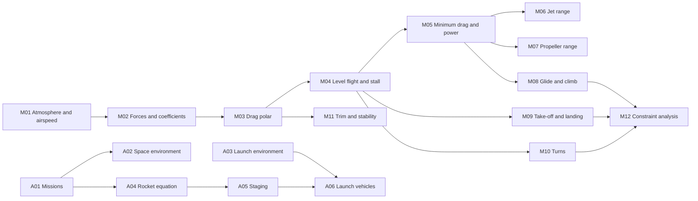

# SESA1015 Intro to Aero & Astro

> [!abstract] Module map
> SESA1015 has three strands. Mechanics of Flight (Prof. Andy Keane) builds aircraft performance from the atmosphere and the aerodynamic coefficients up to range, take-off, turning, trim and preliminary sizing; it feeds most of Year 2 and is the priority. Astronautics covers missions, the space and launch environments, the rocket equation, staging and launch vehicles. Aircraft Operations is filed under Sources and is not yet written up.

The Mechanics of Flight notes follow the course-notes PDF section by section, with the slides (version 2) supplying the notation and the worked examples. Every topic note derives its results in full, states where each assumption enters, and ends with self-study tasks drawn from the 42-question revision workbook, whose full solutions are in the T-notes below. Keep [[SESA1015 Formula Sheet]] open while working problems.

All topic notes have status `lectured`: the module has been taught, but the transcripts were deleted, so the notes are written from the course notes, slides, spreadsheets and workbook.

## Mechanics of Flight

| Topic | Course notes | Main skills |
|---|---|---|
| [[SESA1015 M01 - Atmosphere, Airspeed and Mach Number\|M01 Atmosphere, airspeed and Mach number]] | §2.1–2.3 | ISA from hydrostatics, relative density, pitot-static airspeed, EAS and TAS, Mach number |
| [[SESA1015 M02 - Aircraft Geometry, Forces and Coefficients\|M02 Geometry, forces and coefficients]] | §2.4–2.8 | Force and moment coefficients, flight-path and attitude angles, wing area, aspect ratio, taper, mean aerodynamic chord, NACA sections |
| [[SESA1015 M03 - Aerodynamic Characteristics and the Drag Polar\|M03 Aerodynamic characteristics and the drag polar]] | §3.1–3.5 | Lift curve, parabolic drag polar, tunnel data reduction, pitching moment, centre of pressure, aerodynamic centre |
| [[SESA1015 M04 - Steady Level Flight and Stall\|M04 Steady level flight and stall]] | §4.1–4.3 | Stalling speed, drag curve $D=AV^2+B/V^2$, level-flight speeds for a given thrust |
| [[SESA1015 M05 - Minimum Drag, Power and Performance Curves\|M05 Minimum drag, power and performance curves]] | §4.4–4.6 | Minimum drag, $(L/D)_{max}$, minimum power, altitude effects |
| [[SESA1015 M06 - Jet Aircraft Range and Endurance\|M06 Jet range and endurance]] | §5.1–5.5 | Breguet range and endurance, constant-altitude cruise, cruise-climb, optimum cruise speed |
| [[SESA1015 M07 - Propeller Aircraft Range and Endurance\|M07 Propeller range and endurance]] | §6.1–6.3 | Compressibility and $ML/D$, propeller and battery range, endurance at minimum power |
| [[SESA1015 M08 - Glide and Climb Performance\|M08 Glide and climb]] | §7.1–7.2 | Glide angle and range, minimum sink, climb angle and rate, energy height |
| [[SESA1015 M09 - Take-off and Landing Performance\|M09 Take-off and landing]] | §7.3 | Ground run with friction, lift and drag; reference speeds; engine failure; landing run |
| [[SESA1015 M10 - Turning Flight and Manoeuvre Performance\|M10 Turning flight]] | §7.4 | Load factor, turn radius and rate, stall and thrust limits, corner speed, V–n diagram |
| [[SESA1015 M11 - Longitudinal Trim and Static Stability\|M11 Trim and static stability]] | §8.1–8.4 | Moment balance with a tail, tail volume, downwash, neutral point, static margin, elevator to trim |
| [[SESA1015 M12 - Aircraft Constraint Analysis\|M12 Constraint analysis]] | slides and spreadsheet | $T/W$ against $W/S$ for stall, take-off, cruise, turn, climb and ceiling; choosing a design point |

## Astronautics

| Topic | Source | Main skills |
|---|---|---|
| [[SESA1015 A01 - Astronautics Foundations, Missions and Applications\|A01 Foundations, missions and applications]] | Part 1 | Orbit zones, circular speed and period, inclination, mission types and architecture |
| [[SESA1015 A02 - Space Environment\|A02 Space environment]] | Part 2 | Upper atmosphere and drag, atomic oxygen, radiation belts and dose, solar radiation, debris |
| [[SESA1015 A03 - Launch Environment\|A03 Launch environment]] | Part 2, pp. 39–47 | Quasi-static acceleration, maximum dynamic pressure, acoustic and random vibration, shock |
| [[SESA1015 A04 - Rocket Equation and Launch Performance\|A04 Rocket equation and launch performance]] | Part 3, pp. 3–23 | Rocket equation, gravity and drag losses, velocity budget to LEO, single stage to orbit |
| [[SESA1015 A05 - Staging and Payload Fraction\|A05 Staging and payload fraction]] | Part 3, pp. 24–27 | Payload and structural ratios, multistage rocket equation, number of stages, stage split |
| [[SESA1015 A06 - Launch Vehicles, Systems and Interfaces\|A06 Launch vehicles, systems and interfaces]] | Part 3, pp. 28–56 | Fairing and payload interfaces, launcher selection, vehicle families, reuse, air launch |

## Revision workbook solutions

| Note | Questions | Topics |
|---|---|---|
| [[SESA1015 T01 - Stall and Level-Flight Solutions]] | 1, 2, 4, 14, 15, 30, 42 | M04 |
| [[SESA1015 T02 - Take-off and Landing Solutions]] | 3, 7, 19, 21–24, 28, 38–40 | M09, M04 |
| [[SESA1015 T03 - Wind-Tunnel Data Reduction Solutions]] | 9–12, 41 | M03 |
| [[SESA1015 T04 - Range and Endurance Solutions]] | 5, 16, 20, 27, 29 | M06, M07 |
| [[SESA1015 T05 - Climb and Glide Solutions]] | 17, 18 | M08 |
| [[SESA1015 T06 - Turning Flight Solutions]] | 6, 25, 26, 31 | M10 |
| [[SESA1015 T07 - Trim and Static Stability Solutions]] | 8, 13 | M11 |
| [[SESA1015 T08 - Constraint Analysis Solutions]] | 35–37 | M12 |
| [[SESA1015 Revision Workbook Coverage]] | all 42 | question-by-question map; 32–34 are blank |

The question wording in the workbook is authoritative. Several sheets hold randomised input values that differ from the wording, and a few stored answers are wrong (Q8, Q11, Q29, Q35); each case is explained under its question.

## Concepts

- Atmosphere and airspeed: [[Airspeed Measures]] · [[Dynamic Pressure and Aerodynamic Coefficients]]
- Geometry and aerodynamics: [[Wing Planform Geometry]] · [[Aerofoil Geometry and NACA Four-Digit Sections]] · [[Lift-Curve Slope]] · [[Parabolic Drag Polar]]
- Level flight and cruise: [[Wing Loading]] · [[Stalling Speed]] · [[Minimum Drag and Minimum Power]] · [[Cruise-Climb]] · [[Power Specific Fuel Consumption]]
- Glide, climb, take-off and turns: [[Glide Angle and Rate of Descent]] · [[Specific Excess Power and Rate of Climb]] · [[Take-off Ground Run]] · [[Take-off Reference Speeds]] · [[Load Factor and Turn Performance]] · [[V-n Diagram]]
- Stability and sizing: [[Static Margin and Tail Volume]] · [[Elevator Angle to Trim]] · [[Aircraft Constraint Diagram]] · [[Thrust-to-Weight Ratio]]
- Missions and environment: [[Space Mission Architecture]] · [[Earth Orbit Zones]] · [[Space Environment Hazards]] · [[Exponential Atmosphere and Scale Height]] · [[Atomic Oxygen Erosion]] · [[Van Allen Radiation Belts]]
- Launch: [[Launch Environment Loads]] · [[Sound Pressure Level]] · [[Random Vibration and Acceleration PSD]] · [[Gravity and Drag Losses]] · [[Rocket Mass Fractions]] · [[Multistage Rocket Performance]] · [[Launch Vehicle Interfaces]]

Year 2 notes already cover several of these ideas in more depth and are linked from the topic notes rather than duplicated, for example [[Breguet Range Equation]], [[Tsiolkovsky Rocket Equation]], [[Neutral Point and Static Margin]] and [[Aerodynamic Centre and Centre of Pressure]].

## Concept map

## Exam skills

Most Mechanics of Flight questions are short numerical chains: convert mass to weight, find the density for the altitude, use lift balance to get $C_L$, then apply the right optimum ($C_L=\sqrt{C_{D0}/K}$ for minimum drag and propeller range, $\sqrt{3C_{D0}/K}$ for minimum power, $\sqrt{C_{D0}/(3K)}$ for jet range at constant altitude) and check the speed against stall. The take-off, turn and trim questions add one physical idea each (friction on the unloaded weight, $n=1/\cos\phi$, moment balance about the CG). Astronautics questions are mostly the rocket equation with mass fractions, plus descriptive questions on the environments.

## Later in the degree

- Aerodynamic coefficients and stability: [[SESA2022 T4 - Thin Aerofoil Theory]] · [[SESA2022 T5 - Finite Wing Theory]] · [[SESA2022 T6 - Aircraft Aerodynamics and Static Stability]]
- Dynamics and control: [[SESA2027 A1 - Dynamic Systems and Aircraft Equations of Motion]] · [[SESA2027 A3 - Longitudinal Dynamic Modes - SPO and Phugoid]]
- Engines, the ISA and rockets: [[SESA2023 W01 - Thrust, Efficiency, Range and the ISA]] · [[SESA2023 W10 - Rocket Performance, Staging and Power Cycles]]
- Spacecraft systems: [[SESA2024 Astronautics Hub]]

## Roadmap

| Strand | State |
|---|---|
| Mechanics of Flight M01–M12 | written, `lectured` |
| Astronautics A01–A06 | written, `lectured` |
| Aircraft Operations (Sections 2–8 and the Mission to Mars decks) | slides filed in `02 - Sources/Aircraft Operations`; low priority, not written up |

## Sources

- Mechanics of Flight: `02 - Sources/Mechanics of Flight/` (Course Notes PDF, Lecture Slides version 2 and the older deck, the Constraint Analysis spreadsheet, the equation solver and NACA tools).
- Astronautics: `02 - Sources/Astronautics/` Parts 1–3.
- Revision workbook: `04 - Labs & Coursework/Revision & Spreadsheets/SESA1015 - Revision Questions (Original).xlsx`.
- Figures: one generator script per topic in `01 - Notes/Figures/`, using `Year 3/_shared/year3_style.py`.

## Cambridge practice

- [[SESA1015 Cambridge Part IIA Practice]]: third-year Cambridge (3A1) questions that revise this module.
