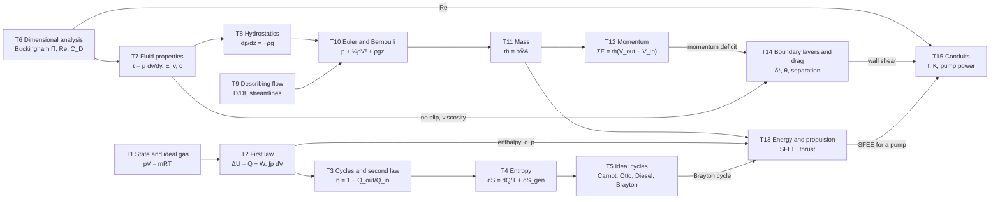

# SESA1016 Thermofluids Hub

> [!abstract] Module at a glance
> The module runs from the energy of a gas in a cylinder to the losses in a pipe network. Thermodynamics (T1–T5) treats a closed system: its state, the first law, the second law through entropy, and the ideal cycles of piston engines and gas turbines. Dimensional analysis (T6) links the two halves. Fluid mechanics (T7–T15) moves from properties and fluids at rest to flow description and the Bernoulli equation, then to control-volume conservation of mass, momentum and energy, and finally to viscous effects: boundary layers, drag and pipe flow.
>
> One distinction runs through all of it. A closed system follows a fixed mass and suits piston-cycle thermodynamics; a control volume is a fixed region with flow across it and suits nearly every flowing device.
>
> Quick reference: [[SESA1016 Formula Sheet]] · assessment practice: [[SESA1016 Online Exam Question Map]]

## Current coverage

All fifteen chapters are written up. Where a recording exists its transcript sets the scope and supplies the line references; where it does not, the note is built from the chapter PDF. The lectures for Chapters 2–4 were never recorded, so those three notes stay `written-ahead`. The boundary-layer lectures of 28–29 April 2025 were recorded without usable audio, so the first half of T14 is from the notes.

| Topic | Status | Recorded lectures used | From the notes only |
|---|---|---|---|
| [[SESA1016 T1 - Thermodynamic Systems, Properties and State\|T1]] | lectured | L1 (27 Jan) | §§1.4–1.6 |
| [[SESA1016 T2 - Work, Heat and the First Law\|T2]] | written-ahead | none | all |
| [[SESA1016 T3 - Heat Engines and the Second Law\|T3]] | written-ahead | none | all |
| [[SESA1016 T4 - Entropy and Isentropic Relations\|T4]] | written-ahead | none | all |
| [[SESA1016 T5 - Ideal Heat Engine Models\|T5]] | lectured | 20 Feb; 13 May (mock Q1) | §§5.1–5.3 (Carnot, Otto, Diesel) |
| [[SESA1016 T6 - Dimensional Analysis and Similarity\|T6]] | lectured | 24 Feb | §§6.4–6.6 |
| [[SESA1016 T7 - Fluid Properties and Viscosity\|T7]] | lectured | 3 Mar | none |
| [[SESA1016 T8 - Hydrostatics\|T8]] | lectured | 4 and 6 Mar | none |
| [[SESA1016 T9 - Describing Flow and the Material Derivative\|T9]] | lectured | 10 and 11 Mar | none |
| [[SESA1016 T10 - Euler and Bernoulli Equations\|T10]] | lectured | L21 (19 Mar) | §§10.1–10.2 |
| [[SESA1016 T11 - Conservation of Mass\|T11]] | lectured | L22 (19 Mar) | multiple ports, examples |
| [[SESA1016 T12 - Conservation of Momentum\|T12]] | lectured | 24 Mar; 13 May (mock Q2) | water jet pack |
| [[SESA1016 T13 - Conservation of Energy and Propulsion\|T13]] | lectured | 25 and 27 Mar | none |
| [[SESA1016 T14 - Boundary Layers and the Origin of Drag\|T14]] | lectured | 1 May | §§14.1–14.8, §14.11 |
| [[SESA1016 T15 - Flow in Conduits\|T15]] | lectured | 8 May; 13 May (mock Q3) | §§15.1–15.6 |

## Concept map



## Topic notes

### Closed-system thermodynamics

1. [[SESA1016 T1 - Thermodynamic Systems, Properties and State]]: systems and control volumes, properties, the continuum, state and the ideal-gas law
2. [[SESA1016 T2 - Work, Heat and the First Law]]: sign convention, boundary work, $c_v$, $c_p$, enthalpy and the four standard processes
3. [[SESA1016 T3 - Heat Engines and the Second Law]]: cycles, thermal efficiency, Kelvin–Planck, heat pumps and reversibility
4. [[SESA1016 T4 - Entropy and Isentropic Relations]]: entropy change and generation, the $T\,ds$ equations and isentropic relations
5. [[SESA1016 T5 - Ideal Heat Engine Models]]: Carnot, Otto, Diesel and Brayton cycles, optimum pressure ratio, Stirling (mock exam)

### Similarity and fluid fundamentals

6. [[SESA1016 T6 - Dimensional Analysis and Similarity]]: homogeneity, Buckingham pi, dimensionless groups, log-log plots and scale models
7. [[SESA1016 T7 - Fluid Properties and Viscosity]]: density, bulk modulus and speed of sound, Newton's law of viscosity, temperature dependence
8. [[SESA1016 T8 - Hydrostatics]]: Pascal, Stevin, Archimedes, barometer, manometers and the atmosphere

### Fluid motion and inviscid flow

9. [[SESA1016 T9 - Describing Flow and the Material Derivative]]: Eulerian and Lagrangian views, the material derivative, flow lines and flow classifications
10. [[SESA1016 T10 - Euler and Bernoulli Equations]]: particle acceleration, the Euler and Bernoulli equations, Pitot tubes and the pressure coefficient

### Control-volume conservation laws

11. [[SESA1016 T11 - Conservation of Mass]]: volume and mass flow rate, area-averaged velocity, continuity
12. [[SESA1016 T12 - Conservation of Momentum]]: momentum flow rate, forces on vanes, bends, rockets and wakes
13. [[SESA1016 T13 - Conservation of Energy and Propulsion]]: the SFEE, flow work, Reynolds transport theorem, thrust and propulsive efficiency

### Viscous flows

14. [[SESA1016 T14 - Boundary Layers and the Origin of Drag]]: thickness measures, skin friction, transition, separation and pressure drag
15. [[SESA1016 T15 - Flow in Conduits]]: developing flow, Poiseuille flow, friction factor, minor losses and pumping power

## Core concept notes

| Thermodynamics | Fluid mechanics | Conservation and losses |
|---|---|---|
| [[Closed System vs Control Volume]] | [[Pressure and Head]] | [[Control-volume Analysis Workflow]] |
| [[Thermodynamic State and Process]] | [[Newtonian Fluid and Viscosity]] | [[Mass Flow Rate]] |
| [[Ideal-gas Law]] | [[Material Derivative]] | [[Momentum Flux]] |
| [[Boundary Work]] | [[Streamline, Pathline and Streakline]] | [[Steady-flow Energy Equation]] |
| [[Internal Energy and Enthalpy]] | [[Bernoulli Equation]] | [[Boundary-layer Thickness Measures]] |
| [[Thermal Efficiency and COP]] | [[Stagnation Pressure and Pitot Tube]] | [[Skin-friction and Pressure Drag]] |
| [[Entropy Generation]] | [[Pressure Coefficient]] | [[Darcy Friction Factor]] |
| [[Isentropic Ideal-gas Relations]] | [[Reynolds Number]] | [[Major and Minor Head Losses]] |
| [[Buckingham Pi Theorem]] | | |

## Exam skills

The assessment was online with no past papers, so the skills below are the ones the worked examples, problem sheets and the 13 May mock exam keep returning to.

| Skill | Where it is practised |
|---|---|
| Ideal-gas state changes with absolute $p$ and $T$, fixed mass between states | [[SESA1016 T1 - Thermodynamic Systems, Properties and State#Worked example - two connected tanks\|T1 tanks]] · Sheet 1 |
| First-law bookkeeping for a process sequence, signs of $Q$ and $W$ | [[SESA1016 T2 - Work, Heat and the First Law#Worked example - three paths between the same two states\|T2 three paths]] · Sheet 2 |
| Cycle efficiency from the heats, checking against Carnot | [[SESA1016 T3 - Heat Engines and the Second Law#Worked example - a three-process engine\|T3 engine]] · Sheet 3 |
| Entropy change and generation for heat transfer and gas processes | [[SESA1016 T4 - Entropy and Isentropic Relations#Worked example - which heat transfer is more irreversible\|T4]] · Sheet 3 |
| Otto, Diesel and Brayton state tables and efficiencies; Stirling and Carnot limits | [[SESA1016 T5 - Ideal Heat Engine Models#Worked example - Brayton cycle power\|T5 Brayton]] · [[SESA1016 T5 - Ideal Heat Engine Models#Worked example - solar furnace and a Stirling engine\|mock Q1]] · Sheet 4 |
| Buckingham pi with repeating variables; using a $C_D(Re)$ curve; model scaling | [[SESA1016 T6 - Dimensional Analysis and Similarity#Worked example - scale-model aerofoil\|T6]] · Sheet 5 |
| Couette shear forces; manometer chains; layered tanks; atmosphere models | [[SESA1016 T8 - Hydrostatics#Worked example - oil and water in a tank\|T8]] · Sheet 6 |
| Streamlines and acceleration from a velocity field; Bernoulli with continuity; Pitot readings | [[SESA1016 T10 - Euler and Bernoulli Equations#Worked example - Pitot-static flow meter\|T10]] · Sheets 7–8 |
| Mass flow from non-uniform profiles | [[SESA1016 T11 - Conservation of Mass#Worked example - numerical mass flow in an intercooler\|T11]] · Sheet 8 |
| Momentum control volumes: vanes, bends, jets and wakes | [[SESA1016 T12 - Conservation of Momentum#Worked example - pipe bend and nozzle\|T12 bend]] · [[SESA1016 T12 - Conservation of Momentum#Worked example - disc held up by a water jet\|mock Q2]] · Sheet 9 |
| SFEE for turbines, compressors, nozzles and heat exchangers; thrust and propulsive efficiency | [[SESA1016 T13 - Conservation of Energy and Propulsion#Worked example - industrial gas turbine\|T13]] · Sheet 9 |
| $\delta^*$, $\theta$ by the trapezoidal rule; plate drag; pressure drag from surface data | [[SESA1016 T14 - Boundary Layers and the Origin of Drag#Worked example - displacement thickness from measurements\|T14]] · Sheet 10 |
| Type 1 and type 2 pipe problems with Colebrook; minor losses; pump power | [[SESA1016 T15 - Flow in Conduits#Worked example - fuel line, a type 2 problem\|T15]] · [[SESA1016 T15 - Flow in Conduits#Worked example - liquid-hydrogen pipeline\|mock Q3]] · Sheet 11 |

## Problem sheets

Each solution note was re-checked numerically in Python. Where a printed answer could not be reproduced, the note says so beside the question.

| Sheet | Coverage | Solution note |
|---|---|---|
| 1 | Basic concepts and the ideal gas | [[SESA1016 Problem Sheet 01 - Basic Concepts Solutions]] |
| 2 | Work and heat | [[SESA1016 Problem Sheet 02 - Work and Heat Solutions]] |
| 3 | Heat engines and entropy | [[SESA1016 Problem Sheet 03 - Heat Engines and Entropy Solutions]] |
| 4 | Heat-engine models | [[SESA1016 Problem Sheet 04 - Heat Engine Models Solutions]] |
| 5 | Dimensional analysis | [[SESA1016 Problem Sheet 05 - Dimensional Analysis Solutions]] |
| 6 | Fluid properties and hydrostatics | [[SESA1016 Problem Sheet 06 - Fluid Properties and Hydrostatics Solutions]] |
| 7 | Describing flow and the Euler equation | [[SESA1016 Problem Sheet 07 - Describing Flow and Euler Equation Solutions]] |
| 8 | Bernoulli and mass conservation | [[SESA1016 Problem Sheet 08 - Bernoulli and Mass Conservation Solutions]] |
| 9 | Momentum and energy conservation | [[SESA1016 Problem Sheet 09 - Momentum and Energy Conservation Solutions]] |
| 10 | Drag and external flows | [[SESA1016 Problem Sheet 10 - Drag and External Flows Solutions]] |
| 11 | Flow in conduits | [[SESA1016 Problem Sheet 11 - Flows in Conduits Solutions]] |

## Preparing without past papers

This was the module's first delivery and the assessment was online, so there is no record of past questions to mine. The evidence is the chapter worked examples, the numbered sheet problems with their printed answers, and the 13 May mock exam, whose three questions are worked in [[SESA1016 T5 - Ideal Heat Engine Models#Worked example - solar furnace and a Stirling engine|T5]], [[SESA1016 T12 - Conservation of Momentum#Worked example - disc held up by a water jet|T12]] and [[SESA1016 T15 - Flow in Conduits#Worked example - liquid-hydrogen pipeline|T15]]. [[SESA1016 Online Exam Question Map]] turns these into a coverage matrix and mixed practice, and [[SESA1016 Cambridge Part IIA Practice]] lists Cambridge questions that revise the same material.

A sensible order is to read a topic note once for the model and its assumptions, attempt the matching sheet without the solution, compare modelling choices, signs and units rather than only the final number, and finish with mixed questions from the map.

## All notes

```dataview
TABLE type, stream, status, file.mtime AS "Updated"
FROM "Year 1/SESA1016 Thermofluids"
WHERE type
SORT type ASC, file.name ASC
```

## Builds on / feeds into

- **Builds on**: algebra, calculus, mechanics, ideal gases and energy conservation.

| Later module | Bridge from SESA1016 | Continue with |
|---|---|---|
| [[SESA2022 Aerodynamics Hub]] | Bernoulli, pressure coefficient, boundary layers and drag | [[SESA2022 T2 - Boundary Layers]] · [[SESA2022 T3 - Potential Flow]] |
| [[SESA2023 Propulsion Hub]] | ideal gases, entropy, Brayton cycles, momentum thrust, SFEE and similarity | [[SESA2023 W01 - Thrust, Efficiency, Range and the ISA]] · [[SESA2023 W02 - Thermodynamics, Mixtures, SFEE and Isentropic Efficiency]] · [[SESA2023 W06 - Jet Engine Cycle Analysis - Brayton, Ramjet, Turbojet and Reheat]] · [[SESA2023 W09 - Turbomachinery Characteristics - Coefficients, Similarity and Maps]] |
| [[SESA2029 Digital Aerospace Methods Hub]] (CFD) | material derivative, Newtonian fluids, control-volume conservation, Euler flow and boundary layers | [[SESA2029 A6 - Higher-Order Time Integration, Runge-Kutta and the Blasius Equation]] · [[SESA2029 A7 - Governing Equations - Euler and Navier-Stokes]] · [[SESA2029 A8 - Turbulence, RANS and Turbulence Models]] · [[SESA2029 A9 - Finite Volume Method]] |
| [[SESA2024 Astronautics Hub]] | jet momentum, nozzle energy conversion and propulsion control volumes | [[SESA2024 07 - Spacecraft Propulsion]] |

Propulsion adds compressibility, component efficiencies and combustion to the balances here; Aerodynamics adds circulation and lifting flows; Digital Aerospace discretises the same conservation laws in a CFD solver.

## Sources

- Lecture notes: `02 - Sources/Lectures/Chapter 1.pdf` to `Chapter 15.pdf`, one per topic note.
- Recordings and transcripts: listed with dates and topic matches in [[SESA1016 Transcript Index]]. Fourteen transcripts survive, from Lecture 1 (27 Jan 2025) to the mock-exam solutions (13 May 2025); the Work and Heat, Heat Engines and Entropy lectures were not recorded, and the 28–29 April boundary-layer recordings have no usable audio.
- Problem sheets: `02 - Sources/Tutorial Sheets/Problem Sheet 01` to `11`, with printed answers.
- Figures: generated by `01 - Notes/Figures/generate_tf_figures.py` (shared Year 3 style).

## Transcript and slide slips

Slips are recorded at the end of each topic note, with line or equation references. The ones that change a number are: Ch1 eq. 1.10 (volume $10^{-3}$ for $10^{-2}$ m³), Ch3 eq. 3.28 ($c_v$ printed as 817 for 718), Ch5 eq. 5.79 ($p_3/p_2$ for $p_3/p_4$), Ch13 dam example (1.46 GW where the data give 0.81 GW), Ch14 sphere $C_D$ defined with $d^2$ instead of the frontal area, and the 13 May transcript's 94.1 % (for 91.4 %) and 0.01928 kg (for 0.0928 kg).
