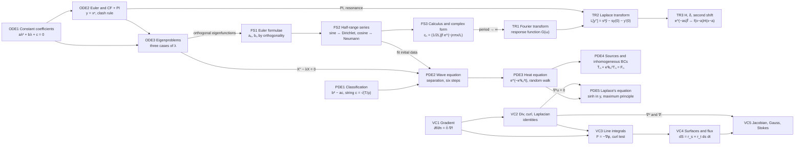

# MATH2048 Mathematics for Engineering and the Environment Part II Hub

> [!abstract] Module at a glance
> This is the maths behind SESA2027 and SESA2029, examined as maths: derivations, proofs and full working. Its five blocks build on one another. ODEs give the solution toolkit; Fourier series expand a function in eigenfunctions; Fourier and Laplace transforms turn ODEs into algebra; PDEs (wave, heat, Laplace) combine all three, since separation of variables is an eigenvalue problem, then a time ODE, then a Fourier series fitted to the initial data; and vector calculus covers grad, div, curl, line, surface and volume integrals and the Gauss and Stokes theorems.
>
> Quick reference: [[MATH2048 Formula Sheet]] · Exam practice: [[MATH2048 Past Paper Solutions]]

## Current coverage

All 19 topic notes are `lectured`, and none is `written-ahead`: every lecture of the 2024-25 series was recorded, and its transcript sets the scope of the note it feeds. Each note gives full derivations (including steps left as exercises, such as the cosine–cosine orthogonality relation, $\mathcal L[\cos ax]$, the Neumann coefficients of $x(1-x)$ and the spherical normal), works the problem-sheet and past-paper questions on its topic with numbers checked in SymPy or NumPy, and ends with a table of transcript and slide slips. Material in the printed lecture notes that was not lectured, such as d'Alembert's solution, the Fourier-transform shift theorems and the vector potential, is mentioned where relevant but not developed. The folder holds 19 topic notes, 30 concept notes, 6 tutorial-solution notes and 5 figure generator scripts.

| Topic | Status | Lectures (2024-25) | Slides |
|---|---|---|---|
| [[MATH2048 ODE1 - Second-Order Linear ODEs with Constant Coefficients\|ODE1]] | lectured | L1 (30 Sep) | Lecture1_ODE, slides 10–12 from the PDF only |
| [[MATH2048 ODE2 - Euler Equations and Inhomogeneous ODEs\|ODE2]] | lectured | L2 (1 Oct), start of L3 | Lecture2_ODE, Lecture3_ODE slide 18 |
| [[MATH2048 ODE3 - Boundary Value and Eigenvalue Problems\|ODE3]] | lectured | L3 (2 Oct) | Lecture3_ODE, eigenvalue appendix |
| [[MATH2048 FS1 - Fourier Series, Orthogonality and the Euler Formulae\|FS1]] | lectured | L4–L5 (7–8 Oct) | Lecture4–5_FourierSeries |
| [[MATH2048 FS2 - Even and Odd Functions, Half-Range Series and Convergence\|FS2]] | lectured | L6 (9 Oct) | Lecture6_FourierSeries3 |
| [[MATH2048 FS3 - Calculus with Fourier Series and Complex Fourier Series\|FS3]] | lectured | L7–L8 (14–15 Oct) | Lecture7–8_FourierSeries |
| [[MATH2048 TR1 - Fourier Transforms\|TR1]] | lectured | L9–L10 (16, 21 Oct) | Lecture9–10_FourierTransforms |
| [[MATH2048 TR2 - Laplace Transforms - Definition, Properties and Solving IVPs\|TR2]] | lectured | L11–L12 (22–23 Oct) | Lecture11–12_LaplaceTransform |
| [[MATH2048 TR3 - Heaviside and Delta Functions and the Second Shift Theorem\|TR3]] | lectured | L13 (28 Oct) | Lecture13_LaplaceTransform3 |
| [[MATH2048 PDE1 - Classification of PDEs and the Wave Equation\|PDE1]] | lectured | L14 (29 Oct) | Lecture14_Hyperbolic1 |
| [[MATH2048 PDE2 - Separation of Variables for the Wave Equation\|PDE2]] | lectured | L15–L16 (30 Oct, 4 Nov), start of L17 | Lecture15–16_Hyperbolic |
| [[MATH2048 PDE3 - The Heat Equation\|PDE3]] | lectured | L17 (5 Nov) | Lecture17_Parabolic1 |
| [[MATH2048 PDE4 - Inhomogeneous PDEs and Inhomogeneous Boundary Conditions\|PDE4]] | lectured | L18–L19 (6, 11 Nov), recap 13 Nov | Lecture18–19_Parabolic |
| [[MATH2048 PDE5 - Laplace's Equation\|PDE5]] | lectured | L20 (12 Nov) | Lecture20_LaplaceEquation1 |
| [[MATH2048 VC1 - Scalar and Vector Fields, Gradient and Directional Derivatives\|VC1]] | lectured | L21 (first part), L23 (18, 20 Nov) | Lecture21, Lecture23 |
| [[MATH2048 VC2 - Divergence, Curl, Laplacian and Vector Identities\|VC2]] | lectured | L24–L25 (25–26 Nov) | Lecture24–25 |
| [[MATH2048 VC3 - Line Integrals and Conservative Fields\|VC3]] | lectured | end of L21, L22, L26 (18–19, 27 Nov) | Lecture21, 22, 26 |
| [[MATH2048 VC4 - Surfaces, Surface Area and Flux Integrals\|VC4]] | lectured | L27–L28 (2–3 Dec) | Lecture27–28 |
| [[MATH2048 VC5 - Volume Integrals, the Divergence Theorem and Stokes' Theorem\|VC5]] | lectured | L29–L30 (4, 9 Dec) | Lecture29–30 |

## Concept map



## Topic map

### Block 1: Ordinary differential equations (L1–3)
1. [[MATH2048 ODE1 - Second-Order Linear ODEs with Constant Coefficients]]: the auxiliary equation, three root cases, reduction of order, the Wronskian, the damped oscillator with numbers
2. [[MATH2048 ODE2 - Euler Equations and Inhomogeneous ODEs]]: $y=x^n$, $t=\ln x$, complementary function plus particular integral, the $ue^{kx}$ substitution for clashes, resonance as the limit of beats
3. [[MATH2048 ODE3 - Boundary Value and Eigenvalue Problems]]: unique, no or infinitely many solutions (PS2 Q2); the three-case method; Robin eigenfunctions, Newton's method and orthogonality

### Block 2: Fourier series (L4–8)
4. [[MATH2048 FS1 - Fourier Series, Orthogonality and the Euler Formulae]]: all three orthogonality proofs, Euler formulae, sawtooth, tent and $e^x$, Gibbs overshoot, summing series
5. [[MATH2048 FS2 - Even and Odd Functions, Half-Range Series and Convergence]]: even and odd, $1+x$ on $[-2,2]$, three extensions, the cosine series of $x$ on $[0,1]$, Dirichlet conditions, jumps
6. [[MATH2048 FS3 - Calculus with Fourier Series and Complex Fourier Series]]: when term-by-term calculus is allowed, coefficient decay and smoothness; $c_n$ for $e^x$, $x$ and a square wave

### Block 3: Fourier and Laplace transforms (L9–13)
7. [[MATH2048 TR1 - Fourier Transforms]]: the limit of the complex series (series coefficients as samples of $F$), $e^{-\omega_0|t|}$, properties with proofs, the response function and its peak height
8. [[MATH2048 TR2 - Laplace Transforms - Definition, Properties and Solving IVPs]]: the table from the definition, shift and derivative rules, partial fractions, PS5 Q2 inversions
9. [[MATH2048 TR3 - Heaviside and Delta Functions and the Second Shift Theorem]]: $H$, $\delta$, the second shift theorem, a hammer-struck pendulum, a switched pulse, impulse peaks (PS5 Q4)

### Block 4: Partial differential equations (L14–20)
10. [[MATH2048 PDE1 - Classification of PDEs and the Wave Equation]]: the three types and their data, $b^2-ac$ with worked classifications, the Tricomi equation, the string derivation
11. [[MATH2048 PDE2 - Separation of Variables for the Wave Equation]]: the six steps, fixed and free ends, the plucked string, standing as travelling waves, the damped 2025/26 A2
12. [[MATH2048 PDE3 - The Heat Equation]]: the random-walk derivation and its variance, exponential decay, the insulated rod, heat conservation, the loss-term substitution
13. [[MATH2048 PDE4 - Inhomogeneous PDEs and Inhomogeneous Boundary Conditions]]: eigenfunction expansion, the 2022/23 A2, a switched source (PS7 Q3), subtracting a boundary function
14. [[MATH2048 PDE5 - Laplace's Equation]]: the static limit, $\sinh$ in $y$, superposition of sides, the maximum principle and uniqueness

### Block 5: Vector calculus (L21–30)
15. [[MATH2048 VC1 - Scalar and Vector Fields, Gradient and Directional Derivatives]]: fields, curves, steepest ascent, normals, PS8 Q1–Q4
16. [[MATH2048 VC2 - Divergence, Curl, Laplacian and Vector Identities]]: div and curl built from the gradient, vorticity, the identities with proofs and an identity-6 check
17. [[MATH2048 VC3 - Line Integrals and Conservative Fields]]: the work integral, path dependence, PS8 Q7, $\mathbf F=-\nabla\phi$, finding $\phi$
18. [[MATH2048 VC4 - Surfaces, Surface Area and Flux Integrals]]: $\mathbf r_s\times\mathbf r_t$, $dA$, the cone area, flux, the helicoid and the funnel
19. [[MATH2048 VC5 - Volume Integrals, the Divergence Theorem and Stokes' Theorem]]: Jacobians, PS11 volumes, Gauss, Stokes, weak and strong forms

## Concept notes

| ODEs | Fourier series | Transforms | PDEs | Vector calculus |
|---|---|---|---|---|
| [[Auxiliary Equation]] | [[Fourier Series]] | [[Fourier Transform]] | [[PDE Classification]] | [[Gradient and Directional Derivative]] |
| [[Euler-Cauchy Equation]] | [[Orthogonality of Trigonometric Functions]] | [[Laplace Transform Properties and Proofs]] | [[Separation of Variables]] | [[Divergence, Curl and the Laplacian]] |
| [[Method of Undetermined Coefficients]] | [[Half-Range Expansions]] | [[Partial Fractions for Inverse Laplace]] | [[Wave Equation]] | [[Line Integrals]] |
| [[Resonance]] | [[Fourier's Theorem]] | [[Heaviside Step Function]] | [[Heat Equation]] | [[Conservative Vector Fields]] |
| [[Boundary Value Problems]] | [[Complex Fourier Series]] | [[Dirac Delta Function]] | [[Laplace's Equation]] | [[Flux Integrals]] |
| [[ODE Eigenvalue Problems]] | | [[Laplace Transform]] (SESA2027) | [[Eigenfunction Expansion Method]] | [[Jacobian and Volume Elements]] |
| | | | | [[Divergence Theorem]] |
| | | | | [[Stokes' Theorem]] |

## Exam skills

The exam is 100 minutes, open book, with the official formula sheet FS/MATH2048 on Blackboard. Candidates answer A1, A2, B1 and B2; Section C is statistics for Civil Engineering only. The three papers filed in `03 - Exams & Past Papers` (2023/24 to 2025/26) all come with official solutions, worked and checked in [[MATH2048 Past Paper Solutions]].

| Question | Marks | Content every year |
|---|---|---|
| A1 | 20 | Laplace: prove a property from the definition (derivative rule, $\mathcal L[\delta(x-a)]$ or the second shift theorem), then solve an IVP with $H$ or $\delta$ |
| A2 | 25 | PDE by separation of variables: separated ODEs, eigenproblem in three cases, $T_n$, fit the initial data |
| B1 | 15 | Fields: grad, div, curl, Laplacian, conservative test, potential, line integral |
| B2 | 20 | Surfaces and volumes: $d\mathbf S$, flux, the divergence theorem, the spherical Jacobian |

Fourier series and transforms are never examined on their own; Fourier series appear inside A2, in fitting the initial data. The online coursework is set in STACK, which writes $i$ for $j$.

| Skill | Paper questions | Where it is taught and practised |
|---|---|---|
| Prove a Laplace property from the definition, stating the condition $f(x)e^{-sx}\to0$ | 2023/24 A1(a), 2024/25 A1(a), 2025/26 A1(a) | [[MATH2048 TR2 - Laplace Transforms - Definition, Properties and Solving IVPs#Derivatives\|TR2 derivative rule]] · [[MATH2048 TR3 - Heaviside and Delta Functions and the Second Shift Theorem#Proof\|TR3 second shift proof]] |
| Rewrite a source as $g(x-a)H(x-a)$ or a sum of deltas, transform, partial fractions, invert with both shift theorems named | 2023/24 A1(b), 2024/25 A1(b), 2025/26 A1(b) | [[MATH2048 TR3 - Heaviside and Delta Functions and the Second Shift Theorem#Switching on a constant force (L13)\|TR3 switched force]] · [[MATH2048 TR3 - Heaviside and Delta Functions and the Second Shift Theorem#The 2025-26 exam, question A1\|TR3 2025/26 A1]] · [[MATH2048 TR2 - Laplace Transforms - Definition, Properties and Solving IVPs#Partial fractions, the systematic route (L12)\|TR2 partial fractions]] · PS5 |
| Separate the PDE and justify the constant, with the exam's sign $X''-\lambda X=0$ | every A2 | [[MATH2048 PDE2 - Separation of Variables for the Wave Equation#Why the two sides must be constant\|PDE2]] |
| Solve the eigenproblem in all three cases, including $\lambda=0$ | every A2 | [[MATH2048 ODE3 - Boundary Value and Eigenvalue Problems#Worked example: an eigenvalue problem\|ODE3 worked example]] · [[MATH2048 PDE2 - Separation of Variables for the Wave Equation#Changing to Neumann ends (L16)\|PDE2 Neumann ends]] · PS2 Q3 |
| Solve each $T_n$ (wave, heat, damped, forced) and fit the initial data by inspection with trig identities | 2023/24 A2 (heat, $\cos^3x$), 2024/25 A2 (forced wave), 2025/26 A2 (damped wave) | [[MATH2048 PDE3 - The Heat Equation#3. The 2023-24 exam, question A2\|PDE3]] · [[MATH2048 PDE4 - Inhomogeneous PDEs and Inhomogeneous Boundary Conditions#3. The 2024-25 exam, question A2\|PDE4]] · [[MATH2048 PDE2 - Separation of Variables for the Wave Equation#4. The 2025-26 exam, question A2\|PDE2]] · PS6–PS7 |
| Fit general initial data with a half-range series chosen by the boundary conditions | PS6 Q1, PS7 Q2 | [[MATH2048 FS2 - Even and Odd Functions, Half-Range Series and Convergence#Which extension goes with which boundary condition\|FS2]] · [[MATH2048 PDE2 - Separation of Variables for the Wave Equation#Guitar string with fixed ends (L16)\|PDE2 guitar string]] |
| Gradient, directional derivative, maximum rate of change, Laplacian at a point | 2023/24 B1(a) | [[MATH2048 VC1 - Scalar and Vector Fields, Gradient and Directional Derivatives#6. The 2023-24 exam, question B1(a)\|VC1]] · [[MATH2048 VC2 - Divergence, Curl, Laplacian and Vector Identities#4. Past exam questions\|VC2]] · PS8–PS9 |
| Curl first: if zero find $\phi$ and use the endpoints, otherwise parametrise and integrate | 2023/24 B1(b), 2024/25 B1, 2025/26 B1 | [[MATH2048 VC3 - Line Integrals and Conservative Fields#Finding a potential (L26)\|VC3 potential]] · [[MATH2048 VC3 - Line Integrals and Conservative Fields#4. Past exam questions B1\|VC3 past B1]] · PS8 Q7 |
| Parametrise a surface, check the normal's direction, compute a flux | 2023/24 B2(a)–(d) | [[MATH2048 VC4 - Surfaces, Surface Area and Flux Integrals#4. The 2023-24 exam, question B2(a)–(d)\|VC4]] · PS10 |
| Derive the spherical Jacobian in full and use Gauss, symmetry and shifts of origin | 2023/24 B2(e), 2024/25 B2, 2025/26 B2 | [[MATH2048 VC5 - Volume Integrals, the Divergence Theorem and Stokes' Theorem#Spherical coordinates\|VC5 Jacobian]] · [[MATH2048 VC5 - Volume Integrals, the Divergence Theorem and Stokes' Theorem#4. Past exam questions B2\|VC5 past B2]] · PS11 |

The mark schemes give marks for naming each theorem as it is used, mark eigenproblems case by case (so $\lambda=0$ is never skipped), and reward a physical check such as half the volume of a ball or a potential reproducing a line integral; see [[MATH2048 Past Paper Solutions#Exam technique (from the mark schemes)|exam technique]]. [[MATH2048 Cambridge Part IIA Practice]] lists third-year Cambridge questions that revise the same material, by topic note.

## Problem sheets (full worked solutions)

| Solutions note | Covers | Notes |
|---|---|---|
| [[MATH2048 Problem Sheets 1-2 Solutions - ODEs]] | PS1, PS2 Q1–3 | PS2 Q2(c) fails because $\lambda=\frac14$ is an eigenvalue of Q3(b) |
| [[MATH2048 Problem Sheets 2-4 Solutions - Fourier Series]] | PS2 Fourier page, PS3, PS4 Q1–2 | $\sum_{n\geq0}\frac{(-1)^n}{1+n^2}=\frac12(1+\pi/\sinh\pi)$, checked numerically |
| [[MATH2048 Problem Sheet 4-5 Solutions - Fourier and Laplace Transforms]] | PS4 FT page, PS5 | Q4 closed form $k_1=2e^{\gamma\tau^*/2}$ |
| [[MATH2048 Problem Sheets 6-7 Solutions - PDEs]] | PS6, PS7 | Every answer printed on the sheets is reproduced |
| [[MATH2048 Problem Sheets 8-11 Solutions - Vector Calculus]] | PS8–PS11 | All integrals checked by explicit parametrisation |
| [[MATH2048 Past Paper Solutions]] | 2023/24, 2024/25, 2025/26 (A and B) | All agree with the official solutions |

## All notes
```dataview
TABLE type, status, file.mtime AS "Updated"
FROM "Year 2/MATH2048 Mathematics for Engineering and the Environment Part II"
WHERE type
SORT type ASC, file.name ASC
```

## Builds on / feeds into
- Builds on [[MATH1054 Mathematics for Engineering and the Environment Hub]]: complex numbers and Euler's formula, first-order and constant-coefficient ODEs with damping, dot and cross products, determinants and eigenvalues.
- Into [[SESA2027 Aerospace Mechanics & Control Hub]]: ODEs, the characteristic equation ([[Damping Ratio and Natural Frequency]]), Laplace transforms ([[Laplace Transform]]), the frequency response ([[Frequency Response Function]]).
- Into [[SESA2029 Digital Aerospace Methods Hub]]: the heat equation and the Fourier number ([[CFL and Fourier Numbers]]), mode shapes ([[Natural Frequencies and Mode Shapes]]).
- Into [[SESA2022 Aerodynamics Hub]]: Laplace's equation in potential flow ([[Streamfunction and Velocity Potential]]), circulation via Stokes ([[Kelvin's Circulation Theorem]], [[Kutta-Joukowski Theorem]]), vorticity as the curl.

## Sources

- Transcripts: `02 - Sources/Lectures/MATH2048 Lecture 1.txt` to `Lecture 30.txt` (2024-25 series, Ian Hawke), the PDE recap of 13 Nov 2024, the 2024-25 revision sessions (Dec 2024, Jan 2025), the 2023-24 problem classes and Lecture 36 revision, and the 2025-26 problem classes. Each is dated and matched to its topic note in [[MATH2048 Transcript Index]].
- Slides and appendices: `02 - Sources/Lectures & Problem Sheets/` by block (`ODEs/`, `Fourier Series/`, `Fourier and Laplace Transform/`, `PDEs/`, `Vector Calculus/`), one PDF per lecture plus appendix slides; `ODEs/` also holds two Differential Equations PDFs.
- Printed lecture notes: `02 - Sources/Lectures & Problem Sheets/LectureNotesMATH2048.pdf`.
- Problem sheets: `02 - Sources/Lectures & Problem Sheets/Problem Sheets/Problem Sheet 1.pdf` to `11.pdf`, with ODE sheets 1–2 also under `ODEs/`.
- Past papers: `03 - Exams & Past Papers/MATH2048-202324`, `202425` and `202526` W1 papers with official solutions; Cambridge 2P7 example papers and Tripos papers (1996–2025) under `Cambridge/`.
- Figures: generated by `01 - Notes/Figures/generate_m2048_{ode,fs,tr,pde,vc}_figures.py` (shared Year 3 style).

## Transcript and slide slips

The slips are tabulated at the end of each topic note. The most consequential: Lecture 6 pairs Dirichlet and Neumann conditions with the wrong extensions ([[MATH2048 FS2 - Even and Odd Functions, Half-Range Series and Convergence|FS2]]); Lecture 22 gives $-\frac{323}7\approx-6.6$ when it is $-46.1$ ([[MATH2048 VC3 - Line Integrals and Conservative Fields|VC3]]); Lecture 30's "paraboloid" parametrisation is a cone, which still gives $18\pi$ by Stokes ([[MATH2048 VC5 - Volume Integrals, the Divergence Theorem and Stokes' Theorem|VC5]]). In the printed lecture notes, line-integral Example 1b is printed as $6$ (correct: $-\frac{79}2$), Example 1a loses its minus sign ($-\frac{323}7$), the paraboloid Stokes example gives $18$ for $18\pi$, and in §4.7.3 the spherical-wave denominator should be $as+c$, not $a^2s+c$. The 2024/25 published solution to A2 writes $\dot T$ and $\partial u/\partial x$ where it means $\ddot T$ and $\partial u/\partial t$.
