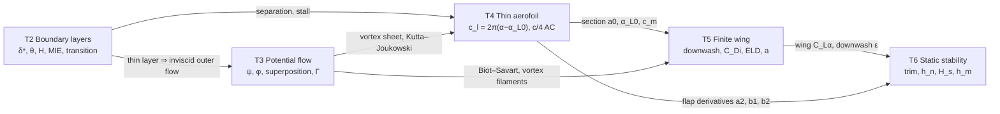

# SESA2022 Aerodynamics Hub

> [!abstract] Module at a glance
> Viscous flow (boundary layers) → inviscid flow (potential flow) → aerofoils (thin aerofoil theory) → wings (lifting line) → aircraft (trim and static stability).
>
> Semester 1, 2025-26. Topics 2–3 taught by the module lead; Topics 4–6 by Prof. Neil Sandham (L16, ll. 654–657). Topic 1 (Lecture 2: non-dimensionalisation, Taylor series) is background and not examined (L1, l. 376).
>
> Quick reference: [[SESA2022 Formula Sheet]] · exam strategy: [[SESA2022 Past Paper Map]] · recordings: [[SESA2022 Transcript Index]]

## Current coverage

All topic notes were brought to the Year 3 standard on 28 Oct 2026 (exam quick path, full derivations one step per line, worked examples verified in Python, transcript slips with line references, a terminology table and a self-study checklist) and rewritten in plainer prose on 30 Oct 2026.

| Topic | Lectures (2025-26) | Note | Status | Figure script |
|---|---|---|---|---|
| 2 Boundary layers | L1, L5–L10 (30 Sep – 15 Oct) | [[SESA2022 T2 - Boundary Layers]] | lectured | `generate_aero_t2_figures.py` |
| 3 Potential flow | L3–L4, L11–L16 (2 Oct, 16–24 Oct) | [[SESA2022 T3 - Potential Flow]] | lectured | `generate_aero_t3_figures.py` |
| 4 Thin aerofoil theory | 28 Oct – 5 Nov | [[SESA2022 T4 - Thin Aerofoil Theory]] | lectured | `generate_aero_t4_figures.py` |
| 5 Finite wing theory | 6–13 Nov | [[SESA2022 T5 - Finite Wing Theory]] | lectured | `generate_aero_t5_figures.py` |
| 6 Aircraft aerodynamics and static stability | 14–25 Nov | [[SESA2022 T6 - Aircraft Aerodynamics and Static Stability]] | lectured | `generate_aero_t6_figures.py` |

Status is `lectured` (fully written up, not yet revised). Promote a note to `revised` once you have worked its Core self-study tasks, and to `exam-ready` after the further practice and timed past-paper questions.

## Concept map



| Boundary layers | Potential flow | Thin aerofoil | Finite wing | Stability |
| --------------------------------------- | ----------------------------------------- | ---------------------------------------------- | ------------------------------------------ | ---------------------------------------- |
| [[Displacement and Momentum Thickness]] | [[Streamfunction and Velocity Potential]] | [[Vortex Sheet]]                               | [[Biot-Savart Law and Helmholtz Theorems]] | [[Neutral Point and Static Margin]]      |
| [[Momentum Integral Equation]]          | [[Elementary Potential Flows]]            | [[Kutta Condition]]                            | [[Downwash and Induced Drag]]              | [[Stick-Fixed vs Stick-Free Stability]]  |
| [[Law of the Wall]]                     | [[Flow Past a Cylinder]]                  | [[Kelvin's Circulation Theorem]]               | [[Elliptic Lift Distribution]]             | [[Manoeuvre Point and Manoeuvre Margin]] |
| [[Virtual Origin Method]]               | [[Rankine Oval]]                          | [[Glauert Integrals]]                          | [[Oswald Efficiency Factor]]               | [[Lateral and Directional Stability]]    |
| [[Boundary Layer Separation]]           | [[Kutta-Joukowski Theorem]]               | [[Aerodynamic Centre and Centre of Pressure]]  | [[Maximum Lift-to-Drag Ratio]]             |                                          |
|                                         | [[Method of Images]]                      | [[Aerofoil Stall]]                             |                                            |                                          |
|                                         | [[D'Alembert's Paradox]]                  | [[Trailing-Edge Flap in Thin Aerofoil Theory]] |                                            |                                          |

Legacy compressible-flow content (examined up to 2019-20, now [[SESA2023 Propulsion Hub|SESA2023]]): [[Isentropic Nozzle Flow]] · [[Normal Shock Waves]]

## Assessment

In-person exam 60%, Blackboard quizzes 20% (one each for Topic 2, Topic 3 and Topics 4–6, two attempts each), wind-tunnel lab report 15%, potential-flow computing lab 5% (L1, ll. 423–437). There are no tutorial sessions: the tutorial and examples sheets, with written solutions, are for independent work (L1, ll. 441–452). The exam's formula pages cover all topics, including static stability (21 Nov, ll. 12–37).

2025-26 exam format (Revision 1, ll. 25–52; 7 Jan revision, ll. 15–45): two hours, in person, five questions. Part A (50): Q1 boundary layers and Q2 potential flow, 25 marks each with 4–5 parts. Part B (50): Q3 thin aerofoils, Q4 finite wings, Q5 static stability, about 17/16/17 marks with three parts each, so about two-thirds the length of older Part B questions. Full working is required; all numerical answers to 4 decimal places; approved calculators only; no scrap paper; pen, not pencil, and not red or green ink (examiners' colours). The examples sheets are mostly past exam questions; for Q5, use Examples Sheet 6 and Q2 of past SESA2025 papers, ignoring trim drag.

## Exam skills

Exam technique (both revision lectures):
- Know the formula sheet before the exam; read the question fully and list what is given and what is asked: *"Half the battle is won if you read the question properly"* (Revision 1, ll. 53–78).
- Give units (a 98/100 script lost a mark for them), sanity-check magnitudes, and show each substitution: for a "show that", the final line alone earns nothing (Revision 1, ll. 81–113, 288–299).
- *"There will be at least one question where you have to sketch something"*: label the axes and add legends (Revision 1, ll. 126–142).
- Substitute every value given; do not assume quantities; if an earlier part failed, carry its result as a variable (Revision 1, ll. 143–174, 398–402).
- Marks come for correct equations even if unsolved. A single arithmetic slip costs little; an answer that is wrong only in the 4th decimal place gets full credit (Revision 1, ll. 186–193, 252–255; 7 Jan revision, ll. 251–264).
- Degrees to radians is the commonest error (7 Jan revision, l. 175).

T2 Boundary layers
- compute $\delta_{99}$ (interpolate), $\delta^*$, $\theta$, $H$ from a profile or data, and classify laminar ($H>2$) or turbulent ($H<2$);
- derive $D' = \rho U_\infty^2\theta$ and $c_f = 2\,d\theta/dx$ from a control volume;
- apply the MIE to an assumed profile (linear, parabolic) to get $\theta/x$ and $c_f$; use Blasius when the question just says "laminar";
- plate drag with two sides and a span; turbulent correlations; $U_\tau$, $y^+$ and the law of the wall;
- transitional plate by the virtual origin; explain separation, tripping and bluff-body drag.

T3 Potential flow
- superpose elementary flows with the course sign convention ($x$–$z$, $\Gamma>0$ clockwise);
- stagnation points, body streamline, velocities and $C_p$ for the half-body, cylinder, Rankine oval (slender approximation) and lifting cylinder;
- integrate $C_p$ for lift and drag; state D'Alembert and Kutta–Joukowski;
- enforce a wall with images (source same sign, vortex opposite sign).

T4 Thin aerofoil theory (two question types, 31 Oct, ll. 1–2, 405–412)
- given a camber line: $A_n$, $c_l$, $\alpha_{L=0}$, $\alpha_{ideal}$, $c_{m,c/4}$, $c_{m,le}$, $x_{cp}$, loading;
- given a flap: $\theta_h$, $A_n$, $\partial c_l/\partial\eta$, $\partial c_{m,c/4}/\partial\eta$;
- explain the Kutta condition, Kelvin's theorem and the starting vortex, stall types, slats versus flaps.

T5 Finite wing theory
- explain downwash and induced drag physically; Biot–Savart for segments;
- $C_L = \pi AR B_1$, $C_{D_i} = C_L^2(1+\delta)/\pi AR$, $a = a_0/[1+a_0(1+\tau)/\pi AR]$, run forwards and backwards;
- elliptic loading by planform or by twist (twist distribution for a rectangular wing);
- drag polar, span loading, $(L/D)_{max}$.

T6 Static stability
- trim ($\alpha$, $\eta$, $\beta$) from aircraft data, stick fixed and free;
- neutral points and static margins, stick fixed and free; manoeuvre margin with $\Phi$;
- short proofs ($\bar a_1$, $C_{L_{T,\alpha}} = k(1-\epsilon_\alpha)$, $h_n$); flight-test extrapolation; lateral/directional stability qualitatively.

## Problem sheets (full worked solutions)
- [[SESA2022 Tutorial 2 - Viscous Flow Solutions]]
- [[SESA2022 Tutorial 3 - Potential Flow Solutions]]
- [[SESA2022 Examples Sheet 4 - Thin Aerofoil Theory Solutions]]
- [[SESA2022 Examples Sheet 5 - Finite Wing Theory Solutions]]
- [[SESA2022 Examples Sheet 6 - Static Stability Solutions]]
- [[SESA2022 Static Stability Past Paper Questions Solutions]]

*"The example sheets for sections 3, 4, 5 are pretty much what you're going to get on the exam"*, except the NACA 2412 thin-aerofoil question, which is longer than an exam question (25 Nov, ll. 407–414). Static stability was part A of the former flight-mechanics module SESA2025; its past papers are relevant (25 Nov, ll. 415–419).

## Past papers (all 12 solved)

| Year | Format | Solutions |
|---|---|---|
| 2013-14 | closed book | [[SESA2022 Exam 2013-14 Solutions]] ✅ |
| 2014-15 | closed book | [[SESA2022 Exam 2014-15 Solutions]] ✅ |
| 2015-16 | closed book | [[SESA2022 Exam 2015-16 Solutions]] ✅ |
| 2016-17 | closed book | [[SESA2022 Exam 2016-17 Solutions]] ✅ |
| 2017-18 | closed book | [[SESA2022 Exam 2017-18 Solutions]] ✅ |
| 2018-19 | closed book | [[SESA2022 Exam 2018-19 Solutions]] ✅ |
| 2019-20 | closed book | [[SESA2022 Exam 2019-20 Solutions]] ✅ |
| 2020-21 | 24 h online, per-student data | [[SESA2022 Exam 2020-21 Solutions]] ✅ |
| 2021-22 | 8 h online, notebook data | [[SESA2022 Exam 2021-22 Solutions]] ✅ |
| 2022-23 | online, per-ID data | [[SESA2022 Exam 2022-23 Solutions]] ✅ |
| 2023-24 | online, per-ID data | [[SESA2022 Exam 2023-24 Solutions]] ✅ |
| 2024-25 | 2 h closed book + rubric | [[SESA2022 Exam 2024-25 Solutions]] ✅ |

> [!warning] Data not in the vault
> The 2020-21 per-student parameters, the 2021-22 notebook profile, the 2022-23 and 2023-24 `.csv` files, and `0020Cpcomp.csv` are missing. Those parts are solved on clearly labelled illustrative data, with reusable code. Everything else uses the exact paper values.

## Labs & coursework
- [[SESA2022 Wind Tunnel Lab Summary]]: NACA 0020 $C_p$, finite-wing polar, flat-plate BL (submitted Dec 2025)

## All notes
```dataview
TABLE type, status, file.mtime AS "Updated"
FROM "Year 2/SESA2022 Aerodynamics"
WHERE type
SORT type ASC, file.name ASC
```

## Builds on / feeds into
- From [[SESA1016 Thermofluids Hub]]: [[SESA1016 T10 - Euler and Bernoulli Equations]] and [[SESA1016 T14 - Boundary Layers and the Origin of Drag]] provide the pressure-flow and viscous-drag foundations.
- [[SESA2027 Aerospace Mechanics & Control Hub]]: static stability (T6) becomes dynamic stability ($M_w = -H_sC_{L^*_\alpha}$).
- [[SESA3043 Advanced Aeronautics Hub|SESA3043 Advanced Aeronautics]]: boundary-layer equations, MIE with pressure gradient, conformal mapping, lumped-vortex and panel methods.
- [[SESA3029 Aerothermodynamics Hub|SESA3029 Aerothermodynamics]]: compressible flow and shocks.
- [[SESA3047 Advanced Aerospace Mechanics & Control Hub|SESA3047 Advanced Aerospace Mechanics & Control]]: lateral/directional dynamics.

## Sources

- Slides, examples sheets and notebooks in `02 - Sources/BL`, `PF`, `Airfoils and Wings`, `Stability`.
- 2025-26 lecture transcripts in `02 - Sources/Lectures/`, mapped to topics in [[SESA2022 Transcript Index]]. Earlier-year topic recordings: `BLs.txt`, `PFs.txt`, `TAT.txt`, `FWT.txt`, `Static Stability.txt`.
- Revision lectures: `SESA2022 Lecture 1 - Revision.txt` (first half) and `SESA2022 Lecture 2026-01-07.txt` (second half), read in full (28 Oct 2026); their advice is in [[#Assessment]], [[#Exam skills]], each topic note's quick-path box and [[SESA2022 Exam 2024-25 Solutions]]. Lab-report briefing: `SESA2022 Lecture 34a.txt`, summarised in [[SESA2022 Wind Tunnel Lab Summary#Report brief (26 Nov lecture)]].

> [!warning] Slips found in the transcripts (all flagged in the topic notes)
> The most consequential: Lecture 7 attributes $0.664/\sqrt{Re}$ and $H = 2.59$ to the parabolic profile (they are Blasius; the parabola gives $0.730$ and $2.5$) ([[SESA2022 T2 - Boundary Layers#Transcript slips (Lectures 5–10)|T2]]); the maths revision uses anticlockwise-positive vorticity while the aerodynamics uses clockwise-positive $\Gamma$ ([[SESA2022 T3 - Potential Flow#Transcript slips (Lectures 3–16)|T3]]); the NACA 6500 zero-lift angle is said as $-0.02$ rad instead of $-0.12$ rad ([[SESA2022 T4 - Thin Aerofoil Theory#Transcript slips (28 Oct – 5 Nov)|T4]]); the aspect-ratio example quotes $C_L = 0.464$ for $0.466$ ([[SESA2022 T5 - Finite Wing Theory#Transcript slips (6–13 Nov)|T5]]); and the pull-up is described with $V = $ pitch rate × $q$ instead of $V = qR$ ([[SESA2022 T6 - Aircraft Aerodynamics and Static Stability#Transcript slips (14–25 Nov)|T6]]).
