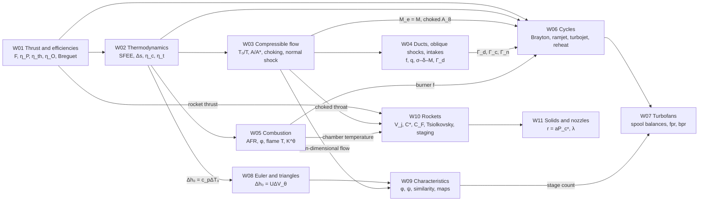

# SESA2023 Propulsion Hub

> [!abstract] Module at a glance
> Fundamentals (thrust, efficiencies, thermodynamics, compressible flow) → combustion → air-breathing engines (ramjet, turbojet, reheat, turbofan) → turbomachinery (Euler, triangles, maps, similarity) → rockets (performance, staging, nozzles, solids).
>
> Quick reference: [[SESA2023 Formula Sheet]] · exam strategy: [[SESA2023 Past Paper Map]]

## Current coverage

All eleven topic notes are `lectured`; none is `written-ahead`. Each was written from the weekly handout and slides and checked against the lecture transcripts listed in [[SESA2023 Transcript Index]], which set the scope. Two parts have no recording behind them: the 8 May lecture on solid motors and real nozzles (W11 §§3–4, written from the Week 11 notes) and the propeller and actuator-disk material in W09 §5, which comes from the 2023-24 paper and was not lectured in 2025-26. Promote notes to `revised` and `exam-ready` yourself.

| # | Note | Coverage | Lecturer | Status |
|---|---|---|---|---|
| 1 | [[SESA2023 W01 - Thrust, Efficiency, Range and the ISA]]: thrust equation, $\eta_P$, $\eta_{th}$, $\eta_O$, TSFC, Breguet, ISA | Lectures 1–3 | Richardson, Grenga | lectured |
| 2 | [[SESA2023 W02 - Thermodynamics, Mixtures, SFEE and Isentropic Efficiency]]: perfect gas, entropy, mixtures, SFEE, $\eta_c$, $\eta_t$ | Lectures 4–6 | Grenga | lectured |
| 3 | [[SESA2023 W03 - Compressible Flow, Normal Shocks and Nozzles]]: stagnation properties, sound speed, choking, $A/A^*$, normal shocks, C–D regimes, shock in a nozzle | Lectures 7–9 + 17 Feb review | Grenga | lectured |
| 4 | [[SESA2023 W04 - Friction, Heat Addition, Oblique Shocks and Intakes]]: friction and heating in ducts, oblique shocks, intakes and $\Gamma_d$ | Lectures 10–12 | Grenga | lectured |
| 5 | [[SESA2023 W05 - Combustion, Stoichiometry and Chemical Equilibrium]]: AFR, $\phi$, LCV, flame temperature, $K^\theta$ and dissociation | Lectures 13–15 | Grenga | lectured |
| 6 | [[SESA2023 W06 - Jet Engine Cycle Analysis - Brayton, Ramjet, Turbojet and Reheat]]: Brayton trends, ramjet, the station-by-station turbojet march, reheat | Lectures 16–19 | Richardson | lectured |
| 7 | [[SESA2023 W07 - Turbofan Architectures and Fan Pressure Ratio Selection]]: architectures, spool balances, fpr and bpr, installation, noise | Lectures 20–21 | Richardson | lectured |
| 8 | [[SESA2023 W08 - Turbomachinery Principles - Euler Equation and Velocity Triangles]]: Euler equation, blade rows, velocity triangles, mirror blading | Lectures 22–24 | Richardson | lectured |
| 9 | [[SESA2023 W09 - Turbomachinery Characteristics - Coefficients, Similarity and Maps]]: $\phi$, $\psi$, stage count, similarity, specific speed, maps; Lecture 27 design example | Lectures 25–27 | Richardson | lectured |
| 10 | [[SESA2023 W10 - Rocket Performance, Staging and Power Cycles]]: $V_j$, $I_{sp}$, $C^*$, $C_F$, Tsiolkovsky, staging, power cycles | rockets lectures (28 Apr–5 May) | Richardson, Grenga | lectured |
| 11 | [[SESA2023 W11 - Solid Propellants and Rocket Nozzle Design]]: solid grains, burning rate and stability, propellants, nozzle contours; final review | 1 May solids intro + 8 May (not recorded) + 12 May review | Richardson, Grenga | lectured |

Exam format (12 May review, [[SESA2023 W11 - Solid Propellants and Rocket Nozzle Design#5. Exam format|W11 §5]]): four compulsory questions of 25 marks, Data Book provided; papers from 2021 onwards match the current syllabus.

## Concept map



## Concept notes

| Performance and thermo | Gas dynamics | Combustion | Engines | Turbomachinery | Rockets |
|---|---|---|---|---|---|
| [[Thrust Equation]] | [[Speed of Sound and Mach Number]] | [[Stoichiometry and Equivalence Ratio]] | [[Brayton Cycle]] | [[Euler Work Equation]] | [[Rocket Performance Parameters]] |
| [[Specific Thrust]] | [[Stagnation Pressure Loss and Entropy]] | [[Calorific Value]] | [[Ramjet]] | [[Velocity Triangles]] | [[Tsiolkovsky Rocket Equation]] |
| [[Propulsive Efficiency]] | [[Stagnation Properties]] | [[Adiabatic Flame Temperature]] | [[Turbojet]] | [[Degree of Reaction]] | [[Rocket Staging]] |
| [[Thermal and Overall Efficiency]] | [[Critical Conditions and Choked Flow]] | [[Chemical Equilibrium and Dissociation]] | [[Afterburning (Reheat)]] | [[Flow and Work Coefficients]] | [[Rocket Engine Power Cycles]] |
| [[Thrust Specific Fuel Consumption]] | [[Converging-Diverging Nozzle Operating Regimes]] | | [[Bypass Ratio and Fan Pressure Ratio]] | [[Dimensional Analysis of Turbomachines]] | [[Rocket Nozzle Geometry]] |
| [[Breguet Range Equation]] | [[Friction and Heat Addition in Constant-Area Ducts]] | | [[Turbine Entry Temperature and Blade Cooling]] | [[Specific Speed]] | [[Solid Propellant Burning Rate]] |
| [[International Standard Atmosphere]] | [[Oblique Shock Waves]] | | | [[Compressor and Turbine Characteristics]] | [[Electric (Ion) Propulsion]] (legacy) |
| [[Two-Property Rule and Perfect Gas Model]] | [[Intake Pressure Recovery]] | | | [[Compressor Stall and Surge]] | |
| [[Entropy Change of a Perfect Gas]] | [[Component Stagnation Pressure Ratios]] | | | [[Actuator Disk Theory]] | |
| [[Gas Mixtures and Dalton's Law]] | | | | | |
| [[Steady Flow Energy Equation]] | | | | | |
| [[Isentropic Efficiency]] | | | | | |

Shared with SESA2022 (legacy compressible flow): [[Normal Shock Waves]] · [[Isentropic Nozzle Flow]]

## Exam skills

Taken from the eleven solved papers (summarised in [[SESA2023 Past Paper Map]]) and the problem sheets. Papers from 2020-21 onwards are the model; earlier years add cycle numbers and essays on topics no longer taught.

| Skill | Papers | Where it is taught |
|---|---|---|
| Define $\eta_P$, $\eta_{th}$, $\eta_O$ and show $\eta_O=\eta_P\eta_{th}$; TSFC; derive and use the Breguet range | 2014-15 Q1, 2016-17 Q3, 2017-18 Q1, 2018-19 Q1, 2023-24 Q1 and Q3, 2024-25 Q1 | [[SESA2023 W01 - Thrust, Efficiency, Range and the ISA#Overall and thermal efficiency\|W01 efficiencies]] · [[SESA2023 W01 - Thrust, Efficiency, Range and the ISA#Range in terms of overall efficiency\|W01 range]] · Sheet 1 |
| Mixture properties ($M$, $R$, $c_p$, $\gamma$), then choked flow of the mixture | 2021-22 Q1 | [[SESA2023 W02 - Thermodynamics, Mixtures, SFEE and Isentropic Efficiency#2. Mixtures (Lecture 5)\|W02 mixtures]] · [[SESA2023 W03 - Compressible Flow, Normal Shocks and Nozzles#Mass flow rate\|W03 mass flow]] · Sheet 2 |
| C–D nozzle regimes, normal shock in a nozzle, shock from a measured pressure ratio, $M_2(M_1)$ | 2020-21 Q1, 2022-23 Q1, 2024-25 Q1(iii–iv) | [[SESA2023 W03 - Compressible Flow, Normal Shocks and Nozzles#Worked example – shock in the diverging section\|W03 shock in a nozzle]] · Sheet 3 |
| Intake loss: $\Gamma_d$ from $\eta_d$ or from measurements, normal-shock (Pitot) intake | 2013-14 Q3, 2023-24 Q2 | [[SESA2023 W04 - Friction, Heat Addition, Oblique Shocks and Intakes#Ideal and real diffusers\|W04 diffusers]] · [[SESA2023 W04 - Friction, Heat Addition, Oblique Shocks and Intakes#Supersonic intakes\|W04 supersonic intakes]] · Sheet 4 Q4.3 |
| Stoichiometry, AFR, $\phi$ and products; burner $f$ (with heat loss or $\eta_b$); equilibrium composition from $K^\theta$ | 2013-14 Q4, 2021-22 Q2(vi), 2022-23 Q3(iv), 2023-24 Q1 | [[SESA2023 W05 - Combustion, Stoichiometry and Chemical Equilibrium#The same balance in gas-turbine form\|W05 burner]] · [[SESA2023 W05 - Combustion, Stoichiometry and Chemical Equilibrium#Worked example – CO equilibrium at 2600 K and 3 bar\|W05 equilibrium]] · Sheet 5 |
| Ideal ramjet: prove $M_e=M$ and the specific thrust; find $f$ from $T_{03}$, or the flight Mach number from $f$ | 2013-14 Q2, 2014-15 Q2, 2015-16 Q4, 2016-17 Q4, 2017-18 Q4, 2018-19 Q4, 2021-22 Q2, 2024-25 Q1 | [[SESA2023 W06 - Jet Engine Cycle Analysis - Brayton, Ramjet, Turbojet and Reheat#Worked example – ideal ramjet at Mach 3 and 51,000 ft\|W06 ideal ramjet]] · Sheet 4 Q4.1 |
| Real ramjet with $\Gamma_d$, $\Gamma_c$, $\Gamma_n$, $\eta_b$ (or the $\Gamma$s found from measurements) | 2018-19 Q4, 2020-21 Q2, 2023-24 Q2 | [[SESA2023 W06 - Jet Engine Cycle Analysis - Brayton, Ramjet, Turbojet and Reheat#The real ramjet\|W06 real ramjet]] · Sheet 4 Q4.2 |
| Turbojet or gas-turbine station march with a $T$–$s$ sketch; cold and hot gas properties; turbine-only version | 2013-14 Q1, 2014-15 Q3, 2015-16 Q3, 2017-18 Q2, 2018-19 Q2, 2022-23 Q3, 2024-25 Q3 | [[SESA2023 W06 - Jet Engine Cycle Analysis - Brayton, Ramjet, Turbojet and Reheat#Worked example – turbojet at Mach 2 and 31,000 ft\|W06 turbojet]] · Sheet 7 |
| Reheat: specific thrust with afterburning and the nozzle-area increase | 2016-17 Q1, 2020-21 Q3 | [[SESA2023 W06 - Jet Engine Cycle Analysis - Brayton, Ramjet, Turbojet and Reheat#7. Reheat (afterburning)\|W06 reheat]] |
| Turbofan: $F/\dot m_c$ derivation, matched jets and $\eta_P$, the fpr–bpr trade-off, LPT stage count, electric and geared fans | 2016-17 Q3, 2018-19 Q1, 2020-21 Q4, 2021-22 Q3, 2023-24 Q3 | [[SESA2023 W07 - Turbofan Architectures and Fan Pressure Ratio Selection#Worked example – the PS8 fan-pressure-ratio sweep\|W07 fpr sweep]] · Sheet 8 (turbofans) |
| Velocity triangles and the Euler equation for a compressor or turbine stage; rotor exit static pressure | 2021-22 Q4, 2022-23 Q4, 2024-25 Q4 | [[SESA2023 W08 - Turbomachinery Principles - Euler Equation and Velocity Triangles#Worked example – repeating compressor stage\|W08 stage]] · Sheet 8 (turbomachinery) |
| $\phi$, $\psi$ and the stage count; similarity scaling of a test; reading maps, surge and choke; axial against radial | 2015-16 Q1, 2020-21 Q4, 2021-22 Q4, 2022-23 Q4 | [[SESA2023 W09 - Turbomachinery Characteristics - Coefficients, Similarity and Maps#Worked example – the Lecture 27 HP compressor design\|W09 design example]] · Sheet 9 |
| Propeller triangles and actuator-disk theory | 2023-24 Q4 | [[Actuator Disk Theory]] · [[SESA2023 W09 - Turbomachinery Characteristics - Coefficients, Similarity and Maps\|W09 §5]] |
| Rocket nozzle: $V_j$, $\dot m$, $A_t$, $A_e$, $C^*$, $C_F$, $I_{sp}$; derive $I_{sp}$ from the SFEE | 2013-14 Q4, 2014-15 Q4, 2021-22 Q1(iii), 2022-23 Q2, 2024-25 Q2 | [[SESA2023 W10 - Rocket Performance, Staging and Power Cycles#Worked example – the Saturn V F-1 engine\|W10 F-1]] · Sheet 10 Q10.3 |
| Derive the Tsiolkovsky equation; single-stage, SSTO and staged mass budgets | 2016-17 Q2, 2017-18 Q3, 2018-19 Q3, 2024-25 Q2 | [[SESA2023 W10 - Rocket Performance, Staging and Power Cycles#Worked example – the 2024-25 exam rocket question\|W10 2024-25 question]] · Sheet 10 Q10.1–Q10.2 |
| Rocket power cycles and propellant choice (descriptive) | 2014-15 Q4, 2015-16 Q2 | [[SESA2023 W10 - Rocket Performance, Staging and Power Cycles#6. Liquid-rocket power cycles (Lecture 30)\|W10 power cycles]] |
| Solid-motor chamber pressure, stability and nozzle contours | not yet examined in the papers on file | [[SESA2023 W11 - Solid Propellants and Rocket Nozzle Design#Worked example – chamber pressure and its sensitivity\|W11]] |

> [!warning] Legacy content (2013–19 papers only)
> Ion thrusters, SABRE, the J58, Concorde, turboprop architecture and APU/ETOPS are not in the current lecture notes. Their model answers are in the exam solutions, and they are low priority for the current exam.

## Problem sheets (full worked solutions)

- [[SESA2023 Problem Sheet 1 Solutions]]: thrust and efficiencies
- [[SESA2023 Problem Sheet 2 Solutions]]: thermodynamics (includes the $c_p$ = 0.827 typo fix)
- [[SESA2023 Problem Sheet 3 Solutions]]: compressible flow
- [[SESA2023 Problem Sheet 4 Solutions]]: ramjets (ideal, real with $\Gamma$, normal-shock inlet)
- [[SESA2023 Problem Sheet 5 Solutions]]: combustion
- Problem Sheet 6 is identical to Sheet 10: see [[SESA2023 Problem Sheet 10 Rockets Solutions]]
- [[SESA2023 Problem Sheet 7 Solutions]]: gas-turbine cycle
- [[SESA2023 Problem Sheet 8 Turbofans Solutions]] · [[SESA2023 Problem Sheet 8 Turbomachinery Solutions]]
- [[SESA2023 Problem Sheet 9 Solutions]]: stage count, similarity, throttled turbine
- [[SESA2023 Problem Sheet 10 Rockets Solutions]]: SSTO, staging, rocket nozzle

The "Additional question on thermodynamics" PDF is a gap-fill lecture handout (the W02 refresher), not a problem sheet. Its content is covered in [[SESA2023 W02 - Thermodynamics, Mixtures, SFEE and Isentropic Efficiency]].

## Past papers (all 11 solved)

| Year | Format | Solutions |
|---|---|---|
| 2013-14 | closed book, Q1 + 2 of 3 | [[SESA2023 Exam 2013-14 Solutions]] ✅ |
| 2014-15 | closed book, Q1 + 2 of 3 | [[SESA2023 Exam 2014-15 Solutions]] ✅ |
| 2015-16 | closed book, Q1 + 2 of 3 | [[SESA2023 Exam 2015-16 Solutions]] ✅ |
| 2016-17 | closed book, data book | [[SESA2023 Exam 2016-17 Solutions]] ✅ |
| 2017-18 | closed book, formula sheet | [[SESA2023 Exam 2017-18 Solutions]] ✅ |
| 2018-19 | closed book, formula sheet | [[SESA2023 Exam 2018-19 Solutions]] ✅ |
| 2020-21 | online open book, all 4 | [[SESA2023 Exam 2020-21 Solutions]] ✅ |
| 2021-22 | Q1 + 2 of 3, data book | [[SESA2023 Exam 2021-22 Solutions]] ✅ |
| 2022-23 | all 4, data book | [[SESA2023 Exam 2022-23 Solutions]] ✅ |
| 2023-24 | all 4, data book | [[SESA2023 Exam 2023-24 Solutions]] ✅ |
| 2024-25 | all 4, data book | [[SESA2023 Exam 2024-25 Solutions]] ✅ |

There is no 2019-20 paper. The topic-by-year grid, recurring bookwork and the traps in these papers are in [[SESA2023 Past Paper Map]].

- [[SESA2023 Cambridge Part IIA Practice]]: third-year Cambridge questions (Part IIA) that revise this module, listed under each topic note.

## Scripts (`04 - Scripts/`)

- `prop.py`: the shared toolkit (isentropic, shocks, choked flow, data-book ISA, oblique shocks, rockets).
- `make_figures.py`: regenerates all 30 figures in `01 - Notes/Figures` from 27 figure functions. The five added in the Year 3 upgrade (sound-wave control volume, W03 shock in a nozzle, oblique-shock geometry, W05 $h$–$T$ combustion paths, W07 turbofan stations) are in the block at the end of the script. It still uses its own styling rather than `Year 3/_shared/year3_style.py`; switch it over when it is next edited.
  - `python make_figures.py` regenerates everything.
  - `python make_figures.py fig_isa --out preview/` renders one figure to a scratch folder.
- `verify_tutorials.py`: reproduces the answers in the problem-sheet notes, Sheets 1–5 and 7–10.
- `verify_past_papers.py`: reproduces the answers in all eleven exam solutions, plus the extra values quoted in the text.
- `audit_notes.py`: checks every note in the module for unresolved links, missing or unused figures, frontmatter keys and unbalanced inline maths, display maths and braces (exit code 1 if anything is found).

## All notes

```dataview
TABLE type, status, file.mtime AS "Updated"
FROM "Year 2/SESA2023 Propulsion"
WHERE type
SORT type ASC, file.name ASC
```

## Connections

- [[SESA2022 Aerodynamics Hub]]: the SESA2022 legacy compressible-flow notes ([[Normal Shock Waves]], [[Isentropic Nozzle Flow]]) cross-link here.
- Builds on [[SESA1016 Thermofluids Hub]]: [[SESA1016 T4 - Entropy and Isentropic Relations]], [[SESA1016 T5 - Ideal Heat Engine Models]], [[SESA1016 T12 - Conservation of Momentum]] and [[SESA1016 T13 - Conservation of Energy and Propulsion]] supply the perfect-gas, Brayton, thrust and SFEE foundations.
- Feeds SESA2024 Astronautics (the rocket equation, staging, orbits) and SESA3029 Aerothermodynamics (compressible flow, high-speed propulsion).

## Sources

- Lecture notes and slides in `02 - Sources/Lectures/`: one handout per week, `Week 01 - Introduction and Fundamentals.pdf` to `Week 11 - Rockets.pdf` (Weeks 6 and 7 share `Week 06-07 - Jet Engines.pdf`), with separate lecture-slide PDFs for Weeks 9, 10 and 11.
- Transcripts: 28 lecture transcripts (27 Jan to 12 May 2026) in the same folder, listed with their dates and matching topic notes in [[SESA2023 Transcript Index]]. Two Blackboard videos (lab demonstration, rocket test firing) have no usable speech.
- Problem sheets in `02 - Sources/Tutorial Sheets/`: Weeks 1–10 (two sheets for Week 8, turbofans and turbomachinery) and the "Additional question on thermodynamics" handout.
- `02 - Sources/Data Book.pdf`: the Thermofluids Data Book (2022 edition), provided in the exam. What it does and does not contain is listed at the top of [[SESA2023 Formula Sheet]].
- Past papers in `03 - Exams & Past Papers/`: eleven PDFs, 2013-14 to 2024-25 (no 2019-20), each with a solution note in `Solutions/`.
- Figures: 30 PNGs in `01 - Notes/Figures`, generated by `04 - Scripts/make_figures.py`.
