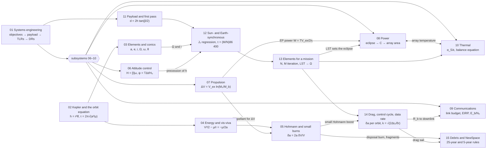

# SESA2024 Astronautics Hub

> [!abstract] Module at a glance
> **Design a spacecraft from its payload outward.**
> 1. Systems engineering turns the mission objectives into design requirements (Ch 1, 4).
> 2. Mission analysis finds the orbit and the ΔV (Ch 5): Kepler, vis-viva, Hohmann.
> 3. Each subsystem is sized to serve the payload: attitude (Ch 6), propulsion (Ch 7), power (Ch 8), comms (Ch 9), thermal (Ch 10).
> 4. The Ch 11 **remote-sensing case study** ties it all together: the payload selects a Sun- and Earth-synchronous orbit, and that orbit's eclipse, drag and data rate size everything else.
>
> One thread runs through the module: **the payload selects the orbit, and the orbit sizes the spacecraft.**
>
> Quick reference: [[SESA2024 Formula Sheet]] · Exam guide: [[SESA2024 Past Paper Trend Analysis]] · Memorisation site (facts, numbers, lists, equations, derivations, with a recall mode): [Astronautics Memory Bank](05%20-%20Revision%20Site/index.html)

## Coverage

The module has 15 topic notes, 37 concept notes, 7 workbook solution notes and 12 past-paper solution notes (plus the trend analysis and the legacy key-answer index). Thirteen topic notes (01–13) are `lectured`. Two are `written-ahead`: [[SESA2024 14 - Orbit Control, Drag and Payload Data Rate|14]], because the 2025-26 lectures stopped at the orbital elements (2025-12-11) and orbit control was never lectured, so the note follows the workbook's Chapter 11B solutions and the past papers; and [[SESA2024 15 - Space Sustainability, Debris and NewSpace|15]], because Dr Vaidya's two lectures were not recorded, so the note follows the two slide decks. The notes were rebuilt from the 2025-26 lecture transcripts on 30 Oct 2026. The lectures ran in this order: introduction (30 Sep), Ch 1 (2 Oct), Ch 6 (7–16 Oct), Ch 7 (16 Oct plus pre-recording), Ch 5 Kepler and elements (21–30 Oct), sustainability and NewSpace (Dr Vaidya, weeks 5–6, not recorded), Ch 8 (11 Nov; the 13 Nov recording is silent), Ch 9 (18–20 Nov), Ch 10 and Ch 4 (20–25 Nov), Ch 5 energy and Hohmann (27 Nov, 2 Dec), Ch 11 (4–11 Dec), revision (6 Jan). Prof Lewis's 2020 recordings fill the steps the 2025 lectures skipped. Note [[SESA2024 08 - Electrical Power Subsystem|08]] is lectured, but its battery and array sizing rests on the slides because the 13 Nov recording is silent. The full mapping is in [[SESA2024 Transcript Index]].

On 5 Nov 2026 all fifteen notes were deepened to the current standard: every derivation written out one step per line (thrust and rocket equation, eclipse geometry, battery and array sizing, link budget in dB, EP optimum condition, orbit-control parabola and boost, disposal burn), every worked example substituted with real numbers and rechecked in Python, numerical-check callouts added, inline source problems moved to each note's slips section, nine figures added and four regenerated in the shared style. Note 05 §4 adds the small-burn analysis ($\delta a=2a\,\delta V/V$) that ties RemoveDebris, drag make-up (note 14) and fragment clouds (note 15) together. On 10 Nov 2026 note 12 gained an outline derivation of the $J_2$ regression rate, and the [[SESA2024 Formula Sheet]] was rebuilt in note order, one section per topic note.

## Concept map



Two chains carry most of the exam. The orbital-mechanics chain runs 02 → 04 → 05 with 07 supplying the propellant. The remote-sensing chain runs 11 → 12 → 13 → 14 and then reaches back into power (eclipse), thermal and communications (data rate), which is the module's thread: the payload selects the orbit, and the orbit sizes the spacecraft.

## Topic map

### Systems (Dr C. Ryan, Dr H. Sykulska-Lawrence)
1. [[SESA2024 01 - Systems Engineering and Spacecraft Design]]: subsystems; objectives → payload → TLRs → DRs; ECSS phases 0–F; trade-offs; Ulysses and Starlink; payload impact (Ch 4); Planet's agile development

### Mission analysis: Chapter 5 (Dr C. Ryan, after Prof H. Lewis)
2. [[SESA2024 02 - Kepler's Laws and the Orbit Equation]]: polar ellipse, $a_r$ and $a_\theta$, $h = r^2\dot\theta$, $u''+u = \mu/h^2$, $\tau = 2\pi\sqrt{a^3/\mu}$
3. [[SESA2024 03 - Orbital Elements and Conic Sections]]: $a, e, i, \Omega, \omega, \theta$; orbit categories; conics
4. [[SESA2024 04 - Orbital Energy and the Vis-Viva Equation]]: $\varepsilon = -\mu/2a$; the 200 × 40 000 km example
5. [[SESA2024 05 - Orbital Transfers and the Hohmann Transfer]]: impulsive burns; RemoveDebris; LEO → GEO 3.932 km/s

### Spacecraft subsystems: Chapters 6–10 (Dr H. Sykulska-Lawrence)
6. [[SESA2024 06 - Attitude Control]]: $\mathbf H = [\mathbf I]\boldsymbol\omega$; momentum bias; 4 stabilisation types; torquers, sensors, dumping
7. [[SESA2024 07 - Spacecraft Propulsion]]: thrust, $I_{sp}$, rocket equation; chemical systems; EP optimisation (Pluto)
8. [[SESA2024 08 - Electrical Power Subsystem]]: sources; solar cells; batteries; eclipse → $C$ → array area
9. [[SESA2024 09 - Communications]]: dB, bands, PSK; $G$ and $\theta_{3dB}$; link budget; EIRP and $G/T$; BER
10. [[SESA2024 10 - Thermal Control]]: blackbody, $\alpha$ and $\varepsilon$; thermal balance; $\alpha_S/\varepsilon$; passive vs active

### Remote-sensing case study: Chapter 11 (Dr C. Ryan)
11. [[SESA2024 11 - Payload and Orbit Selection]]: first pass (near-polar, circular, 700–900 km); push-broom; illumination and view needs
12. [[SESA2024 12 - Sun- and Earth-Synchronous Orbits]]: $J_2$ regression (outline derivation), $i\approx98^\circ$; $\tau = (M/N)\times86\,400$ s
13. [[SESA2024 13 - Calculating Orbital Elements for a Remote Sensing Mission]]: the $N, M$ iteration; the lecture's (98,7) is really (14,1), so (99,7) at 845 km; LST → RAAN → eclipse
14. [[SESA2024 14 - Orbit Control, Drag and Payload Data Rate]] (written-ahead): δa, δτ, $k$, Hohmann make-up; data rate and compression

### Sustainability and NewSpace (Dr N. Vaidya)
15. [[SESA2024 15 - Space Sustainability, Debris and NewSpace]] (written-ahead): SDGs, debris, IADC/UN/FCC rules, disposal, ADR, SBSP, NewSpace trade-offs

## Concept notes
All 37 concept notes in `01 - Notes/Concepts`, grouped by the topic notes that use them; the three SESA2023 notes are shared from Propulsion.

| Systems and orbits (01–05) | Attitude and propulsion (06–07) | Power and communications (08–09) | Thermal, remote sensing and debris (10–15) |
|---|---|---|---|
| [[Systems Engineering Design Phases]] | [[Inertia Matrix]] | [[Spacecraft Power Sources]] | [[Blackbody Radiation]] |
| [[Spacecraft Subsystems]] | [[Momentum Bias and Gyroscopic Rigidity]] | [[Solar Cells and Arrays]] | [[Absorptance and Emittance]] |
| [[Agile Aerospace]] | [[Spacecraft Stabilisation Types]] | [[Battery Sizing]] | [[Spacecraft Thermal Balance Equation]] |
| [[Kepler's Laws]] | [[Reaction Wheels and Momentum Dumping]] | [[Eclipse Duration]] | [[Passive vs Active Thermal Control]] |
| [[Orbit Equation and Conic Sections]] | [[Attitude Sensors and Torquers]] | [[Decibels]] | [[Swath Width and Push-Broom Imaging]] |
| [[Orbital Angular Momentum]] | [[Chemical Propulsion Systems]] | [[Antenna Gain and Beamwidth]] | [[Sun-Synchronous Orbit]] |
| [[Keplerian Orbital Elements]] | [[Electric Propulsion Sizing]] | [[Link Budget Equation]] | [[Nodal Regression (J2)]] |
| [[Vis-Viva Equation]] | [[Tsiolkovsky Rocket Equation]] (SESA2023) | [[EIRP and G-T]] | [[Repeat Ground Track]] |
| [[Hohmann Transfer]] | [[Thrust Equation]] (SESA2023) | [[Bit Error Rate and Eb-N0]] | [[Local Solar Time and RAAN]] |
| | [[Rocket Performance Parameters]] (SESA2023) | | [[Orbit Control Cycle]] |
| | | | [[Payload Data Rate]] |
| | | | [[Space Debris Mitigation]] |

## Workbook solutions (Problem Sheet Workbook 2025-26)
| Chapter | Note | Highlights |
|---|---|---|
| 5 Mission analysis | [[SESA2024 Workbook Ch5 - Mission Analysis Solutions]] | $\varepsilon = -\mu/2a$ proof; missile vs satellite; 300 km → GEO 600 kg; comet intercept 4.55 km/s, 340 d |
| 6 Attitude control | [[SESA2024 Workbook Ch6 - Attitude Control Solutions]] | 12 Q&As; GEO telescope ACS design |
| 7 Propulsion | [[SESA2024 Workbook Ch7 - Propulsion Solutions]] | EP power at 50 mN; **Pluto EP orbiter** |
| 8 Power | [[SESA2024 Workbook Ch8 - Power Solutions]] | GEO 8 kW: 841 A·h, 771 kg, 84 m² |
| 9 Communications | [[SESA2024 Workbook Ch9 - Communications Solutions]] | band table; GEO global beam 0.83 m; **Pluto link** 3483 bps |
| 10 Thermal | [[SESA2024 Workbook Ch10 - Thermal Control Solutions]] | array at 18 000 km: 49 / 46 / 44 °C (= exam 2022/23 B2) |
| 11B Case study | [[SESA2024 Workbook Ch11B - Remote Sensing Case Study Solutions]] | the Excel iteration transcribed: civil (89,6) and military (1999,125); ⚠ bytes/bits slip in the handwritten version |

> [!note] There are no workbook questions for Chapters 1 and 4 (the lectures carry them). The contents page lists an "11A worksheet": that is the civilian/military mission pair on p. 57, solved in the 11B note. The Blackboard **Excel visualisation tools** (orbit, ΔV, Hohmann, ground track) are not in the vault. The workbook's Excel-based 11B solutions are transcribed in full in the 11B note.

## Past papers
| Year | Solutions | Section B themes |
|---|---|---|
| 2024/25 | [[SESA2024 2024-25 Exam Solutions]] | asteroid deflection · GPS link · CO₂ SSO + thermal |
| 2023/24 | [[SESA2024 2023-24 Exam Solutions]] | Starship IFT-2 · C-band + GEO battery · Jupiter SSO |
| 2022/23 | [[SESA2024 2022-23 Exam Solutions]] | OMOTENASHI · array thermal + L-band · Starlink |
| 2021/22 | [[SESA2024 2021-22 Exam Solutions]] | Apollo 9 · Meteosat · Mars relay SSO |
| 2020/21 | [[SESA2024 2020-21 Exam Solutions]] | 24-h single reference mission: SSO (143,10) → drag, ACS, power, comms, thermal |
| 2019/20 | [[SESA2024 2019-20 Exam Solutions]] | GEO radius + corridor · SSO array thermal/power · drag sail + hyperspectral |
| 2018/19 | [[SESA2024 2018-19 Exam Solutions]] | Kepler 2 + GTO kick · 900 km power · SSO FOV 28° |
| 2017/18 | [[SESA2024 2017-18 Exam Solutions]] | Hohmann to Saturn · dish trade + Voyager · SSO 31-day + drag |
| 2016/17 | [[SESA2024 2016-17 Exam Solutions]] | Ariane 5 → apogee raise · GEO cube radiators · SSO 38-day + charging |
| 2015/16 | [[SESA2024 2015-16 Exam Solutions]] | Kepler + GEO Hohmann · Phobos link · SSO 33-day + control cycle |
| 2014/15 | [[SESA2024 2014-15 Exam Solutions]] | launcher ΔV + Ariane 5 · ISS power · SSO 30-day + launch azimuth |
| 2013/14 | [[SESA2024 2013-14 Exam Solutions]] | orbits + debris intercept · GEO spinner thermal · hyperspectral SSO |
| All legacy | [[SESA2024 Legacy Papers 2013-2021 Key Answers]] | quick-check index of headline numbers |

The 2022/23 paper is filed as `SESA2024-202425-01-SESA2024.pdf`; the 2024/25 paper is the `W1` file ([[SESA2024 Past Paper Trend Analysis]]).

- [[SESA2024 Cambridge Part IIA Practice]]: third-year Cambridge questions (Part IIA) that revise this module, listed under each topic note.

## Exam skills

The paper has Section A (25 marks, 7–10 short compulsory questions) and Section B (answer two of three 30-mark case studies); since 2021/22 it has been online and open-book, with marks only for shown working. Every recent paper has one orbital-mechanics B question, one on communications, power or thermal, and one remote-sensing Sun-synchronous question ([[SESA2024 Past Paper Trend Analysis]]). The skills below are the ones the papers and the workbook keep asking for, in order of frequency.

| Skill | Where it is taught and practised |
|---|---|
| Sun-synchronous inclination from $a$; $\tau=(M/N)86\,400$ s and the altitude for a repeat (12 of 12 papers) | [[SESA2024 12 - Sun- and Earth-Synchronous Orbits#Sixteen orbits a day (2024/25 A6)\|12: 16 orbits a day]] · [[SESA2024 12 - Sun- and Earth-Synchronous Orbits#Inclination for 700 to 900 km\|12: 700–900 km]] |
| Swath → $N$, $M$ (coprime) → $\tau$ → $a$, $h$, $i$ → LST and RAAN; ground-track sketch | [[SESA2024 13 - Calculating Orbital Elements for a Remote Sensing Mission#The 28.96 degree imager\|13: 28.96° imager]] · [[SESA2024 13 - Calculating Orbital Elements for a Remote Sensing Mission#3. The remaining elements\|13: LST → Ω]] · [[SESA2024 Workbook Ch11B - Remote Sensing Case Study Solutions]] |
| First-pass $i$, $e$, $a$ for a remote-sensing mission, and why it must be Sun- and Earth-synchronous | [[SESA2024 11 - Payload and Orbit Selection#3. The first pass for a 10 m imager\|11: first pass]] |
| Vis-viva storylines: $a$ and $e$ from one state, $\theta$ from $r$, satellite or missile, ΔV at a common point | [[SESA2024 04 - Orbital Energy and the Vis-Viva Equation#5. Identifying an orbit from one measurement\|04: one measurement]] · [[SESA2024 04 - Orbital Energy and the Vis-Viva Equation#The 200 km circle and the 200 by 40 000 km ellipse\|04: 200 × 40 000 km]] · [[SESA2024 Workbook Ch5 - Mission Analysis Solutions]] |
| Hohmann ΔV and time; small boosts and the relative motion after a small burn | [[SESA2024 05 - Orbital Transfers and the Hohmann Transfer#200 km parking orbit to GEO\|05: LEO → GEO]] · [[SESA2024 05 - Orbital Transfers and the Hohmann Transfer#4. How far a small burn moves the orbit\|05: small burn]] |
| Periods, $a$ from a period, apsis radii and elements of real orbits | [[SESA2024 02 - Kepler's Laws and the Orbit Equation#Geostationary radius from the sidereal day\|02: GEO radius]] · [[SESA2024 03 - Orbital Elements and Conic Sections#Apsis altitudes of QZSS and NEOWISE\|03: QZSS and NEOWISE]] |
| Link budget in dB: EIRP, transmitter power, global-coverage dish, data rate from $E_b/N_0$, power–gain trade | [[SESA2024 09 - Communications#GEO TV broadcast satellite\|09: GEO TV]] · [[SESA2024 09 - Communications#Voyager at Saturn (2017/18 B3)\|09: Voyager]] · [[SESA2024 Workbook Ch9 - Communications Solutions]] |
| Thermal balance at noon, terminator and eclipse; choose a finish for a temperature window | [[SESA2024 10 - Thermal Control#A painted sphere in low Earth orbit\|10: painted sphere]] · [[SESA2024 Workbook Ch10 - Thermal Control Solutions]] |
| Rocket equation and $I_{sp}$; EP power and the EP optimisation curve | [[SESA2024 07 - Spacecraft Propulsion#Power for a 50 mN thruster\|07: 50 mN thruster]] · [[SESA2024 07 - Spacecraft Propulsion#Pluto orbiter by electric propulsion\|07: Pluto orbiter]] · [[SESA2024 Workbook Ch7 - Propulsion Solutions]] |
| Worst-case eclipse, battery capacity and mass, array area | [[SESA2024 08 - Electrical Power Subsystem#800 km LEO spacecraft, 1 kW for two years\|08: 800 km, 1 kW]] · [[SESA2024 Workbook Ch8 - Power Solutions]] |
| Drag decay, the orbit-control cycle $k$, make-up ΔV and propellant; push-broom data rate and compression | [[SESA2024 14 - Orbit Control, Drag and Payload Data Rate#The workbook civilian imager at 619 km\|14: 619 km imager]] |
| Stabilisation type from an inertia matrix; momentum bias, dumping, torquers and sensors (Section A) | [[SESA2024 06 - Attitude Control#Inertia matrix from the 2024/25 paper\|06: 2024/25 A4]] · [[SESA2024 06 - Attitude Control#4. The four stabilisation types\|06: four types]] · [[SESA2024 Workbook Ch6 - Attitude Control Solutions]] |
| Fragment-cloud reasoning, disposal ΔV, mitigation rules (Section A) | [[SESA2024 15 - Space Sustainability, Debris and NewSpace#Fragments from a 570 km break-up (2022/23 A6)\|15: 570 km break-up]] · [[SESA2024 15 - Space Sustainability, Debris and NewSpace#A disposal burn from 800 km\|15: disposal burn]] |
| Systems-engineering steps, ECSS phases, payload-driven trade-offs (Section A) | [[SESA2024 01 - Systems Engineering and Spacecraft Design#5. Design phases (ECSS)\|01: ECSS phases]] · [[SESA2024 01 - Systems Engineering and Spacecraft Design#6. Ulysses: a trajectory that decided the power system\|01: Ulysses]] |

Section A also gives free marks for the LST of the two nodes (12 h apart and constant from pass to pass) and for the eclipse temperature being independent of $\varepsilon$ ([[SESA2024 10 - Thermal Control#4. Dependence of temperature on surface finish|note 10 §4]]).

## Figures
All generated in Python (300 dpi) and stored in `01 - Notes/Figures/`. The generator scripts there (`generate_ast_ch1_systems_figures.py`, `generate_ast_ch4_energy_figures.py`, `generate_ast_ch5_kepler_figures.py`, `generate_ast_ch5_elements_figures.py`, `generate_ast_ch5_transfer_figures.py`, `generate_ast_ch6_attitude_figures.py`, `generate_ast_ch8_power_figures.py`, `generate_ast_ch9_comms_figures.py`, `generate_ast_ch11_payload_figures.py`, `generate_ast_ch12_sso_figures.py`, `generate_ast_ch14_control_figures.py`, `generate_ast_ch15_debris_figures.py`, `generate_ast_extra_figures.py`) all import `Year 3/_shared/year3_style.py`:
- systems: `ast_initial_study_logic`, `ast_ecss_phases`;
- orbits and transfers: `ast_ellipse_polar_geometry`, `ast_radial_transverse_axes`, `ast_kepler_equal_areas`, `ast_conic_sections`, `ast_orbital_elements_3d`, `ast_polar_orbit_omega`, `ast_visviva_speed`, `ast_energy_exchange`, `ast_hohmann_leo_geo`, `ast_hohmann_dv_ratio`, `ast_removedebris_relative_motion`;
- propulsion and ACS: `ast_rocket_equation`, `ast_ep_optimisation`, `ast_acs_loop`, `ast_gyroscopic_rigidity`, `ast_wheel_momentum_elliptic`, `ast_momentum_dumping`;
- power, comms and thermal: `ast_solar_cell_iv`, `ast_eclipse_geometry`, `ast_eclipse_vs_altitude`, `ast_antenna_gain_beamwidth`, `ast_ber_psk`, `ast_link_budget_geo_tv`, `ast_link_budget_pluto`, `ast_thermal_alpha_eps`, `ast_array_temperature_profile`;
- remote sensing: `ast_swath_geometry`, `ast_sso_inclination`, `ast_repeat_groundtrack_solutions`, `ast_sso_ground_track`, `ast_orbit_control_cycle`, `ast_lst_orbit_planes`;
- debris: `ast_gabbard_570km`;
- past papers: `ast_2021_ground_track` (2020/21 Q2(iv)).

Four older PNGs still have no generator script in the folder: `ast_ber_psk`, `ast_link_budget_pluto`, `ast_array_temperature_profile` and `ast_sso_ground_track`; they predate the shared style and should be regenerated when next edited.

## All notes
```dataview
TABLE type, status, file.mtime AS "Updated"
FROM "Year 2/SESA2024 Astronautics"
WHERE type
SORT type ASC, file.name ASC
```

## Builds on / feeds into
- **From** SESA1015 (Intro to Aero and Astro): basic orbits and the rocket equation.
- **From** [[FEEG1002 Mechanics, Materials and Structures Hub]] (Year 1 Dynamics):
  - central-force angular momentum and the perigee/apogee energy problem: [[FEEG1002 D5 - Angular Impulse and Momentum]];
  - $-GMm/r$ potential energy: [[FEEG1002 D3 - Work, Energy and Power]];
  - mass moment of inertia: [[FEEG1002 D8 - Kinetics of Rigid Bodies]].
- **From** [[FEEG1004 Electronics Hub]] (Year 1 Electrical and Electronic Systems):
  - p-n junctions (solar cells), regulators and rectifiers for the power subsystem: [[FEEG1004 B1 - Semiconductors and Diodes]], [[FEEG1004 B2 - Diode Circuits - Rectifiers, Regulators, Limiters and Clamps]];
  - $F = BIL$ and $T = K_Ti$ behind magnetorquers and reaction wheels: [[FEEG1004 A2 - Magnetism, Induction and the Lorentz Force]], [[FEEG1004 C5 - DC Motors - Torque, Back EMF and Efficiency]];
  - decibels in link budgets: [[FEEG1004 D3 - AC Filters and Bode Plots]].
- **From** [[SESA1016 Thermofluids Hub]]: [[SESA1016 T12 - Conservation of Momentum]] and [[SESA1016 T13 - Conservation of Energy and Propulsion]] provide the control-volume basis for thrust and nozzle energy conversion.
- **Shared with** [[SESA2023 Propulsion Hub]]: [[Tsiolkovsky Rocket Equation]], [[Rocket Staging]], [[Thrust Equation]], nozzle expansion.
- **Shared with** [[SESA2027 Aerospace Mechanics & Control Hub]]: closed-loop control (ACS loop); [[Euler Angles and Rotation Matrices]].
- **From** MATH2048: ODEs ($u''+u = \mu/h^2$), vectors, eigenvalues (principal axes).
- **Into** Year 3: advanced spacecraft design and GDP, astrodynamics and perturbations.

## Sources
- `02 - Sources/Lectures`: 2025-26 slide decks for Chapters 1 and 4–11 in chapter subfolders (25 PDFs, including the pre-recorded and "complete" versions of Chapters 6–9 and the Chapter 5 and 11 worked examples), Dr Vaidya's two decks on sustainability and debris and on the industrialisation of space (note 15), and the Problem Sheet Workbook 2025-26 V1.1
- 35 transcripts in `02 - Sources/Lectures` (2025-26 live lectures, pre-recordings, the two quiz walk-throughs, the Planet Labs guest lecture and Prof Lewis's 2020 Chapter 5 and 11 recordings), mapped in [[SESA2024 Transcript Index]]
- `03 - Exams & Past Papers`: 12 papers, 2013/14–2024/25, one per year (the 2022/23 paper is the file named `SESA2024-202425-01-SESA2024.pdf`)
- Fortescue, Stark & Swinerd, *Spacecraft Systems Engineering* (4th ed.), Wiley. The course textbook.
