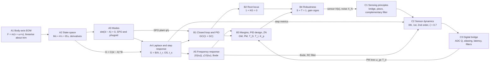

# SESA2027 Aerospace Mechanics & Control Hub

> [!abstract] Module at a glance
> Part A models the aircraft: body-axis equations of motion, the longitudinal state-space model and its aerodynamic derivatives, the short-period and phugoid modes, then Laplace transforms and Bode plots for its response. Part B controls it: feedback and PID, root locus, frequency-response design with margins and Ziegler–Nichols, and robustness. Part C measures it: sensing principles and fusion, sensor dynamics, then the conditioning, digitisation and filtering between sensor and flight computer.
>
> One idea runs through all three parts. The aircraft, the controller, the sensor, the filter and the delay are each a dynamic system with poles, a step response and a Bode plot, and the closed loop inherits all of them.
>
> Quick reference: [[SESA2027 Formula Sheet]] · practice: [[SESA2027 Mock Questions]]

## Current coverage

All twelve topic notes are at status `lectured`. The module was delivered in 2025/26 and every lecture took place; where a recording survives, its transcript sets the scope and supplies the line references, and where it does not, the note follows the slides. Line references cite the recording file (for example L2.05, l. 412). Promote a note to `revised` or `exam-ready` yourself once it has been worked through.

| Topic | Status | Recordings used | From the slides only |
|---|---|---|---|
| [[SESA2027 A1 - Dynamic Systems and Aircraft Equations of Motion\|A1]] | lectured | L1.01, L1.02, L1.03 | none |
| [[SESA2027 A2 - Longitudinal State-Space Model and Aerodynamic Derivatives\|A2]] | lectured | L1.04, L1.10, L1.11 | none |
| [[SESA2027 A3 - Longitudinal Dynamic Modes - SPO and Phugoid\|A3]] | lectured | L1.05, L1.06 | none |
| [[SESA2027 A4 - Laplace Transforms, Transfer Functions and Step Response\|A4]] | lectured | L1.07 | none |
| [[SESA2027 A5 - Frequency Response and Bode Plots\|A5]] | lectured | L1.08, L1.09 | none |
| [[SESA2027 B1 - Control System Fundamentals and PID Control\|B1]] | lectured | L2.01, L2.02, L2.03 | none |
| [[SESA2027 B2 - Root Locus Method\|B2]] | lectured | L2.04 | none |
| [[SESA2027 B3 - Frequency-Response PID Design and Ziegler-Nichols Tuning\|B3]] | lectured | L2.05 (delivered from an uncorrected deck), L2.06 | none; the corrected L2.05 slides are followed |
| [[SESA2027 B4 - Robustness, Stability vs Manoeuvrability and Design Process\|B4]] | lectured | L2.07, L2.08, L2.09 | none |
| [[SESA2027 C1 - Sensing Systems, Sensor Principles and Sensor Fusion\|C1]] | lectured | L3.02–3.03 | L3.01 (§§1–3) |
| [[SESA2027 C2 - Sensor Characteristics, Dynamics and Design\|C2]] | lectured | L3.04, L3.05 | L3.06 (§3) |
| [[SESA2027 C3 - Signal Conditioning, Digitisation and Digital Filtering\|C3]] | lectured | none | L3.07, L3.08 (all) |

Counts in `01 - Notes` today: 12 topic notes, 31 concept notes, 4 tutorial notes (three problem-sheet solutions and the mock questions), 13 figure scripts.

## Concept map



## Topic map

### Part A: Dynamic Systems (Dr S. Araujo-Estrada, L1.01–1.11)
1. [[SESA2027 A1 - Dynamic Systems and Aircraft Equations of Motion]]: DAP1–3, 6-DoF body-axis EOM, Euler angles, small-perturbation decoupling
2. [[SESA2027 A2 - Longitudinal State-Space Model and Aerodynamic Derivatives]]: $\mathbf M\dot{\mathbf x} = \mathbf A'\mathbf x+\mathbf B'\mathbf u$, dimensional and dimensionless derivatives, elevator $\mathbf B$, $G = \mathbf C(s\mathbf I-\mathbf A)^{-1}\mathbf B$
3. [[SESA2027 A3 - Longitudinal Dynamic Modes - SPO and Phugoid]]: stability quartic, Routh, $\omega_n$, $\zeta$, SPO approximation, F-4C
4. [[SESA2027 A4 - Laplace Transforms, Transfer Functions and Step Response]]: poles and zeros, partial fractions, $t_r$, OS, $t_s$
5. [[SESA2027 A5 - Frequency Response and Bode Plots]]: $G(i\omega)$, Bode construction from factors, resonance and bandwidth

### Part B: Control Systems (L2.01–2.09)
6. [[SESA2027 B1 - Control System Fundamentals and PID Control]]: objectives, closed loop with noise and disturbance, P/I/D actions
7. [[SESA2027 B2 - Root Locus Method]]: six construction steps, double-integrator and SPO pitch-rate examples
8. [[SESA2027 B3 - Frequency-Response PID Design and Ziegler-Nichols Tuning]]: GM/PM, eight-step design, ZN; follow the corrected L2.05 slides ([[SESA2027 B3 - Frequency-Response PID Design and Ziegler-Nichols Tuning#L2.05 as delivered versus the corrected slides|the comparison]])
9. [[SESA2027 B4 - Robustness, Stability vs Manoeuvrability and Design Process]]: sign rules, three closed-loop TFs, handling qualities, design process

### Part C: Sensing Systems (Prof A. Cammarano, L3.01–3.08)
10. [[SESA2027 C1 - Sensing Systems, Sensor Principles and Sensor Fusion]]: measurement chain, resistive, capacitive, inductive, thermoelectric and piezoelectric sensing, IMU fusion
11. [[SESA2027 C2 - Sensor Characteristics, Dynamics and Design]]: accuracy and precision, noise, 0th/1st/2nd-order sensors, $\zeta\approx0.7$, RC filter
12. [[SESA2027 C3 - Signal Conditioning, Digitisation and Digital Filtering]]: range mapping, ADC, loading, Nyquist and aliasing, latency, digital filters

## Concept notes

| Part A: modelling | Part A: response | Part B: control | Part C: sensing |
|---|---|---|---|
| [[Design and Analysis Principles]] | [[Laplace Transform]] | [[Closed-Loop Transfer Function]] | [[Measurement Chain]] |
| [[Euler Angles and Rotation Matrices]] | [[Transfer Function]] | [[PID Controller]] | [[Accuracy and Precision]] |
| [[Small Perturbation Linearisation]] | [[Poles and Zeros]] | [[Root Locus]] | [[Wheatstone Bridge and Strain Gauges]] |
| [[State-Space Representation]] | [[Step Response Specifications]] | [[Gain and Phase Margins]] | [[Complementary Filter]] |
| [[Aerodynamic Stability Derivatives]] | [[Frequency Response Function]] | [[Ziegler-Nichols Tuning]] | [[Sensor Dynamic Models]] |
| [[Characteristic Equation and Eigenvalues]] | [[Bode Plot]] | [[Stability vs Manoeuvrability]] | [[ADC Quantisation and Resolution]] |
| [[Damping Ratio and Natural Frequency]] | | | [[Loading Effect and Buffering]] |
| [[Routh-Hurwitz Stability Criterion]] | | | [[Nyquist Sampling and Aliasing]] |
| [[Short Period Oscillation]] | | | [[Digital Filtering]] |
| [[Phugoid Mode]] | | | |

Shared with SESA2022: [[Neutral Point and Static Margin]] (pitch stiffness $M_w = -H_sC_{L^*_\alpha}$).

## Exam skills

No SESA2027 papers are filed, so these skills come from the two practice-problem sheets, the Part C problem sheet, the self-written mock questions and the question types flagged as possible exam or quiz material, with line references in each note's Exam scope section (listed under the table). Each row links to the worked example that teaches it.

| Skill | Where it is practised |
|---|---|
| Rotate a vector between Earth and body axes; gravity components; say which terms survive linearisation | [[SESA2027 A1 - Dynamic Systems and Aircraft Equations of Motion#Worked example: gravity and velocity in body axes\|A1 example]] · [[SESA2027 Mock Questions#Q1. Body axes, rotation and linearisation\|Mock Q1]] |
| Gravity perturbation terms; convert a dimensionless derivative to dimensional form with units; name the negligible derivatives | [[SESA2027 A2 - Longitudinal State-Space Model and Aerodynamic Derivatives#Dimensional vs dimensionless derivatives\|A2 F-4C conversions]] · [[SESA2027 Mock Questions#Q2. Gravity and derivatives in the longitudinal model\|Mock Q2]] |
| Elevator derivatives from tail data, and their signs | [[SESA2027 A2 - Longitudinal State-Space Model and Aerodynamic Derivatives#Elevator derivatives\|A2]] · [[SESA2027 Practice Problems 2 Solutions#Q2: Elevator derivatives\|PS2 Q2]] |
| $\mathbf C(s\mathbf I-\mathbf A)^{-1}\mathbf B$ for a 2×2 system, then standard form | [[SESA2027 A2 - Longitudinal State-Space Model and Aerodynamic Derivatives#Worked example: SPO state space to transfer function (PS2 Q3)\|A2 example]] · [[SESA2027 Practice Problems 2 Solutions#Q3: State space to transfer function\|PS2 Q3]] |
| Factorised quartic to roots, stability, $T$, $t_{1/2}$ or $t_2$, $\omega_n$, $\zeta$; identify SPO and phugoid; s-plane sketch | [[SESA2027 A3 - Longitudinal Dynamic Modes - SPO and Phugoid#Worked numerical example\|A3 quartic]] · [[SESA2027 A3 - Longitudinal Dynamic Modes - SPO and Phugoid#Worked example: an unstable oscillatory mode\|A3 unstable mode]] · [[SESA2027 Mock Questions#Q3. Modes from a factorised quartic\|Mock Q3]] · [[SESA2027 Practice Problems 1 Solutions\|PS1 Q1]] |
| SPO approximation from dimensional derivatives: $\omega_n$, $\zeta$, eigenvalues | [[SESA2027 A3 - Longitudinal Dynamic Modes - SPO and Phugoid#5. The SPO approximation\|A3 §5]] · [[SESA2027 Practice Problems 1 Solutions#Q2: SPO approximation for the given aircraft\|PS1 Q2]] |
| $t_r$, $OS$ (with the square root), $t_p$, $t_s$ (1 %), final value, sketch | [[SESA2027 A4 - Laplace Transforms, Transfer Functions and Step Response#Worked example: PS1 Q3 specifications from first principles\|A4 example]] · [[SESA2027 Mock Questions#Q4. Step response of a second-order system\|Mock Q4]] · [[SESA2027 Practice Problems 1 Solutions#Q3: Transfer function and step response\|PS1 Q3]] |
| $\lvert G(i\omega)\rvert$ and $\angle G(i\omega)$ at given frequencies; Bode sketch from factors; attenuation read off a plot; pole–zero map stable and physical | [[SESA2027 A5 - Frequency Response and Bode Plots#Five-step method (SPO example)\|A5 method]] · [[SESA2027 A5 - Frequency Response and Bode Plots#4. Building a Bode plot from factors\|A5 factors]] · [[SESA2027 Mock Questions#Q5. Bode magnitude and phase\|Mock Q5]] · [[SESA2027 Practice Problems 1 Solutions#Q4: Frequency response\|PS1 Q4]] · [[SESA2027 Practice Problems 2 Solutions\|PS2 Q1]] |
| Closed-loop TF and characteristic polynomial; effect of P, I and D; steady-state error; cons of model-based and rule-based control | [[SESA2027 B1 - Control System Fundamentals and PID Control#Worked example: P leaves an error, PI removes it\|B1 example]] · [[SESA2027 Mock Questions#Q6. Closed loop and PID actions\|Mock Q6]] · [[SESA2027 Practice Problems 2 Solutions#Q4: Control objectives and P control\|PS2 Q4]] · [[SESA2027 Practice Problems 2 Solutions#Q5: PID actions\|PS2 Q5]] |
| Root-locus sketch to the marking checklist; break-in point; stable gain range; P against PD on $1/s^2$ | [[SESA2027 B2 - Root Locus Method#Worked example: three poles, three asymptotes\|B2 three poles]] · [[SESA2027 B2 - Root Locus Method#4. Worked example: SPO pitch-rate with a P controller\|B2 SPO]] · [[SESA2027 B2 - Root Locus Method#2. Double-integrator examples\|B2 double integrator]] · [[SESA2027 Mock Questions#Q7. Root locus sketch and stable gain range\|Mock Q7]] · [[SESA2027 Practice Problems 2 Solutions\|PS2 Q6]] |
| GM and PM read off a Bode plot; PD/PID design to a PM target; ZN tables; comparing tuning methods | [[SESA2027 B3 - Frequency-Response PID Design and Ziegler-Nichols Tuning#3. Eight-step frequency-response design\|B3 design]] · [[SESA2027 B3 - Frequency-Response PID Design and Ziegler-Nichols Tuning#Ziegler–Nichols: ultimate sensitivity method\|B3 ZN]] · [[SESA2027 Mock Questions#Q8. Margins and PD design\|Mock Q8]] · [[SESA2027 Practice Problems 2 Solutions#Q7: Frequency-response PD design\|PS2 Q7]] · [[SESA2027 Practice Problems 2 Solutions#Q8: Ziegler–Nichols ultimate-sensitivity tuning\|PS2 Q8]] |
| Allowed gain signs; robustness of the closed-loop quadratic to parameter errors; reference, disturbance and noise TFs; stability against manoeuvrability | [[SESA2027 B4 - Robustness, Stability vs Manoeuvrability and Design Process#Worked example: how much model error can a design take?\|B4 example]] · [[SESA2027 B4 - Robustness, Stability vs Manoeuvrability and Design Process#3. The three closed-loop transfer functions\|B4 §3]] · [[SESA2027 Mock Questions#Q9. Robustness and the three closed-loop transfer functions\|Mock Q9]] |
| Strain or voltage from a quarter, half or full bridge; choosing a sensing principle; complementary-filter update and bias bound | [[SESA2027 C1 - Sensing Systems, Sensor Principles and Sensor Fusion#Worked example: strain from bridge voltages\|C1 example]] · [[SESA2027 Mock Questions#Q10. Strain gauge bridge and complementary filter\|Mock Q10]] · [[SESA2027 Part C Problem Sheet Solutions#Q2: Quarter-bridge strain gauge\|Part C Q2]] · [[SESA2027 Part C Problem Sheet Solutions#Q13: Complementary filter for pitch\|Q13]] |
| Sensor order, step metrics and reading at a frequency; damping choice; RC cut-off and dB; accuracy against precision | [[SESA2027 C2 - Sensor Characteristics, Dynamics and Design#Worked example: choosing an accelerometer\|C2 example]] · [[SESA2027 Mock Questions#Q11. Second-order sensor design\|Mock Q11]] · [[SESA2027 Part C Problem Sheet Solutions\|Part C Q4–Q6]] |
| Range mapping and clipping, ADC $Q$, loading, alias frequency, anti-alias RC, PM lost to latency, filter delay, derivative noise, bias integration | [[SESA2027 C3 - Signal Conditioning, Digitisation and Digital Filtering#9. Worked example: one channel from sensor to number\|C3 example]] · [[SESA2027 Mock Questions#Q12. Range mapping, ADC and aliasing\|Mock Q12]] · [[SESA2027 Part C Problem Sheet Solutions#Q7: Scaling, offsetting and clipping\|Part C Q7]] · [[SESA2027 Part C Problem Sheet Solutions#Q10: Sampling and aliasing\|Q10]] |

> [!info] Stated exam and quiz scope
> Stated as possible questions:
> - stability from the sign of the real part; Routh–Hurwitz stated in words, without the formula for $R$ ([[SESA2027 A3 - Longitudinal Dynamic Modes - SPO and Phugoid|A3]]);
> - factorised quartic to roots, $t_{1/2}$ or $t_2$, $T$ and a complex-plane sketch; $\zeta>0\Leftrightarrow\sigma<0$; SPO against phugoid from the eigenvalues (A3);
> - a dimensionless derivative converted to dimensional form with its units; $\alpha\approx w/U_\infty$ from an eigenvector (A3);
> - the negligible derivatives $\mathring X_q$, $\mathring X_{\dot w}$, $\mathring M_u$ ([[SESA2027 A2 - Longitudinal State-Space Model and Aerodynamic Derivatives|A2]]);
> - final value of a step response ([[SESA2027 A4 - Laplace Transforms, Transfer Functions and Step Response|A4]]);
> - pole–zero map: stable? physical? ([[SESA2027 A5 - Frequency Response and Bode Plots|A5]]); the frequency for a given attenuation read off a Bode plot (A5);
> - cons of model-based and rule-based control ([[SESA2027 B1 - Control System Fundamentals and PID Control|B1]]);
> - effect of P on the $1/s^2$ root locus; the PD locus for another $K_P/K_D$ ratio; the full-marks root-locus sketch ([[SESA2027 B2 - Root Locus Method|B2]]);
> - GM and PM read off a Bode plot (±5 %); infinite phase crossover; tuning methods compared with ZN ([[SESA2027 B3 - Frequency-Response PID Design and Ziegler-Nichols Tuning|B3]]);
> - the transfer function as output over input in $s$, and the frequency response from it ([[SESA2027 C2 - Sensor Characteristics, Dynamics and Design|C2]]).
>
> Not examined: the DAPs as such; deriving the EOM and the linearised moment equations; solving Laplace transforms and partial fractions by hand; the MIMO transfer-function derivation and the $q/\eta$, $\theta/\eta$ derivations; assembling $\mathbf M$ and $\mathbf A'$ from data tables; nonlinear sensor behaviour.
>
> Format: the ZPK form is given for root-locus questions; dB conversion formulas are on the question sheet; the quiz is open book; quiz plants are simplified.

## Problem sheets (full worked solutions)

| Sheet | Covers | Notes |
|---|---|---|
| [[SESA2027 Practice Problems 1 Solutions]] | A3–A5: modes, SPO approximation, step specifications, FRF | ⚠ The sheet's Q3 overshoot (22.4 %) drops a square root; the correct value is 25.4 % |
| [[SESA2027 Practice Problems 2 Solutions]] | A2, A5, B1–B3: Bode, elevator derivatives, SS→TF, P control, root locus, PD design, ZN | No printed answers; all values checked in Python. ⚠ Q3's $(2,1)$ entry $-1.045\times10^{-1}$ is ten times the F-4C value the rest of the matrix comes from; see [[SESA2027 A2 - Longitudinal State-Space Model and Aerodynamic Derivatives#Worked example: SPO state space to transfer function (PS2 Q3)\|A2]] |
| [[SESA2027 Part C Problem Sheet Solutions]] | C1–C3: all 13 questions | 3 s.f. as requested; the sheet also covers the Part C computer lab |
| [[SESA2027 Mock Questions]] | A1–C3: one 10-mark question per topic note | Self-written, not lecturer-set; timed at about 1.8 min per mark |

## Past papers

No SESA2027 papers are filed. The worked lecture examples that carry the most exam weight are the F-4C modes (A3), the SPO pitch-rate root locus (B2), the frequency-response PID design with $K_p = 1.345$ and $T_D = 0.342$ s (B3) and the ZN DC servo (B3).

`03 - Exams & Past Papers/Cambridge/` holds Cambridge Part IB papers: `2P1 Mechanics` (example papers 0–4 and the double pendulum, Tripos 1996–2025) and `2P6 Information Engineering` (example papers 1–9, Tripos 1996–2025). They are filed but not yet mapped to the topic notes. [[SESA2027 Cambridge Part IIA Practice]] lists third-year Cambridge questions (3A6, 3C5, 3F2) under each topic note; their PDFs are filed with the Year 3 modules and the links open them from there.

## Labs, projects and reports

- **Lab 1**: compare your SPO approximation with the full model and experimental data; report $t_r$, $OS$ (%) and $t_s$ (1 %); compare with CS-25/FAR-25 and MIL-F-8785C. Parameter sets (JetStar, Boeing 747, F-4C) are interpolated from historical data over Mach and altitude.
- **Lab 2 (control)**: closed-loop SPO transfer functions; negative $K_p$ is fine; robustness to about ±5 % parameter changes and a gust; cite MIL-F-9490D for margins and Cook Ch. 10 for handling qualities.
- **Lab 3**: measurement-noise simulation; the Part C lab uses the sensor dynamics from C2.
- **Part C lab report**: six pages with guiding questions; a summary and critical assessment of the Jupyter notebooks and what you observed (L3.02–3.03, ll. 607–619).
- **Self-study notebooks**: a Python Jupyter notebook for the A3 eigenvalue calculations (L1.05, l. 442) and Python scripts for the C2 time-domain metrics (L3.05, ll. 605–606).
- **CubeSat/gimbal projects**: rise time and tracking objectives; P alone cannot stabilise a double integrator; sample at about 10× the signal frequency when logging data.
- **Summer**: the Cranfield flight lab demonstrates the SPO and phugoid.

## Sources

- Slides (authoritative), `02 - Sources/Lectures/`: `Lecture 1.01.pdf`–`Lecture 1.11.pdf`, `Lecture 2.01.pdf`–`Lecture 2.08.pdf`, `lecture_2.09.pdf`, `Lecture 3.01.pdf`–`Lecture 3.08.pdf`. `Lecture 2.05.pdf` is the corrected version re-issued on 6 March 2026, the day after the lecture.
- Transcripts (speech-to-text, 2025/26 delivery), same folder: `Lecture 1.01 recording.txt`–`Lecture 1.11 recording.txt`, `Lecture 2.01 recording.txt`–`Lecture 2.09 recording.txt`, `Lecture 3.02-3.03 recording.txt`, `Lecture 3.04 recording.txt`, `Lecture 3.05-3.06 recording.txt`. There is no recording of L3.01, L3.07 or L3.08, and the `3.05-3.06` recording stops at the break, so it covers L3.05 only.
- Problem sheets, `02 - Sources/Problem Sheets/`: `SESA2027 practice problems 1.pdf`, `SESA2027 practice problems 2.pdf`, `Problem Sheet-Part C Questions.pdf`.
- Past papers: Cambridge 2P1 and 2P6 only (see [[#Past papers]]).
- Figures: one generator script per topic note in `01 - Notes/Figures/` (`generate_amc_a1_figures.py` … `generate_amc_c3_figures.py`, plus `generate_amc_extra_figures.py`), using the shared style `Year 3/_shared/year3_style.py`. The older `amc_ps*`, `amc_psc_*` and Part A–C overview PNGs predate these scripts.

## Transcript and slide slips

Each topic note records its slips at the end, with line or slide references. The ones that change a number or a method are: the PS1 Q3 overshoot (22.4 % for 25.4 %); the PS2 Q3 $(2,1)$ entry (ten times the F-4C value); L1.05 slide 14, which divides by the damped frequency instead of $\omega_n$ when finding $\zeta$ (A3); the L1.09 gain slopes spoken as −10 and −20 dB/dec for first and second order (−20 and −40, A5); the curvature-drop rule on L1.02 slide 3 (A1); the L2.05 example as delivered from the uncorrected deck (B3); the L2.06 slide's ZN PID gain $K_p = 1.22$ for $0.6K_u = 2.22$ (B3); the ZN "25 % overshoot" reading of quarter decay (about 50 %, B3); and Levels 1–3 described as pilot-skill levels instead of flying-qualities levels (L2.08, B4).

Corrections made in the notes on 7 Nov 2026, now matched on the formula sheet: the bottom row of $\lambda\mathbf I-\mathbf A$ leaves two cofactors (A3); each zero adds phase lead (A5); a metal gauge factor near 2 is mostly geometry, $1+2\nu\approx1.6$, plus piezoresistance (C1); noise statistics are taken on errors measured from the reference (C2).

## All notes
```dataview
TABLE type, status, file.mtime AS "Updated"
FROM "Year 2/SESA2027 Aerospace Mechanics & Control"
WHERE type
SORT type ASC, file.name ASC
```

## Builds on / feeds into
- From [[FEEG1002 Mechanics, Materials and Structures Hub]] (Year 1 Dynamics):
  - $\sum F = ma$ and rigid-body kinetics: [[FEEG1002 D7 - Kinematics of Rigid Bodies]], [[FEEG1002 D8 - Kinetics of Rigid Bodies]];
  - the mass–spring–damper behind every $\omega_n$, $\zeta$ and FRF here: [[FEEG1002 D6 - Single Degree of Freedom Vibration]].
- From [[FEEG1004 Electronics Hub]] (Year 1 Electrical and Electronic Systems):
  - RC circuits as first-order systems and RC filters as Bode plots: [[FEEG1004 A4 - Capacitors]], [[FEEG1004 D3 - AC Filters and Bode Plots]];
  - negative feedback and op-amp golden rules, the analogue ancestor of the closed loop: [[FEEG1004 B4 - Operational Amplifiers]];
  - the Part C transducers, bridges and conditioning: [[FEEG1004 E1 - Measurement Systems and Temperature Sensors]], [[FEEG1004 E2 - Displacement Sensors - Potentiometric, Capacitive and Inductive]], [[FEEG1004 E3 - Strain Gauges, Bridges, Pressure and Flow Sensors]];
  - actuators: [[FEEG1004 C6 - DC Motor Characteristics and Speed Control]].
- From [[SESA2022 Aerodynamics Hub]]: static stability (T6), which becomes the dynamic derivatives ($M_w$, $M_q$) and lift-curve slopes.
- From MATH2048: ODEs, eigenvalues, Laplace transforms.
- Into [[SESA3047 Advanced Aerospace Mechanics & Control Hub|SESA3047 Advanced Aerospace Mechanics & Control]]: lateral/directional modes, state feedback (LQR), Kalman filtering.
