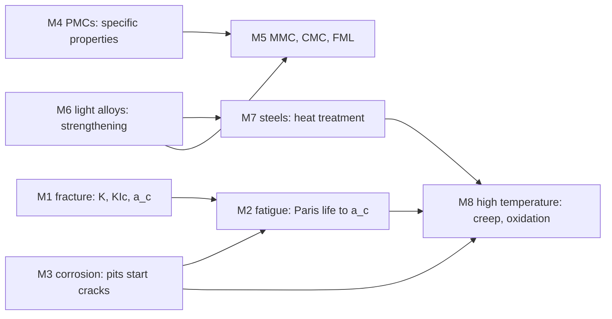

# SESA2028 Aerospace Materials & Structures Hub

SESA2028, examined as FEEG2005, is one design module with two equally weighted toolsets. Structures finds the loads, stresses, deflections and instabilities; materials determines whether the component survives those demands, for how long, and at what mass.

## Coverage and sources

All topic notes were rebuilt on 30 October 2026 from the 2025-26 lecture transcripts, the mini-lecture videos and the slides (status `lectured`; S11 is `draft` because spinning discs were not lectured). The structures lectures ran in a different order from the note numbering: energy methods (S7, S8) from 28 January, unsymmetrical bending (S1) from 25 February, shear (S3) and the structures lab (S2) in early March, torsion (S4) in mid-March, buckling (S5, S6) after Easter, and continuum mechanics and thick cylinders (S9, S10) to 13 May. The materials stream, taught by Prof. Philippa Reed, ran ML1 to ML16 from 27 January to 5 May, each lecture backed by short mini-lectures (ML0a to ML16d) in `02 - Sources/Materials Lectures/mini lecture videos`. The materials notes M1–M8 were rebuilt again on 30–31 October 2026 directly from those 43 mini-lecture transcripts and the dinghy-mast video, with line references, full derivations, recomputed past-paper examples and a transcript-slips table in each. Assessment: 50 % exam, 50 % coursework (quizzes at 3 % each, structures lab 10 %, corrosion lab 5 %, fatigue lab 20 %). The recording-to-note mapping is in [[SESA2028 Transcript Index]].

## Integrated design route

Use this sequence when revising a component rather than treating the two streams as unrelated subjects:

1. Resolve loads and stresses — section properties, bending, shear, torsion and axisymmetric stress.
2. Identify the governing limit state — yielding, buckling, fracture, fatigue, creep, corrosion or wear.
3. Choose material and architecture — alloy class, heat treatment, composite system and manufacturing route.
4. Check life and reserve — critical crack size, Paris law, Miner's rule, creep rupture and safety factors.
5. Improve the design — geometry, stiffness, residual stress, coatings, inspection and damage tolerance.

| Design problem | Structural analysis | Material and life assessment |
|---|---|---|
| Wing, beam or panel | [[SESA2028 S1 - Section Properties and Unsymmetrical Bending]] · [[SESA2028 S2 - Beam Deflection and Bending Design]] · [[SESA2028 S5 - Euler Buckling and Effective Length]] · [[SESA2028 S6 - Imperfect Columns, Beam-Columns and Plate Buckling]] | [[SESA2028 M2 - Fatigue - Fracture Surfaces, Mechanisms and Lifing]] · [[SESA2028 M4 - Polymer Matrix Composites]] · [[SESA2028 M6 - Light Alloys - Aluminium, Magnesium, Beryllium and Titanium]] |
| Thin-walled wing box | [[SESA2028 S3 - Shear Flow and Shear Centre]] · [[SESA2028 S4 - Torsion of Thin-Walled Sections]] | [[SESA2028 M4 - Polymer Matrix Composites]] · [[SESA2028 M5 - Metal and Ceramic Matrix Composites and Hybrid Laminates]] |
| Pressure vessel or shrink fit | [[SESA2028 S9 - Continuum Mechanics in Cylindrical Coordinates]] · [[SESA2028 S10 - Thick Cylinders and Shrink Fits]] | [[SESA2028 M1 - Fracture, Toughness and Fracture Mechanics]] · [[SESA2028 M2 - Fatigue - Fracture Surfaces, Mechanisms and Lifing]] · [[SESA2028 M3 - Corrosion, Wear and Surface Engineering]] |
| Turbine disc or hot rotating component | [[SESA2028 S11 - Spinning Discs]] | [[SESA2028 M2 - Fatigue - Fracture Surfaces, Mechanisms and Lifing]] · [[SESA2028 M8 - High Temperature Materials - Creep, Oxidation and Superalloys]] |
| Deflection or compliance problem | [[SESA2028 S7 - Strain Energy and Conservation of Energy]] · [[SESA2028 S8 - Virtual Work and Castigliano Theorems]] | [[Specific Stiffness and Strength]] · [[Griffith Energy Balance]] |

## Topic notes

### Structural analysis

1. Cross-section mechanics
   - [[SESA2028 S1 - Section Properties and Unsymmetrical Bending]]
   - [[SESA2028 S2 - Beam Deflection and Bending Design]]
   - [[SESA2028 S3 - Shear Flow and Shear Centre]]
   - [[SESA2028 S4 - Torsion of Thin-Walled Sections]]
2. Instability
   - [[SESA2028 S5 - Euler Buckling and Effective Length]]
   - [[SESA2028 S6 - Imperfect Columns, Beam-Columns and Plate Buckling]]
3. Energy methods
   - [[SESA2028 S7 - Strain Energy and Conservation of Energy]]
   - [[SESA2028 S8 - Virtual Work and Castigliano Theorems]]
4. Axisymmetric continuum mechanics
   - [[SESA2028 S9 - Continuum Mechanics in Cylindrical Coordinates]]
   - [[SESA2028 S10 - Thick Cylinders and Shrink Fits]]
   - [[SESA2028 S11 - Spinning Discs]]

### Material behaviour and selection

1. Structural performance
   - [[SESA2028 M1 - Fracture, Toughness and Fracture Mechanics]]
   - [[SESA2028 M2 - Fatigue - Fracture Surfaces, Mechanisms and Lifing]]
   - [[SESA2028 M3 - Corrosion, Wear and Surface Engineering]]
2. Lightweighting
   - [[SESA2028 M4 - Polymer Matrix Composites]]
   - [[SESA2028 M5 - Metal and Ceramic Matrix Composites and Hybrid Laminates]]
   - [[SESA2028 M6 - Light Alloys - Aluminium, Magnesium, Beryllium and Titanium]]
3. Ferrous and high-temperature systems
   - [[SESA2028 M7 - Steels - Phase Transformations, Heat Treatment and Alloying]]
   - [[SESA2028 M8 - High Temperature Materials - Creep, Oxidation and Superalloys]]

| Note | Mini-lectures | Main results |
|---|---|---|
| M1 fracture | ML0a, ML0b, ML1a, ML1b | Griffith and $K$ derived, $a_c$, plane-strain constraint, torsion fracture planes |
| M2 fatigue | ML1c, ML2a–c, dinghy mast | reading fracture surfaces, Basquin, Goodman, Miner, Paris-law life integrated |
| M3 corrosion and wear | ML3a–c, ML4a–c | Nernst and Faraday derived, Evans diagrams, localised attack, protection, wear, coatings |
| M4 polymer composites | ML5a–c, ML6a–b, ML10b | specific-property indices, both rules of mixtures, critical fibre length, manufacture, testing pyramid |
| M5 MMCs, CMCs, FMLs | ML7a–b | why metal and ceramic matrices, bling, GLARE crack bridging, CMC toughening |
| M6 light alloys | ML8a–c, ML9a–b, ML10a | strengthening mechanisms, age hardening, cast against wrought, Mg, Be, Ti classes, Al welds |
| M7 steels | ML11a–b, ML12a–b, ML13a–c | Fe–C, martensite, TTT/CCT, Jominy, tempering, alloying, stainless, quench cracking |
| M8 high temperature | ML14a–c, ML15a–b, ML16a–d | creep law, Larson–Miller derived, creep Miner, oxidation laws, superalloys, ceramics, turbine blade |

## Tutorials

### Structural analysis

- [[SESA2028 Structures Tutorial 1 - Energy Methods Solutions]]
- [[SESA2028 Structures Tutorial 2 - Bending Solutions]]
- [[SESA2028 Structures Tutorial 3 - Torsion Solutions]]
- [[SESA2028 Structures Tutorial 4 - Buckling Solutions]]
- [[SESA2028 Structures Tutorial 5 - Continuum Mechanics Solutions]]

### Materials and lifing

- [[SESA2028 Materials Tutorial MT2 - Fatigue Lifing Solutions]]
- [[SESA2028 Materials Tutorial MT3 - Lightweighting Solutions]]
- [[SESA2028 Materials Tutorial MT4 - Alloy Design Solutions]]
- [[SESA2028 Materials Tutorial MT5 - High Temperature Materials Solutions]]

MT1 fracture-surface case studies are not reproduced; the method is covered in [[Fatigue Fracture Surface Features]].

## Exams and fast reference

- [[SESA2028 Formula Sheet]] — structural analysis, failure, lifing and material equations in one place.
- [[SESA2028 Materials Selection and Comparison Tables]] — component, service condition, failure mode and material comparisons.
- [[SESA2028 Past Paper Map]] — every supplied question, organised by paper and by skill.

Worked solutions cover every supplied paper; there is no 2019-20 paper in the archive:

- [[FEEG2005 Exam 2013-14 Solutions]]
- [[FEEG2005 Exam 2014-15 Solutions]]
- [[FEEG2005 Exam 2015-16 Solutions]]
- [[FEEG2005 Exam 2016-17 Solutions]]
- [[FEEG2005 Exam 2017-18 Solutions]]
- [[FEEG2005 Exam 2018-19 Solutions]]
- [[FEEG2005 Exam 2020-21 Solutions]]
- [[FEEG2005 Exam 2021-22 Solutions]]
- [[FEEG2005 Exam 2022-23 Solutions]]
- [[FEEG2005 Exam 2023-24 Solutions]]
- [[FEEG2005 Exam 2024-25 Solutions]]

## What the exam rewards

### Structural analysis

- Put the centroid and axes on the sketch before calculating.
- Keep $I_y$, $I_z$ and $I_{yz}$ distinct and evaluate coupled stress at every boundary vertex.
- Start open-section shear flow at a free edge, enforce junction equilibrium and separate bending shear from torsional shear.
- State the effective-length factor before using Euler and compare buckling with material failure.
- For energy methods, draw compatible real and virtual moment fields and split the integral at every discontinuity.
- For cylinders and shrink fits, enforce radial-stress boundary conditions before superposition.

### Materials and life

- For Paris-law lifing, use the tensile part of the cycle, obtain $a_c$ from maximum stress, keep crack length in metres and recommend an inspection interval or safety factor.
- For creep, use kelvin and the specified Larson-Miller constant; interpolate life logarithmically and state any extrapolation.
- Explain heat treatment through phase, mechanism and resulting property—not merely the furnace schedule.
- Compare material candidates against service conditions, calculate with the supplied data and make a justified recommendation.
- Manufacturing routes, coatings, residual stress and inspection strategy are examinable design choices.
- Read a fatigue fracture surface backwards: shear lips and final fracture, smooth fatigue region, beach marks, ratchet marks, origins; then infer the loading, stress level and stress concentration (M2).
- For corrosion, name the anode and why it is the anode, then the area ratio, then the protection (M3).
- Longer questions reward reasoned engineering judgement over recalled bookwork; the lecturer's worked quench-cracking question (M7) shows how such an answer is built.

## Concept index

| Area | Concepts |
|---|---|
| Sections and beams | [[Second Moments of Area]] · [[Principal Axes of a Section]] · [[Unsymmetrical Bending]] · [[Shear Flow]] · [[Shear Centre]] · [[Bredt-Batho Torsion]] |
| Stability and energy | [[Euler Buckling]] · [[Plate Buckling]] · [[Strain Energy]] · [[Principle of Virtual Work]] · [[Castigliano Theorem]] · [[Castigliano Second Theorem]] |
| Cylinders and discs | [[Axisymmetric Equilibrium]] · [[Lame Thick-Cylinder Solution]] · [[Shrink Fit]] · [[Spinning Disc Stress]] |
| Fracture and fatigue | [[Ductile-Brittle Transition]] · [[Griffith Energy Balance]] · [[Stress Intensity Factor]] · [[Fracture Toughness and LEFM Validity]] · [[Plane Strain Constraint]] · [[Fatigue Fracture Surface Features]] · [[S-N Curve and Basquin Law]] · [[Goodman Relation]] · [[Paris Law]] · [[Miner's Rule]] · [[Total Life vs Damage Tolerance]] · [[Shot Peening]] |
| Corrosion and surfaces | [[Nernst Equation and Galvanic Series]] · [[Evans Diagram and Passivation]] · [[Localised Corrosion]] · [[Sensitisation and Weld Decay]] · [[Stress Corrosion Cracking]] · [[Corrosion Protection]] |
| Composites and selection | [[Specific Stiffness and Strength]] · [[Rule of Mixtures]] · [[Critical Fibre Length]] · [[Composite Manufacturing Routes]] · [[MMC vs CMC]] · [[Fibre Metal Laminates]] |
| Alloys and heat treatment | [[Hall-Petch Relation]] · [[Precipitation Hardening]] · [[Titanium Alloy Classes]] · [[Martensite]] · [[TTT and CCT Diagrams]] · [[Hardenability and Jominy Test]] · [[Tempering]] · [[Stainless Steel Classes]] |
| High temperature | [[Creep Curve and Mechanisms]] · [[Larson-Miller Parameter]] · [[Creep Miner's Rule]] · [[Oxidation Rate Laws]] · [[Gamma Prime Strengthening]] · [[Thermal Barrier Coatings]] · [[Single Crystal Casting]] |

## Cross-module links

- Year 1 foundation, [[FEEG1002 Mechanics, Materials and Structures Hub]]:
  - bending, deflection, buckling and torsion in Statics 1: [[FEEG1002 A4 - Engineer's Bending Theory and Second Moment of Area]] · [[FEEG1002 A5 - Beam Deflection and Macaulay's Method]] · [[FEEG1002 A7 - Euler Buckling of Struts]] · [[FEEG1002 A8 - Torsion of Circular Shafts]];
  - stress and strain tensors, Mohr and yield in Statics 2: [[FEEG1002 B3 - Generalised Hooke's Law]] · [[FEEG1002 B4 - Stress Transformation and Mohr's Circle]] · [[FEEG1002 B6 - Yield Criteria]];
  - note the sign change: FEEG1002 uses $EI\,v'' = -M$ with $v$ downwards.
- Propulsion: [[Turbine Entry Temperature and Blade Cooling]] · [[Bypass Ratio and Fan Pressure Ratio]] · [[Rocket Nozzle Geometry]]
- FEA: [[Stress Concentration Factor and Factor of Safety]] · [[Stress Singularities]] · [[Plane Stress and Plane Strain]] · [[Von Mises and Tresca Yield Criteria]]
- Mathematics: [[Heat Equation]] for quench cooling and Jominy behaviour.

## Figures

The figures are embedded in the topic notes. They are generated by `01 - Notes/Figures/generate_structures_figures.py`, `generate_materials_figures.py` (past-paper figures, numbers from `materials_calcs.py`) and `generate_materials_ml_figures.py` (the mini-lecture figures for M1–M8, built on the shared Year 3 style). The contact-sheet images the hub used to embed were never generated and have been removed.
